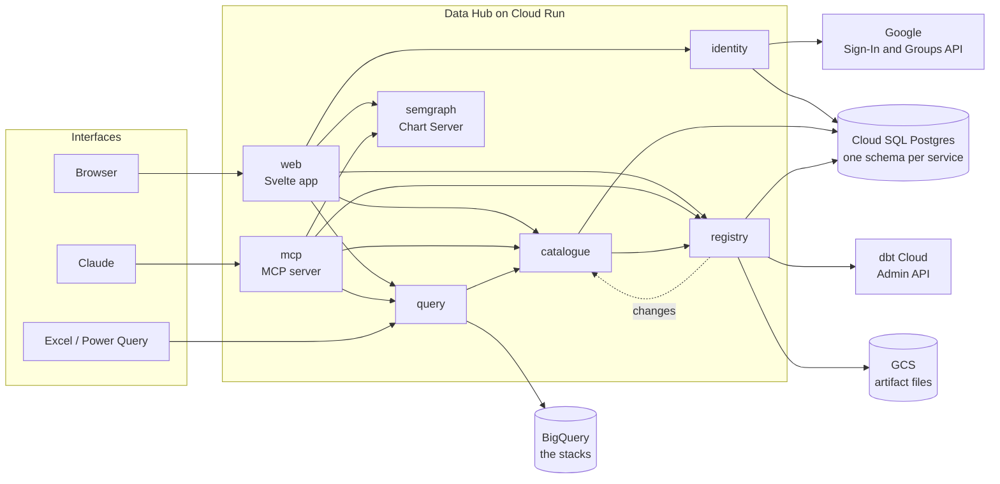
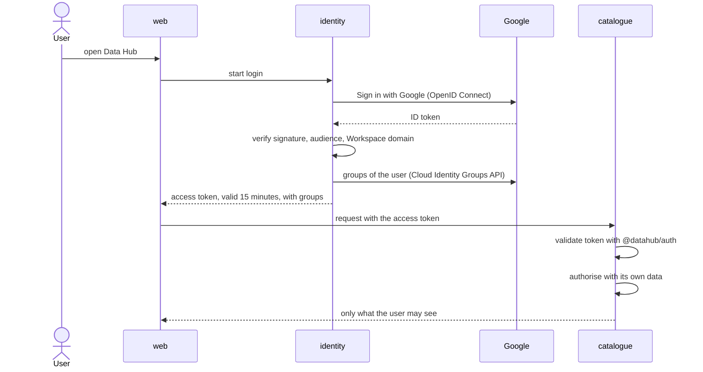

# Architecture

| | |
| --- | --- |
| Status | First version, 2026-10-17 |
| Source of truth | The decisions and technical requirements in [Platform](../requirements/technical/00-platform.md); this page describes the architecture that follows from them |

**In one sentence:** Data Hub is a set of TypeScript services on Cloud Run, each with one responsibility and each validating the User itself, behind several interfaces (the web app, Claude and Excel) that all use the same APIs.

## Principles

| Principle | Decision |
| --- | --- |
| One responsibility per service, deployed separately | [DEC-PF-01](../requirements/technical/00-platform.md#dec-pf-01) |
| Publicly reachable; the token checks protect, not the network | [DEC-PF-10](../requirements/technical/00-platform.md#dec-pf-10) |
| Every service validates the User itself, on every request | [DEC-PF-02](../requirements/technical/00-platform.md#dec-pf-02), [NFR-SEC-01](../requirements/non-functional/security.md#nfr-sec-01) |
| Every interface is a client of the same APIs, without business logic | [DEC-PF-03](../requirements/technical/00-platform.md#dec-pf-03) |
| One schema per service; other data only through APIs | [DEC-PF-05](../requirements/technical/00-platform.md#dec-pf-05) |
| Least privilege: one service account per service | [DEC-PF-08](../requirements/technical/00-platform.md#dec-pf-08), [NFR-SEC-02](../requirements/non-functional/security.md#nfr-sec-02) |
| All TypeScript on Node.js; one monorepo | [DEC-PF-04](../requirements/technical/00-platform.md#dec-pf-04), [DEC-PF-09](../requirements/technical/00-platform.md#dec-pf-09) |

## Overview



Every service also fetches the public keys of identity to validate tokens; those arrows are left out for readability. The dotted arrow is work that no User started: registry handing over the Changes of a new Artifact Set.

## Services

| Service | Responsibility | Functional domains | Schema |
| --- | --- | --- | --- |
| [identity](services/identity.md) | Sign in with Google, Groups from Workspace, Excel keys, Access Tokens | [User management](../requirements/functional/02-user-management.md), [Permissions and Excel keys](../requirements/functional/12-permissions-and-library-cards.md) | `identity` |
| [catalogue](services/catalogue.md) | Resources, Collections, maturity, Resource Card, Log, search, conversations, the progress in the Learning Centre | [Resources](../requirements/functional/04-stacks-and-resources.md), [Collections](../requirements/functional/03-collections.md), [Maturity and release](../requirements/functional/06-maturity-and-release.md), [Resource card](../requirements/functional/05-resource-card.md), [Log and notifications](../requirements/functional/07-log-and-notifications.md), [Conversations](../requirements/functional/14-conversations.md), [Learning](../requirements/functional/16-learning.md) | `catalogue` |
| [registry](services/registry.md) | Fetching, storing and processing the dbt Artifacts; Nodes, lineage and Changes | [Artifact registry](../requirements/functional/01-artifact-registry.md) | `registry` |
| [query](services/query.md) | Running queries on the Resources: Query, previews, later free SQL for Claude and feeds for Excel, and the Query Log | [Resources](../requirements/functional/04-stacks-and-resources.md) (querying), [Channels](../requirements/functional/13-channels.md) | `query` |
| [semgraph](services/semgraph.md) | The Chart Server: drawing every chart by what it means, following the chart language. Moved in from its own repository, with its history ([DEC-PF-23](../requirements/technical/00-platform.md#dec-pf-23), [DEC-PF-25](../requirements/technical/00-platform.md#dec-pf-25)) | The chart language, for [Lenses](../requirements/functional/09-lenses.md) and [Reports](../requirements/functional/10-reports.md) | none |

| Application | For | Uses |
| --- | --- | --- |
| [web](services/web.md) | People in the browser | identity, catalogue, registry, query, semgraph |
| [mcp](services/mcp.md) | Claude, as an MCP server and later MCP Apps | catalogue, registry, query, semgraph; signs in through identity |

Later, once their domains are specified: Lenses and Reports ([Lenses](../requirements/functional/09-lenses.md), [Reports](../requirements/functional/10-reports.md)), checks ([Checks and monitoring](../requirements/functional/08-checks-and-monitoring.md)) and notifications ([OP-PF-06](../requirements/technical/00-platform.md#op-pf-06)). Where [Beta and promotion](../requirements/functional/11-beta-and-promotion.md) and [EDA](../requirements/functional/15-eda.md) live is decided with those domains. [Learning](../requirements/functional/16-learning.md) lives in the web app: its Learning Cards are files in the package `packages/learning`, and catalogue keeps what every User did with them ([TR-LR-01](../requirements/technical/16-learning.md#tr-lr-01), [TR-LR-02](../requirements/technical/16-learning.md#tr-lr-02)).

## How a User is validated



1. **Login** happens in identity, with Google ([FR-UM-01](../requirements/functional/02-user-management.md#fr-um-01), [FR-UM-02](../requirements/functional/02-user-management.md#fr-um-02)).
2. **The Access Token** is short-lived and carries the Groups ([TR-PF-02](../requirements/technical/00-platform.md#tr-pf-02)).
3. **Every service validates** the token itself with the shared package `@datahub/auth` ([TR-PF-03](../requirements/technical/00-platform.md#tr-pf-03)), and **authorises** with its own data ([TR-PF-04](../requirements/technical/00-platform.md#tr-pf-04)).
4. **Between services**, the token of the User is passed on and validated again; background work uses the identity of the service ([TR-PF-05](../requirements/technical/00-platform.md#tr-pf-05)).
5. **Staying signed in**: the server of the web app and Claude get a Refresh Token with the Access Token. Every 15 minutes they exchange it at identity for a new pair, and identity checks the Groups and the account again ([TR-PF-25](../requirements/technical/00-platform.md#tr-pf-25), [TR-PF-26](../requirements/technical/00-platform.md#tr-pf-26)).

### Access Token

| Claim | Content |
| --- | --- |
| `sub` | The fixed Google ID of the User |
| `email`, `name` | From Google |
| `groups` | The Groups of the User, by fixed Google ID ([FR-UM-05](../requirements/functional/02-user-management.md#fr-um-05), [FR-UM-08](../requirements/functional/02-user-management.md#fr-um-08)) |
| `roles` | Derived from the Role Groups, such as the Data Team ([Permissions and Excel keys](../requirements/functional/12-permissions-and-library-cards.md)) |
| `iss`, `aud`, `exp` | identity, the Data Hub services, 15 minutes after issue |

## One set of APIs, several interfaces

| Interface | Reaches Data Hub through | Signs in with |
| --- | --- | --- |
| Browser | web | Google, through identity |
| Claude | mcp | OAuth through identity, which delegates to Google ([TR-PF-06](../requirements/technical/00-platform.md#tr-pf-06)) |
| Excel | query, the result of a Lens as CSV for Power Query ([TR-LE-08](../requirements/technical/09-lenses.md#tr-le-08)) | The Excel key, as the password of Basic, exchanged at identity for an Access Token ([TR-PF-07](../requirements/technical/00-platform.md#tr-pf-07)) |
| Later: HTML reports, others | The same APIs | One of the above |

None of the interfaces holds business logic. Lens and Report components are shared between web and the MCP App ([TR-PF-12](../requirements/technical/00-platform.md#tr-pf-12)).

## Data

| Store | What | Owner |
| --- | --- | --- |
| Postgres schema `identity` | Users, Groups and memberships, Excel key hashes, OAuth clients | identity |
| Postgres schema `catalogue` | Resources, Collections, Fingerprints, Confirmations, Publications, Log Entries, Known Behaviour, Anomalies, Reactions, messages | catalogue |
| Postgres schema `registry` | Artifact Sets, Nodes, columns, Edges, tests, Changes | registry |
| Postgres schema `query` | Queries and their runs: the Query Log ([DEC-LN-01](../requirements/functional/07-log-and-notifications.md#dec-ln-01)) | query |
| GCS bucket | The Artifact files, unchanged, per project and per run ([FR-AR-06](../requirements/functional/01-artifact-registry.md#fr-ar-06)) | registry |
| BigQuery, the tables of the Resources | The data itself; only read | query |

## Repository layout

```text
apps/
  web/            Svelte app, and its small server
  mcp/            MCP server for Claude
services/
  identity/
  catalogue/
  registry/
  query/
  semgraph/       the Chart Server; Node runs its TypeScript directly (DEC-PF-25)
packages/
  auth/           token validation shared by every service and app
  contracts/      zod schemas and the generated OpenAPI per service
  server/         the common shape of every service: logs for Cloud Logging, health check, token check
  db/             the connection to Cloud SQL and the migration runner (Kysely)
  ui/             the look of the design in Svelte: tokens, foundations and components, shared by web and the MCP App
infra/            Terraform, per environment (uat, prod), applied by GitHub Actions
docs/
scripts/          requirements.ts: checks the docs and builds the traceability matrix
Dockerfile        one image per service (build argument SERVICE)
.github/workflows ci.yml: tests, docs, an image per service, and the one gate check ci
```

`packages/ui` holds the look of the design, its values read from `docs/design/tokens.css` ([TR-PF-33](../requirements/technical/00-platform.md#tr-pf-33)); the components for Lenses and Reports follow ([TR-PF-12](../requirements/technical/00-platform.md#tr-pf-12)). How the images are built and where they go is in [Build and deploy](build-and-deploy.md).

Each service keeps its migrations in `services/<name>/src/migrations`. They run as a separate job, as `datahub-migrator`, before the service gets its new revision ([TR-PF-09](../requirements/technical/00-platform.md#tr-pf-09), [TR-PF-22](../requirements/technical/00-platform.md#tr-pf-22)).

The Data Team can look into the tables of registry, catalogue and query, read-only, in Cloud SQL Studio: Google Cloud console → SQL → `datahub-<environment>` → Cloud SQL Studio, database `datahub`, with IAM database authentication, as a member of `datahub-datateam@` ([TR-PF-28](../requirements/technical/00-platform.md#tr-pf-28)).

## Reachability

All services and applications are publicly reachable on Cloud Run ([DEC-PF-10](../requirements/technical/00-platform.md#dec-pf-10), [TR-PF-14](../requirements/technical/00-platform.md#tr-pf-14)). Nothing is protected by being hidden on an internal network; every request has to pass the login and the token check of the service it reaches. The one exception is semgraph, the Chart Server: it holds no data, so it is open to everyone without login, behind a rate limit per address ([DEC-PF-24](../requirements/technical/00-platform.md#dec-pf-24), [TR-PF-30](../requirements/technical/00-platform.md#tr-pf-30)).

| Interface | Calls from | Why public is needed |
| --- | --- | --- |
| Browser | The laptop of the User, anywhere | Colleagues can work without VPN |
| Excel | The laptop of the User, anywhere | Same as the browser |
| Claude | Anthropic's servers, on the internet | Claude cannot reach an internal-only MCP server |

## Environments

Two environments, each in the existing GCP project of the data platform for that environment ([DEC-PF-13](../requirements/technical/00-platform.md#dec-pf-13)), with its own Cloud SQL instance, service accounts, bucket and Cloud Run services, defined in Terraform ([TR-PF-13](../requirements/technical/00-platform.md#tr-pf-13)):

| Environment | Branch | GCP project | Region | Reads the Resources of |
| --- | --- | --- | --- | --- |
| prod | `main` | `immoscoop-dataplatform-398214` | `europe-west1` | the prod dbt job, in the same project |
| uat | `uat` | `immoscoop-dataplatform` | `europe-west1` | the uat dbt job, in the same project |

Every change goes to uat first; `main` only receives merges from `uat` ([DEC-PF-14](../requirements/technical/00-platform.md#dec-pf-14), [Branches and environments](build-and-deploy.md#branches-and-environments)).

The images are built once and live in one repository in the prod project, which uat may read too ([TR-PF-18](../requirements/technical/00-platform.md#tr-pf-18)). The infrastructure is Terraform, applied by GitHub Actions from the branch of each environment ([DEC-PF-16](../requirements/technical/00-platform.md#dec-pf-16)); the one-time bootstrap is in [GCP setup](gcp-setup.md).

## Open points

The open points of the platform are in [Platform](../requirements/technical/00-platform.md#open-points): processing of Artifact Sets ([OP-PF-01](../requirements/technical/00-platform.md#op-pf-01)), the hand-over of Changes ([OP-PF-05](../requirements/technical/00-platform.md#op-pf-05)), the Message Centre ([OP-PF-06](../requirements/technical/00-platform.md#op-pf-06)) and the public domain names ([OP-PF-08](../requirements/technical/00-platform.md#op-pf-08)).
