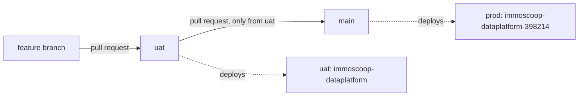

# Build and deploy

| | |
| --- | --- |
| Status | Build, push and deploy in place, after the one-time [GCP setup](gcp-setup.md) |
| Source of truth | The requirements in [Platform](../requirements/technical/00-platform.md); this page describes how to work with them |

**In one sentence:** every service becomes its own Docker image, built by GitHub Actions from one shared Dockerfile, stored in Artifact Registry in GCP, and deployed to Cloud Run.

## Working locally

You need Node.js 24 (see `.node-version`) and pnpm, which Corepack provides: `corepack enable`.

| Command | What it does |
| --- | --- |
| `pnpm install` | Installs all dependencies of the workspace |
| `pnpm build` | Compiles every package and service with TypeScript project references |
| `pnpm typecheck` | Compiles, then type-checks the tests and the scripts |
| `pnpm test` | Runs all tests with Vitest |
| `pnpm docs:check` | Validates requirement IDs, statuses and links in `docs/` |
| `pnpm docs:build` | Regenerates the [traceability matrix](../requirements/traceability.md) |
| `pnpm check` | Type-check, tests and the documentation check together, as CI runs them |

To run one service locally after `pnpm build`:

```sh
cd services/catalogue
DATAHUB_TOKEN_ISSUER=… DATAHUB_TOKEN_AUDIENCE=datahub DATAHUB_JWKS_URL=… PORT=8080 pnpm start
```

## Images

- **One Dockerfile for all services.** The service is chosen with a build argument: `docker build --build-arg SERVICE=catalogue -t catalogue .` ([TR-PF-15](../requirements/technical/00-platform.md#tr-pf-15)).
- **Two stages.** The first stage builds the whole workspace. The second copies only the chosen service and its production dependencies (`pnpm deploy`) onto `node:24-slim`, and runs as the non-root user `node`.
- **Tagged with its code.** Every image is tagged with the git tree hash of its code (`tree-<hash>`) and with the commit SHA. The tree hash is a fingerprint of the code itself: two commits with the same code have the same tree hash, which is what lets prod reuse the image of uat.
- **Stored in Artifact Registry in GCP**, not on Docker Hub ([DEC-PF-11](../requirements/technical/00-platform.md#dec-pf-11)). Cloud Run pulls from it with its own identity, without extra credentials, the images stay private, and they live in the same region as the services.

## Pipeline

| Workflow | When | What |
| --- | --- | --- |
All of it is one workflow, [`ci.yml`](../../.github/workflows/ci.yml), with one gate at the end ([TR-PF-20](../requirements/technical/00-platform.md#tr-pf-20)).

| Job | When | What |
| --- | --- | --- |
| Type-check, test and check the docs | Every pull request, and every push to `uat` or `main` | Install, type-check, test, and check the documentation |
| Find the services | Every run | Lists the folders under `services/` and `apps/`; every folder gets its own image |
| image (*service*) | Every pull request | Builds the image of every service, to prove it builds |
| image (*service*) | Every push to `uat` | Builds the images and pushes them to Artifact Registry, once the variables below are set ([TR-PF-16](../requirements/technical/00-platform.md#tr-pf-16)) |
| image (*service*) | Every push to `main` | Finds the images of the same code from uat and tags them with the new commit; builds only if they are missing ([TR-PF-17](../requirements/technical/00-platform.md#tr-pf-17)) |
| Verify source branch is uat | Every pull request into `main` | Fails unless the pull request comes from `uat` ([TR-PF-19](../requirements/technical/00-platform.md#tr-pf-19)) |
| Terraform format, validate and test | Every run | Checks the Terraform in [`infra/`](../../infra/README.md), and tests its logic against a mocked provider ([TR-PF-13](../requirements/technical/00-platform.md#tr-pf-13)) |
| Terraform apply (uat or prod) | Every push to `uat` or `main`, after the images | Applies the Terraform to the project of that branch, with the images of exactly this code ([TR-PF-21](../requirements/technical/00-platform.md#tr-pf-21)) |
| **ci** | Always, last | Passes only when every job above passed; the source-branch job and the Terraform apply may be skipped, because they only run on pull requests into `main` and on pushes. **This is the only check the branch rules require.** |

GitHub authenticates to GCP with **Workload Identity Federation**: GitHub proves to Google which repository a run comes from, and Google hands out a short-lived token. No service account key is stored anywhere.

### Deploying

Deploying is applying the Terraform: a push to `uat` deploys to the uat project, and a push to `main` deploys to the prod project. The Terraform sets every service to the image tagged with the tree hash of the code being applied. Deploying follows the principle "build once, deploy many" ([TR-PF-17](../requirements/technical/00-platform.md#tr-pf-17)): prod runs the very same images that ran on uat. An image is never rebuilt for prod.

## Branches and environments

Every change goes first to uat, then from uat to prod ([DEC-PF-14](../requirements/technical/00-platform.md#dec-pf-14)), as in the data repository.



| Branch | Receives | Deploys to |
| --- | --- | --- |
| a feature branch | your commits | nothing; its pull request is checked and its images are built |
| `uat` | pull requests from feature branches | the uat project |
| `main` | pull requests from `uat` only | the prod project |

### Rules in GitHub

The check `ci` blocks a pull request with failing tests, a broken image, or, into `main`, the wrong source branch. Only GitHub's branch rules make it impossible to go around it. An admin of the repository sets them up once ([OP-PF-12](../requirements/technical/00-platform.md#op-pf-12)), under **Settings → Rules → Rulesets → New branch ruleset**:

| Ruleset | Target branch | Rules |
| --- | --- | --- |
| `main` | `main` | Restrict deletions; block force pushes; require a pull request before merging, with allowed merge method **Merge** only; require status check `ci` to pass |
| `uat` | `uat` | Restrict deletions; block force pushes; require a pull request before merging; require status check `ci` to pass |

- **Merge, not squash, into `main`.** A squash would give `main` commits that `uat` does not have, and the next pull request from `uat` would show old changes again. Into `uat`, squash or merge are both fine.
- **Required approvals** are your choice; once there is more than one person working on Data Hub, one approval on each ruleset is a sensible start.
- **Default branch.** Set `uat` as the default branch (**Settings → General → Default branch**), so that new pull requests target `uat` by default.
- **Up to date before merging: on for `uat`, off for `main`.** On `uat`, a pull request must first take in what was merged before it, so that `ci` runs on the combination. On `main` it must stay off: every merge from `uat` leaves a merge commit on `main` that `uat` does not have, so `uat` always looks behind, and updating it would mean pushing to `uat` without a pull request, which its ruleset forbids.
- **Do not require status checks on creation: off for both.** It only matters when the branch is created; `main` and `uat` exist and may not be deleted.
- **One required check.** Both rulesets require only `ci`. A new service or a new job in the pipeline never changes the settings in GitHub.
- **Bypass.** Leave the bypass list empty, so that the rules also hold for admins.

## One-time setup in GCP

Before GitHub can push images or apply Terraform, the projects need a one-time bootstrap from someone's own machine: the Terraform identities and state buckets, the image repository, and the branch-bound trust between GitHub and GCP. It is described step by step in [GCP setup](gcp-setup.md) ([OP-PF-10](../requirements/technical/00-platform.md#op-pf-10)). Everything after that is Terraform in `infra/`, applied by GitHub Actions ([DEC-PF-16](../requirements/technical/00-platform.md#dec-pf-16)).

## Adding a service

1. Copy one of the folders under `services/` (or `apps/` for an interface, such as mcp), and change the name in `package.json`, `src/app.ts` and the test.
2. Add it to the `references` in the root `tsconfig.json`. The pipeline finds the new folder by itself and builds its image; the rules in GitHub stay as they are.
3. Add it to the Terraform: `local.services` in `infra/main.tf`, plus its roles ([infra/README.md](../../infra/README.md#adding-a-service)).
4. Describe it in [`services/`](services/) and in the [service map](README.md#services).
