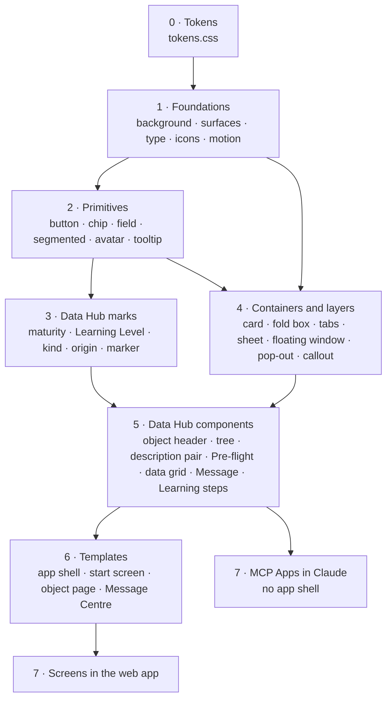

# Data Hub components

Status: first version, 28 October 2026, drawn from the prototypes in [`screens/`](screens/) and [`base.css`](base.css). Completed on 2026-10-28, before the build of part 1: the foundations Texts and User settings, the components the list missed, one Tree for every panel that unfolds, and the template of the sign-in.

This file lists every visual and interactive component of Data Hub, how they are grouped, what each one does, and what it depends on. Its aim: **a behaviour is defined once, in its component**, never per screen or per MCP App. A screen, and an MCP App in Claude, only put components together and give them their data.

| What | Where |
| --- | --- |
| Rules and decisions | [principles.md](principles.md) |
| Values (colours, sizes, durations) | [tokens.css](tokens.css) |
| **Components: what they are, their states, behaviour and dependencies** | **this file** |
| Screens, as compositions of components | [screens/](screens/) |
| Where the code lives | Layers 1 to 5 in `packages/ui`, in Svelte, shared by the web app and the MCP App ([DEC-PF-28](../requirements/technical/00-platform.md#dec-pf-28)); layers 6 and 7 in `apps/web` |

When a rule changes, [principles.md](principles.md) changes first, then [tokens.css](tokens.css), then this file, then the prototypes and the code.

## The layers

Every component sits in one layer and depends only on the layers above it in this table. A screen never reaches past a component to restyle or re-wire it.

| Layer | What it holds | Knows about Data Hub? | Examples |
| --- | --- | --- | --- |
| 0 · Tokens | Values only | No | colours, radii, spacing, durations |
| 1 · Foundations | What every surface stands on | No | background, surfaces, type, icons, colour roles, motion |
| 2 · Primitives | Small building blocks | No | button, chip, field, segmented control, avatar, tooltip |
| 3 · Data Hub marks | Small signs of a Data Hub concept | Yes | maturity icon, Learning Level icon, kind icon, origin tag, marker ⓘ |
| 4 · Containers and layers | What holds or lays over content | No | card, tile, fold box, tabs, sheet, floating window, pop-out, callout |
| 5 · Data Hub components | A Data Hub object or task, built from the layers above | Yes | object header, tree of Collections, description pair, Pre-flight, data grid, Message, Learning steps |
| 6 · Templates | The frame of a kind of page | Yes | app shell, start screen, object page, Message Centre |
| 7 · Screens and MCP Apps | Compositions with data | Yes | `resource-detail`, `query`, a Learning Card in Claude |

## Behaviours, defined once

These are the behaviours the prototypes repeat across screens. Each belongs to one component; a screen only switches it on and gives it data.

| Behaviour | Owned by | What it does | Today in the prototypes | Rules |
| --- | --- | --- | --- | --- |
| **Fold** | Fold box | Opens and shuts by its head; folded it shows a summary; remembers its state where the rule says so | Five times over: a Collection in the panel, the Parameters, the SQL, the Parameters of a Lens, the inline Learning Card | [DEC-UX-71](principles.md#dec-ux-71), [DEC-UX-76](principles.md#dec-ux-76), [DEC-UX-79](principles.md#dec-ux-79) |
| **Lay over** | Layer (sheet, floating window, pop-out, menu) | Opens from what was clicked; closes on Close, Cancel, a click beside it or Escape; a sheet dims the page, a floating window does not | Sheets, three floating windows (Message, Learning Card, Parameter), two pop-outs, menus and SQL suggestions | [Sheets](principles.md#sheets), [DEC-UX-30](principles.md#dec-ux-30), [DEC-UX-57](principles.md#dec-ux-57) |
| **Switch a pane** | Tabs, segmented control | Shows one pane of several; may bring the pane to the top | Generic in `app.js` (`data-group`, `data-pane`) | [Tabs](principles.md#tabs) |
| **Filter a list** | Tree, list | A search hides what does not match, unfolds where a child matches, drops a label with nothing left under it | The panel of Collections | [FR-CO-24](../requirements/functional/03-collections.md#fr-co-24) |
| **Explain on rest** | Pop-out of cards | Opens after a second of rest, or at once on keyboard focus; a tap on the marker opens it and keeps a button from acting | Resource page, learning screens | [DEC-UX-56](principles.md#dec-ux-56), [DEC-UX-57](principles.md#dec-ux-57) |
| **Confirm before acting** | Confirm bar | The button stays off until the declaration is ticked | Publishing | [DEC-UX-63](principles.md#dec-ux-63) |
| **Remember for the User** | App shell, intro, fold box | Theme, panel open or shut, intros dismissed per section and version, language, the background of each theme | Browser storage in the prototypes; in the app, the settings of the User, kept in Data Hub | [DEC-UX-96](principles.md#dec-ux-96) |
| **Focus follows the mouse** | Surfaces | Reading surfaces are opaque only in the window in focus | Every screen | [Layers and focus](principles.md#layers-and-focus) |
| **Drift** | Background | Moves very slowly; still with reduced motion | Every screen; the flowing gradient follows the mouse | [DEC-UX-78](principles.md#dec-ux-78), [DEC-UX-80](principles.md#dec-ux-80) |
| **Page through** | Pager | 100 rows a page, read from the same run, never a new query | Preview, Query | [FR-SR-51](../requirements/functional/04-stacks-and-resources.md#fr-sr-51) |
| **Copy** | Copy button | Copies a Key, a Query ID, a cell | Object header, result | [FR-LN-06](../requirements/functional/07-log-and-notifications.md#fr-ln-06) |
| **Show only what the User may** | Every component, from data | A component hides an action the User may not take, from a flag the service sends (`canEdit`, `canPublish`); it never decides by role itself | `data-for` and the role switch, prototype only | [DEC-CO-15](../requirements/functional/03-collections.md#dec-co-15), [DEC-SR-31](../requirements/functional/04-stacks-and-resources.md#dec-sr-31) |
| **Show Broken** | Broken mark, callout, Run button | From a state the service sends (`broken`, with what is missing): the dot in every list, the chip, the urgent callout on the page, Run off. No screen decides it | The Lens page (`?state=broken`), the Lens "Response time and conversion" in the lists | [DEC-UX-81](principles.md#dec-ux-81), [DEC-DH-67](../overview/data-hub.md#dec-dh-67) |

## 1 · Foundations

| Component | What it is | Behaviour | Depends on | Rules |
| --- | --- | --- | --- | --- |
| Background | Soft clouds in light, a gradient in dark; or a painted picture; or the flowing gradient | Drifts very slowly; a picture and the flow per theme | tokens | [DEC-UX-78](principles.md#dec-ux-78), [DEC-UX-34](principles.md#dec-ux-34), [DEC-UX-80](principles.md#dec-ux-80) |
| Surfaces | Glass (rail tab, panel, main frame), solid (reading surface in focus), sub (a tile inside a surface) | Focus follows the mouse | tokens | [Layers and focus](principles.md#layers-and-focus) |
| Type | Poppins in a few sizes and two weights; a mono for names and SQL | – | tokens | [Typography](principles.md#typography) |
| Icons | Phosphor, regular and fill, light favoured | – | – | [Icons](principles.md#icons) |
| Colour roles | Text in three greys; signal (ochre) for action; urgent (red) for what waits for the Data Team; no colour on Collections ([DEC-UX-105](principles.md#dec-ux-105)) | – | tokens | [Colour](principles.md#colour) |
| Motion | Short transitions; none with reduced motion | – | tokens | [Background and motion](principles.md#background-and-motion) |
| Texts | Every sentence of the interface, by key, in Dutch and English; a name goes in as a parameter and is never translated | Follows the language of the User | – | [DEC-DH-65](../overview/data-hub.md#dec-dh-65), [NFR-LOC-02](../requirements/non-functional/localisation.md#nfr-loc-02) |
| User settings | The settings of the User as keys and values, kept in Data Hub: read when Data Hub starts, written when one changes | **Remember for the User** | – | [DEC-UX-96](principles.md#dec-ux-96) |

## 2 · Primitives

| Component | Variants | Behaviour | Used on | Rules |
| --- | --- | --- | --- | --- |
| Button | primary, quiet, outline, icon; off (disabled) | – | every screen | – |
| Chip | status, code, pill, tag, count, scope (a Resource of a query, removable), parameter | Removable where it has × | every screen | – |
| Field | text, text area, select, date, checkbox and radio; with a label above | – | editing, sheets, Query | – |
| Segmented control | two to four choices | Switch a pane | 22 screens | – |
| Avatar | initials, two sizes | – | every screen, Messages | – |
| Tooltip label | the name of a rail icon, after a short delay | Shows on rest | the rail | [Navigation](principles.md#navigation) |
| Copy button | an icon button next to what it copies | **Copy** | object header, results, Excel key | [FR-LN-06](../requirements/functional/07-log-and-notifications.md#fr-ln-06) |
| Gauge | a bar with the two thresholds and what a run reads | – | Pre-flight, size check | [DEC-SR-29](../requirements/functional/04-stacks-and-resources.md#dec-sr-29) |

## 3 · Data Hub marks

| Component | What it says | Behaviour | Depends on | Used on | Rules |
| --- | --- | --- | --- | --- | --- |
| Maturity icon | The Level of a Resource or Lens, six bars; the previous Level outlined after a drop | Draws itself from the Level; its name on hover | tokens | 24 screens | [Maturity](principles.md#maturity) |
| Learning Level icon | The audience of a Learning Level, never bars | – | icons | learning screens | [DEC-UX-62](principles.md#dec-ux-62) |
| Kind icon | What an item is: table, lens, compass card, query, Collection icon | – | icons | every list | [DEC-UX-11](principles.md#dec-ux-11) |
| Origin tag | Where a value comes from: From dbt, From the owner, From the data team | – | chip | Resource screens | [DEC-UX-61](principles.md#dec-ux-61) |
| Marker ⓘ | The Learning Centre explains this system text: the sign only; its pop-out is the Pop-out of cards | – | type | Resource page, learning | [DEC-UX-54](principles.md#dec-ux-54) |
| Not published | A Resource only its Owner Unit and the Data Team see: a lighter name, no icon | – | – | panel | [DEC-UX-12](principles.md#dec-ux-12) |
| Broken mark | A Lens, Report or query reads what no longer exists: a red dot on its kind icon; a red chip "Broken" on a tile and in a status row | What is missing on hover | kind icon, chip | every list, tiles, object pages | [DEC-UX-81](principles.md#dec-ux-81) |
| Deprecated mark | A Resource that is deprecated: a chip "Deprecated" next to its Level, a tag in the panel | The reason on hover | chip | wherever its Level shows | [DEC-UX-101](principles.md#dec-ux-101) |

## 4 · Containers and layers

| Component | What it is | Behaviour | Depends on | Used on | Rules |
| --- | --- | --- | --- | --- | --- |
| Card | A solid surface with rounded corners | Focus follows the mouse | surfaces | every screen | – |
| Glass card | A card that blurs what lies behind it, over a photo or the background | – | surfaces | sign-in, the message on a narrow window | [DEC-UX-35](principles.md#dec-ux-35) |
| Grid | Always 100% wide; its tiles have a minimum width and grow until a column fits | – | – | start screens, My page | [Grid](principles.md#grid) |
| Tile | A card in a grid that grows to fill the width | Hover outline when it opens something | card, grid | start screens, Collection page | [Grid](principles.md#grid) |
| Sub-tile | A tile inside a reading surface, tinted, with a label and an Edit link | Turns into fields when editing | card | Resource Overview | [DEC-UX-09](principles.md#dec-ux-09) |
| Fold box | A box with a head that folds its body away; folded it shows a summary | **Fold** | card, button | panel, Query, Lens, Messages | [DEC-UX-76](principles.md#dec-ux-76) |
| Tabs | Real tabs flowing into their content | Switch a pane | – | object pages | [Tabs](principles.md#tabs) |
| Sheet | A task over its page, from the right; the page dimmed behind it | **Lay over** | card | publish, add Resources, update a Lens, a new query | [Sheets](principles.md#sheets) |
| Floating window | A window over a usable page; moves by its head, folds to it | **Lay over**, moves, folds | card | Message in context, Learning Card, a Parameter | [Floating window](principles.md#floating-window) |
| Pop-out | A text bubble with its arrow on what it explains | **Explain on rest** | card | marker ⓘ, Run button | [DEC-UX-57](principles.md#dec-ux-57) |
| Menu | A list of choices from a control | **Lay over** | card | Parameter values, column of a grid | – |
| Layer manager | What is laid over the page: which layer is on top, what closes it, and what stays usable behind it | **Lay over** | – | every sheet, floating window, pop-out and menu | [Sheets](principles.md#sheets), [Floating window](principles.md#floating-window) |
| Table | A simple table: a head and rows, nothing more | – | – | Collection page, History, Excel keys | – |
| Steps | Named steps in a row, an arrow between each; the current one marked | – | – | adding Resources, a Learning Card | [DEC-UX-58](principles.md#dec-ux-58), [DEC-UX-48](principles.md#dec-ux-48) |
| Callout | One line that tells a state, with an icon and at most one action; tones: neutral, warning, urgent, fine | – | button | alert on a change, notice, needs attention, size state, check line | [DEC-UX-64](principles.md#dec-ux-64) |
| Edit bar | The bar on top while editing in place: what happens, Cancel and Save | – | button | editing screens | [Editing a Resource](principles.md#editing-a-resource) |
| Confirm bar | A declaration and the button it unlocks, in one bar | **Confirm before acting** | field, button | publishing | [DEC-UX-63](principles.md#dec-ux-63) |
| Intro | The explanation on top of a start screen, dismissed per User and version | **Remember for the User** | card | start screens | [Start screen per section](principles.md#start-screen-per-section) |

## 5 · Data Hub components

Grouped by the object or task they serve. Each is built from the layers above; its behaviour lives in it.

### Navigation and finding

| Component | What it is | Behaviour | Built from | Used on | Rules |
| --- | --- | --- | --- | --- | --- |
| Rail | Floating icons of the main sections, Collections, Query, Charts, Messages with its count and the Learning Centre, then Admin for the Data Team ([DEC-UX-130](principles.md#dec-ux-130)); at the bottom the theme and the initials that open My page ([DEC-UX-89](principles.md#dec-ux-89), [DEC-UX-84](principles.md#dec-ux-84)) | The active icon flows into the panel | button, tooltip | every screen | [DEC-UX-66](principles.md#dec-ux-66) |
| Panel | The index of its section, sliding out next to the rail | Opens and shuts; remembers it | surfaces | every screen | [What is in the panel](principles.md#what-is-in-the-panel) |
| Tree | A list whose items unfold, each in a card, to what they hold: a Collection to its Resources, then its Lenses; a Learning Level to its sections and cards; a query to its last runs | **Fold**, **Filter a list** | fold box, list item, maturity | Collections, learning centre, Query | [DEC-UX-10](principles.md#dec-ux-10), [DEC-UX-65](principles.md#dec-ux-65), [DEC-UX-74](principles.md#dec-ux-74) |
| List item | Kind icon, name on one line, Level | Ellipsis and full name on hover | kind icon, maturity | panels, lists | [DEC-UX-11](principles.md#dec-ux-11) |
| Search | A field that filters its list, or a search by question | **Filter a list** | field | panels, start screens | [FR-CO-37](../requirements/functional/03-collections.md#fr-co-37) |
| Breadcrumb | Where the page sits | – | – | object pages | – |
| Background picker | A tile per background of the current theme, Random first, the chosen one with a ring | Chooses the background of the theme, kept as a setting | grid, tile | My page | [DEC-UX-108](principles.md#dec-ux-108) |

### Objects: Collection, Resource, Lens

| Component | What it is | Behaviour | Built from | Used on | Rules |
| --- | --- | --- | --- | --- | --- |
| Object header | Name, Key with copy, actions, and a status row of chips | **Copy** | button, chip, maturity | object pages | [Detail page of a Resource](principles.md#detail-page-of-a-resource) |
| Status row | Level, Publication, Owner, open Signals, as chips | – | chip, maturity | object pages | [DEC-UX-07](principles.md#dec-ux-07) |
| Description pair | The Business Description and the description from dbt, side by side, each with its origin | Edit in place | sub-tile, origin tag | Resource page, publish, editing | [DEC-UX-61](principles.md#dec-ux-61) |
| Columns table | Every field with its type, two descriptions, Entity and role | Edit in place | table, chip | Resource Columns | [FR-RC-16](../requirements/functional/05-resource-card.md#fr-rc-16) |
| Facts list | Labels and values, such as Published and Confirmed | – | – | Overview tiles | – |
| Maturity ladder | The six Levels drawn large, with the current one | – | maturity | Resource Overview | [Maturity](principles.md#maturity) |
| Change block | A description before and now, with the Business Description next to it | – | sub-tile | Message on a changed description | [FR-RC-17](../requirements/functional/05-resource-card.md#fr-rc-17) |
| Lineage | This Resource in the middle, its direct models on either side, joined by curves; walked a step at a time | Opens a branch, closes the other | card | Resource Lineage | [DEC-UX-100](principles.md#dec-ux-100), [DEC-UX-102](principles.md#dec-ux-102) |
| Log list | The latest entries of a Log, with their Log ID, text and time | – | – | Resource Overview, Collection page | [FR-SR-11](../requirements/functional/04-stacks-and-resources.md#fr-sr-11) |
| Field mapping | Per field its type, description, mapping and identity, with the cardinality shown, never chosen | – | table, field, chip | adding Resources, step 2; Edit relations | [DEC-UX-58](principles.md#dec-ux-58), [DEC-UX-107](principles.md#dec-ux-107) |
| Icon picker | The line icons of Phosphor, searched by name, one chosen | – | field, grid | making and editing a Collection | [DEC-CO-25](../requirements/functional/03-collections.md#dec-co-25) |

### Querying and Lenses

| Component | What it is | Behaviour | Built from | Used on | Rules |
| --- | --- | --- | --- | --- | --- |
| Scope of a query | "Reads only" and the Resources of a query; adding or removing one starts a new query | Opens the sheet for a new query | chip | Query | [DEC-UX-73](principles.md#dec-ux-73) |
| SQL editor | The SQL at full width, folding its CTEs, with suggestions | **Fold** (box and each CTE), suggestions as a menu | fold box, menu | Query | [DEC-UX-70](principles.md#dec-ux-70), [DEC-UX-76](principles.md#dec-ux-76) |
| Parameters | A Parameter per tile, folded to chips; made in a floating window | **Fold**, **Lay over** | fold box, floating window, chip | Query, Lens | [DEC-UX-71](principles.md#dec-ux-71) |
| Pre-flight | What a run reads, partitions, and the range: up to 100 MB, warned, Data Team | – | gauge, callout | Query, Preview, Make it a lens | [DEC-SR-29](../requirements/functional/04-stacks-and-resources.md#dec-sr-29) |
| Run button | Run, with what it reads in the button; red above the approval threshold | **Explain on rest** for how to read less | button, pop-out | Query, Lens | [DEC-UX-28](principles.md#dec-ux-28) |
| Data grid | The result as a grid: row number, typed columns, resizable, a page of 100 | **Page through**, sort the page, **Copy** a cell | table, pager, menu | Query, Preview, Lens | [DEC-UX-72](principles.md#dec-ux-72) |
| Pager | Rows from to, previous and next | **Page through** | button | results | [FR-SR-51](../requirements/functional/04-stacks-and-resources.md#fr-sr-51) |
| Size check | What one run of a new Lens reads, in three ranges, and the outcome | – | gauge, callout | Make it a lens | [FR-LE-08](../requirements/functional/09-lenses.md#fr-le-08) |
| Lens tile | A Lens with its question, Level and how it ran | – | tile, maturity | start of Collections | [FR-CO-37](../requirements/functional/03-collections.md#fr-co-37) |
| Lens card | A Lens offered to reuse: its name, question and what it shows with the words it shares with a question marked, its Resources, those beyond the query with "+", its tags, its Collection and maker, and "Use this Lens" | Opens the Lens | kind icon, maturity, chip, button | new query, Lenses on these Resources | [DEC-UX-22](principles.md#dec-ux-22), [DEC-UX-23](principles.md#dec-ux-23) |
| Lens link | "Used as the lens", and "Update the lens" with its sheet | **Lay over** | callout, sheet | Query | [DEC-UX-77](principles.md#dec-ux-77) |

### Messages

| Component | What it is | Behaviour | Built from | Used on | Rules |
| --- | --- | --- | --- | --- | --- |
| Message item | A Message in a list: its object, kind, state, who, when, first lines | Opens it | chip, avatar, kind icon | Message Centre | [DEC-UX-29](principles.md#dec-ux-29) |
| Message | A Message with its replies | – | avatar, chip | Message Centre, slide-in, floating window | [Messages](principles.md#messages) |
| Composer | A field to write, the kind to choose, who gets a notification | – | field, segmented | slide-in, Message | [FR-CV-07](../requirements/functional/14-conversations.md#fr-cv-07) |
| Request decision | What a Request asks to decide, with Refuse and Accept for the Data Team | – | facts, composer | Request | [DEC-CV-06](../requirements/functional/14-conversations.md#dec-cv-06) |
| Learning Card in a Message | "Understand what is happening here" and the card, opening inline | **Fold** | fold box, kind icon | every Message from Data Hub | [DEC-UX-79](principles.md#dec-ux-79) |

### Admin

| Component | What it is | Behaviour | Built from | Used on | Rules |
| --- | --- | --- | --- | --- | --- |
| Source Job tile | A dbt project with its Source Job by name and ID, kind, environment, docs, last delivered run and who set it | "Change" opens the job picker | tile, chip | Webhooks | [FR-AR-18](../requirements/functional/01-artifact-registry.md#fr-ar-18) |
| Job picker | The jobs of a dbt project as dbt Cloud names them, by environment; one that cannot be a Source Job says why | **Lay over** | sheet, radio, chip | Webhooks | [FR-AR-18](../requirements/functional/01-artifact-registry.md#fr-ar-18) |
| Delivery item | A delivery of the webhook in a list: what Data Hub did, when, the job by name and ID, the dbt project and the run | Opens it | chip, kind icon | Webhooks | [FR-AR-19](../requirements/functional/01-artifact-registry.md#fr-ar-19) |
| Delivery | One delivery opened: its job, run and event, what Data Hub did step by step, and what the Data Admin can do | – | facts list, callout, button | Webhooks | [Admin](principles.md#admin) |

### Learning

| Component | What it is | Behaviour | Built from | Used on | Rules |
| --- | --- | --- | --- | --- | --- |
| Learning steps | The five steps of a card, quick or full path, with Next | Switch a pane | tabs, button | card page, floating window, Claude | [DEC-LR-10](../requirements/functional/16-learning.md#dec-lr-10), [DEC-UX-47](principles.md#dec-ux-47) |
| Check your understanding | One question at a time: predict, then the answer and why | – | button | the same | [FR-LR-30](../requirements/functional/16-learning.md#fr-lr-30) |
| Attached card | A card in a Message, with whether the reader understood it | Opens the card | kind icon | Messages | [DEC-UX-41](principles.md#dec-ux-41) |
| Pop-out of cards | The cards that explain a marked text, with what each brings | **Explain on rest** | pop-out, list | marked text | [DEC-UX-57](principles.md#dec-ux-57) |

## 6 · Templates

| Template | What it holds | Components |
| --- | --- | --- |
| App shell | Rail, panel and main, over the background; below the narrowest window it shows one message instead ([DEC-UX-91](principles.md#dec-ux-91)) | rail, panel, background, surfaces, glass card |
| Sign-in | A photo of the set, the glass card with the way in, and the story of the photo; no rail and no panel | background, glass card, button |
| Start screen | Intro, a search, then sections of tiles | intro, search, tile, segmented |
| Object page | Breadcrumb, object header, status row, a callout when needed, tabs and their content | object header, status row, callout, tabs |
| Message Centre | Filters, the list and the one opened | list, Message item, Message, composer |
| Learning Card page | The way to the card, the steps and what follows | Learning steps |

## 7 · Channels: where a component shows

| Component | Web app | MCP App in Claude, version 2 ([DEC-CH-02](../requirements/functional/13-channels.md#dec-ch-02)) | HTML report, Excel |
| --- | --- | --- | --- |
| App shell, rail, panel | Yes | No: an MCP App stands on its own ([DEC-LR-08](../requirements/functional/16-learning.md#dec-lr-08)) | No |
| Learning steps, Check your understanding | Yes | Yes, compact ([FR-LR-26](../requirements/functional/16-learning.md#fr-lr-26)) | No |
| Lens: Parameters, Run, Data grid, charts | Yes | Yes ([DEC-DH-15](../overview/data-hub.md#dec-dh-15)) | The result |
| Maturity icon, Level | Yes | Yes | Yes, with the date ([DEC-DH-37](../overview/data-hub.md#dec-dh-37)) |

A component used in Claude takes its look from the same theme in `packages/ui` and has no navigation of its own: it carries "Open in Data Hub" instead.

## What to consolidate

The prototypes grew screen by screen. Before the build, these are the places where one component should take over from several:

1. **One fold box** for the panel's Collections, the Parameters, the SQL, the Parameters of a Lens and the inline Learning Card, with one way to fold and one look for its head.
2. **One layer manager** for sheets, floating windows, pop-outs, menus and suggestions: one rule for what opens, what closes it, what stays usable behind it, and which layer is on top.
3. **One callout** for the alert on a change, the notice, needs attention, the size state and the check line: one shape with a tone.
4. **One chip** with variants for status, code, pill, tag, count, scope and parameter.
5. **Three tables, not more:** a simple table, the data grid of a result, and the facts list.
6. **Names by component, not by screen:** `base.css` names many classes after the screen they were made for. A class name meant one thing on two screens once (`.sql-box`, for a block of SQL and for the box of the editor); the build names components, not places.
7. **Visibility from data:** the prototypes show roles with `data-for` and a role switch; in the app a component reads what the User may do from the service, and the same component serves every role.

Prototype only, not to be built: the role switch and the scenario switches at the edge of a screen, and the states chosen by the address, such as `?msg=described` or `?bg=flow`.

## Adding or changing a component

1. A new screen is made of existing components. If something is missing, it is added here first, in its layer, with its behaviour.
2. A behaviour that two screens need belongs to a component, never to a screen.
3. A component depends only on the layers above it, and on tokens for every value.
4. When a component changes, every screen that uses it follows; the "Used on" column says which.
