# Data Hub — functional and technical review

Snapshot of 2026-10-25 · Maxime Passenier

What Data Hub must do, how each part looks, and what is behind it: the services, what they store and what is built today. Your read-through before the technical analysis and the (re)build.

> This file replaces the review in Claude Docs, which was hard to work with. It is a snapshot: the files it links to stay the source, and where they differ, the source wins. Every open point is at the end, in [Every open point](#every-open-point), as a checkbox with its ID, to answer one by one.

## How to read this document

This review puts in one place what is spread over `docs/` in the repository: the functional story with its screens, and for each part what lies behind it technically. It describes what exists and decides nothing new. For the parts that are designed but not built, the technical side is a starting point for the analysis, marked **Proposal**.

Every part follows the same order:

1. **What it does:** the functional rules, with the key requirement IDs.
2. **The screens:** the prototypes in `docs/design/screens/`.
3. **Behind it:** which service, what it stores, which endpoints. For a part that is not built, a proposal.
4. **Open:** the open points that touch the part.

| Marker | Meaning |
| --- | --- |
| **Built** | Implemented and running on uat |
| **Designed** | A prototype screen exists; no code yet |
| **Specified** | The rules are written and agreed; no screen or code yet |
| **Proposed** | Written down, not agreed yet |

### Where it stands on 2026-10-25

| What | Count |
| --- | --- |
| Functional requirements | 214: 41 Implemented, 65 Specified, 77 Proposed, 31 Withdrawn |
| Technical requirements of the platform | 31: 18 Implemented, 10 Specified, 3 Proposed |
| Non-functional requirements | 15: 14 Specified, 1 Proposed, for localisation and security |
| Design decisions (DEC-UX) | 66 |
| Prototype screens | 32, plus the index |
| Open points | 142 open, of 208 |

The newest screens and rules (publishing and confirming, the page for a link to nothing, signing in, the backgrounds, the learning centre, adding Resources in two steps, and the language principle) are in [pull request 31](https://github.com/maximethenextimmoscoopbe/immoscoop-dataplatform-datahub/pull/31), waiting to be merged into uat. The links in this file are relative, so they open the files next to it, on whichever branch you read it.

### Short on time?

Read **Data Hub at a glance**, **Architecture** and **Decisions before the technical analysis**. The last one collects the questions you raised, such as postponing EDA and how to handle confidentiality, and sorts the open points into decide now, postpone on purpose, and decide during the build. Then answer the checklist in [Every open point](#every-open-point).

To click through the screens: open [`docs/design/screens/index.html`](../design/screens/index.html) in a browser. The switches at the bottom of a screen show its states, and `?role=owner` or `?role=reader` in the address shows it as another User.

## Data Hub at a glance

**In one sentence:** Data Hub is the library of our data: the one entry point for business colleagues and their Claude, next to and together with the Chart Server. All data in the company runs through it.

It exists because descriptions in BigQuery cannot carry the documentation ([DEC-DH-03](../overview/data-hub.md#dec-dh-03)), dbt licences for everyone do not fit the budget ([DEC-DH-04](../overview/data-hub.md#dec-dh-04)), and business and Claude ask the same questions: what does this mean, may I use it this way, what is not in it.

### The library

| In the library | In Data Hub |
| --- | --- |
| The librarian | The Data Team: takes data in, describes it, puts it on the shelves |
| A book on the shelves | A Resource: a table the Data Team exposes from dbt |
| A collection, with its curator | A Collection, with its Owner Unit, which vouches for its Resources |
| General circulation | A published Resource |
| The catalogue card | The Resource Card |
| The accession register | The dbt Artifacts, fetched after every prod run |
| The magnifying glass | A Lens: a way of looking at a Resource, with Parameters |
| The dossier | A Report: Lenses bundled around one question |
| Margin notes | Messages, attached to the object they are about |
| The reading lessons | The learning centre: short Learning Cards on how to read and use the data, offered where the question comes up |
| The library card | A personal key, for Excel |

### Who does what

| Role | Who | Does |
| --- | --- | --- |
| Data Team (Data Admin) | The members of the Role Group of the Data Team | Exposes tables in dbt, adds Resources to Collections, looks after the registry |
| Owner | The Owner Unit of a Collection: any Google group of the Workspace domain | Describes, publishes and confirms the Resources of its Collection |
| User | Everyone with an Immoscoop account | Finds, reads and queries what they may see, makes Lenses, talks about data |
| Claude | On behalf of the signed-in User | What that User may do, through the MCP server |

### What is on the shelves, and how far to trust it

Data Hub has four kinds of assets: the **Resource**, the **Lens** on it, the **Report** that bundles Lenses, and the **chart** the Chart Server draws ([DEC-DH-64](../overview/data-hub.md#dec-dh-64)). A **Collection** is not an asset but the container that groups Resources and Lenses under an Owner Unit.

Every asset carries a Level. A Lens or a Report takes the lowest Level of what lies beneath it.

| Level | Name | Reached when | Whose job |
| --- | --- | --- | --- |
| 0 | Beta | A Beta Concept, only in its own context | Business |
| 1 | Available | Registered; the description is incomplete | Data Team |
| 2 | Described | The table and every column have a description | Data Team |
| 3 | Confirmed | The Owner confirms it; the first Publication is the first Confirmation | Owner |
| 4 | Explored | An EDA document is linked | Owner |
| 5 | Monitored | At least one check is active | Owner and Data Team |

Two rules carry the rest. The Level is derived from traces, never stored as a label ([DEC-DH-31](../overview/data-hub.md#dec-dh-31)), and it restricts nothing: it is shown everywhere ([FR-MR-10](../requirements/functional/06-maturity-and-release.md#fr-mr-10)). Who sees a Resource follows its Publication and its Collection, not its Level ([DEC-DH-40](../overview/data-hub.md#dec-dh-40)).

### From exposure to Lens

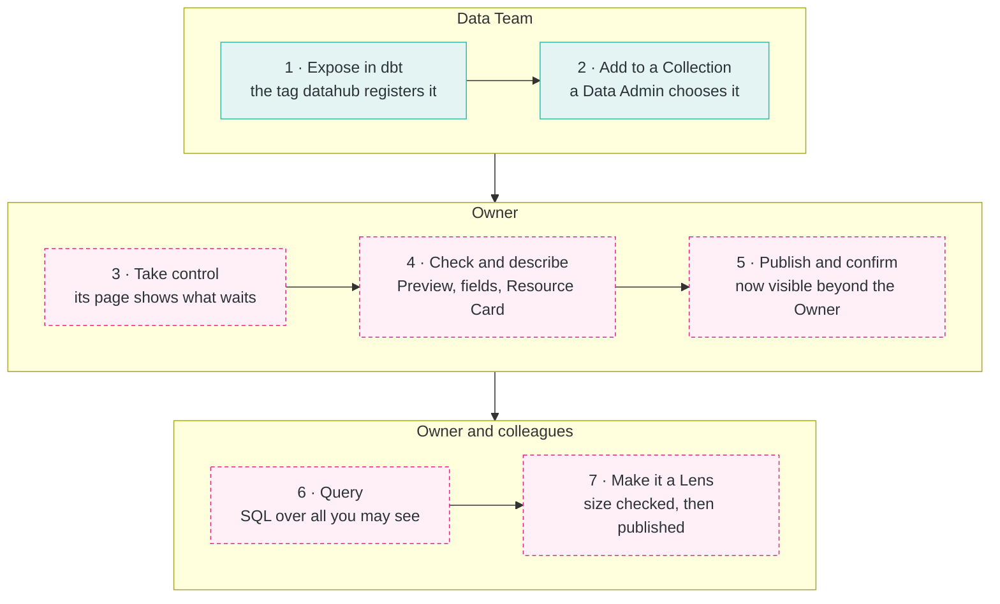

*The Data Team makes a Resource available, its Owner vouches for it, and the Owner and colleagues use it. Steps 1 and 2 are built (solid border); steps 3 to 7 are designed (dashed border).*

Release happens in two steps, and Data Hub keeps that order: the Data Team makes a Resource available to one Owner, and only that Owner releases it to the company. Steps 6 and 7 carry it on into Query and Lenses.

| Step | What happens | Screens | State |
| --- | --- | --- | --- |
| 1 | An exposure with the tag `datahub` in dbt registers the table as a Resource, without a Collection | None: it happens in dbt | Built |
| 2 | A Data Admin adds the Resource to a Collection, and records its Entity reference (entity.identifier) | `resource-unassigned`, `collection-add-resources` | Built in today's web app; the new design is not built |
| 3 | The page of the Collection shows the Owner what waits for them | `collection-overview` | Designed |
| 4 | The Owner checks the data with the Preview and describes it and its fields | `resource-preview`, `resource-edit` | Designed |
| 5 | The Owner publishes; a sheet says who will see it and asks for the Confirmation | `resource-publish` | Designed |
| 6 | The Owner and colleagues query it, with other Resources they may see | `query-new`, `query` | Designed |
| 7 | With Make it a lens, and once its size is checked, the query becomes a Lens | `lens-new`, `lens`, `collections-start` | Designed |

The [walkthrough on Confluence](https://immoscoop.atlassian.net/wiki/spaces/DATA/pages/1380253717) shows each step with its screens.

## Architecture

**In one sentence:** Data Hub is a set of TypeScript services on Cloud Run, each with one responsibility and each validating the User itself, behind several interfaces (the web app, Claude and Excel) that all use the same APIs.

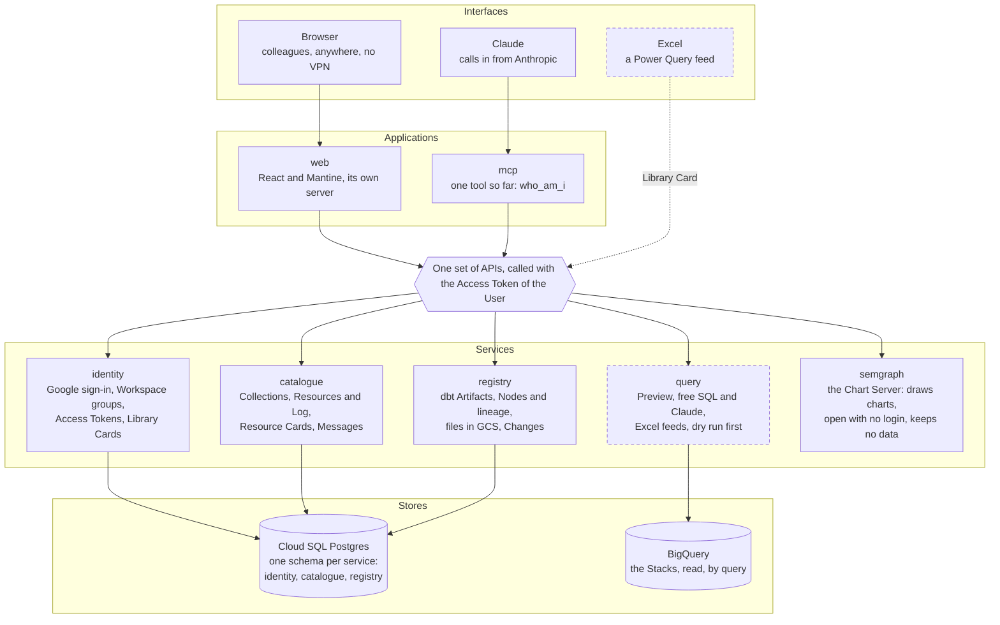

*One set of APIs behind every interface; each service owns its data. Every service checks the token itself; semgraph alone is open. Dashed: not built yet.*

The interfaces hold no business logic: web, mcp and the Excel feed are clients of the same APIs. Each service keeps its own schema and reads another service's data only through its API. registry also calls catalogue without a User, with its own service identity, to hand over the Resources after each dbt run (and later the Changes).

### The principles

| Principle | Decision |
| --- | --- |
| One responsibility per service, deployed separately | [DEC-PF-01](../requirements/technical/00-platform.md#dec-pf-01) |
| Publicly reachable; the token checks protect, not the network | [DEC-PF-10](../requirements/technical/00-platform.md#dec-pf-10) |
| Every service validates the User itself, on every request | [DEC-PF-02](../requirements/technical/00-platform.md#dec-pf-02) |
| Every interface is a client of the same APIs, without business logic | [DEC-PF-03](../requirements/technical/00-platform.md#dec-pf-03) |
| One schema per service; other data only through APIs | [DEC-PF-05](../requirements/technical/00-platform.md#dec-pf-05) |
| Least privilege: one service account per service | [DEC-PF-08](../requirements/technical/00-platform.md#dec-pf-08) |
| All TypeScript on Node.js 24, in one pnpm monorepo | [DEC-PF-04](../requirements/technical/00-platform.md#dec-pf-04), [DEC-PF-09](../requirements/technical/00-platform.md#dec-pf-09) |

### The parts

| Part | Responsibility | Stores | Built today |
| --- | --- | --- | --- |
| identity | Sign in with Google, Workspace groups, Access Tokens, Library Cards | Schema `identity` | Signing in, groups, sessions, Refresh Tokens. Library Cards and the group synchronisation are not built |
| catalogue | The library itself: Collections, Resources, Log, Resource Card, Publication, Messages | Schema `catalogue` | Collections with their Log, Resources from the exposures, adding to and removing from a Collection |
| registry | Fetching and processing the dbt Artifacts: Nodes, columns, lineage, tests, Changes | Schema `registry`, and the files in a GCS bucket | Everything but comparing versions and handing over Changes |
| query | The only service that reads the Stacks: Preview, free SQL for Claude, feeds for Excel | Nothing in v1 | An empty skeleton |
| semgraph | The Chart Server: draws every chart by what it means, refuses what would mislead | Nothing | Moved in from its own repository, with its gallery |
| web | The interface in the browser | Nothing; the Refresh Token in a cookie | Sign-in, Collections, Resources, the registry search, the chart gallery, in the current look. The new design is not built |
| mcp | The interface for Claude, as an MCP server | Nothing | Signing in, and one tool, `who_am_i` |

The shared code lives in `packages/`: `auth` validates tokens in every service, `contracts` holds the zod schemas and OpenAPI, `server` gives every service the same shape (logs, health check, token check), `db` holds the connection and the migration runner (Kysely), and `ui` holds the brand theme and the components that web and the MCP App will share.

### How a User is validated

1. **Signing in** happens at identity, with Google, for accounts of the own Workspace domain only.
2. **The Access Token** lives 15 minutes and carries the User's fixed Google ID, email, name, Groups and roles. identity signs it with a key in Cloud KMS and publishes the public keys.
3. **Every service validates** the token itself with `@datahub/auth`, and decides with its own data what the User may see.
4. **Between services**, the User's token is passed on and validated again. Work no User started, such as registry handing over Resources, uses the identity of the service.
5. **Staying signed in:** the server of web and Claude hold a Refresh Token. Every 15 minutes they exchange it at identity for a new pair, and identity checks the account and its Groups again. Claude stays connected for 30 days after its last use.

### Infrastructure

| What | How |
| --- | --- |
| Environments | uat (branch `uat`, project `immoscoop-dataplatform`) and prod (branch `main`, project `immoscoop-dataplatform-398214`), both in `europe-west1`. Every change goes to uat first |
| Runtime | Seven Cloud Run services, scaling from 0 to at most 2 instances, plus two Cloud Run jobs: `datahub-registry-ingest` and the migrations |
| Database | One Cloud SQL Postgres 17 instance per environment (`db-f1-micro` on uat, `db-g1-small` on prod), one database `datahub`, one schema per service. Migrations run as a separate job before a service gets its new revision |
| Files | One GCS bucket for the dbt Artifacts, kept for good |
| Secrets and keys | The dbt Cloud token and webhook secret in Secret Manager; the signing key of the Access Tokens in Cloud KMS |
| Images | Built once in CI, one per service, in one Artifact Registry in the prod project |
| Terraform | All of it in `infra/`, applied by GitHub Actions from the branch of each environment; never by hand |
| Looking into the data | The Data Team reads the tables of registry and catalogue in Cloud SQL Studio, read-only, with IAM login |

**Open for the platform:** the public domain names ([OP-PF-08](../requirements/technical/00-platform.md#op-pf-08)), which also unblock the rate limit in front of semgraph; who gives query its read access on the Stacks ([OP-PF-14](../requirements/technical/00-platform.md#op-pf-14)); where the Message Centre lives ([OP-PF-06](../requirements/technical/00-platform.md#op-pf-06)); and whether pull requests show a Terraform plan ([OP-PF-13](../requirements/technical/00-platform.md#op-pf-13)).

## Signing in and users

**Built.** The sign-in itself, the groups and staying signed in run on uat. The new sign-in screen is designed, not built.

### What it does

- Sign in with Google only, and only with an account of the own Workspace domain ([FR-UM-01](../requirements/functional/02-user-management.md#fr-um-01), [FR-UM-02](../requirements/functional/02-user-management.md#fr-um-02)). Data Hub creates the User at the first login and never keeps a password ([FR-UM-03](../requirements/functional/02-user-management.md#fr-um-03)).
- Every Google group of the own domain the User is in, nested groups included, comes along; any of them can be the Owner Unit of a Collection ([FR-UM-04](../requirements/functional/02-user-management.md#fr-um-04), [FR-UM-11](../requirements/functional/02-user-management.md#fr-um-11)). A group is recognised by its fixed Google ID, so renaming it changes nothing ([FR-UM-08](../requirements/functional/02-user-management.md#fr-um-08)).
- Roles come only from the Role Groups, named `datahub-<role>@`: the Data Team is `datahub-datateam@`.
- **Specified, not built:** synchronising the members of all groups periodically ([FR-UM-07](../requirements/functional/02-user-management.md#fr-um-07)), and what happens to removed or suspended accounts beyond ending their sessions ([FR-UM-10](../requirements/functional/02-user-management.md#fr-um-10)).

### The screens

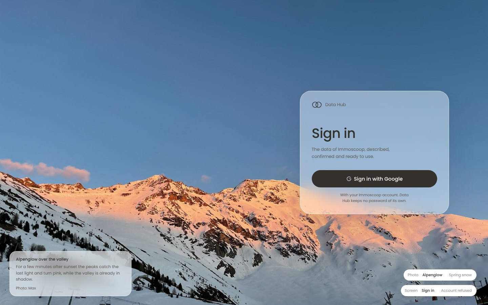

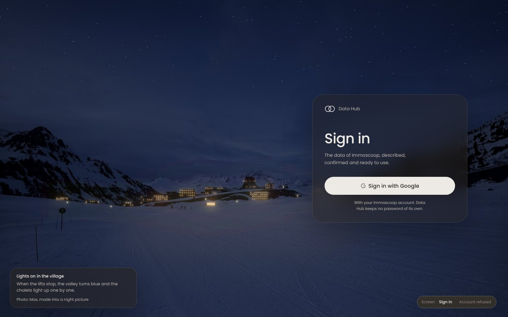

A photo of the set, as it is, fills the screen. The sign-in sits on a glass card that blurs what lies behind it: the name, one sentence on what Data Hub is, and Sign in with Google. In a corner, also on glass, the story of the photo: a title, a few lines and who took it. The dark theme has its own photos, never darkened copies ([DEC-UX-35](../design/principles.md#dec-ux-35), [DEC-UX-36](../design/principles.md#dec-ux-36)). An account of another domain is refused on the same card, naming the account. Screen: `sign-in`.

### Behind it

**Service:** identity. **Schema:** `identity`.

| Table | What it keeps |
| --- | --- |
| `users` | The fixed Google ID, email, name, first and last login |
| `clients` | The OAuth clients: the web app, and each Claude that registered itself, with its callback addresses |
| `authorization_requests`, `authorization_codes` | A sign-in in progress (PKCE), for a few minutes; codes as hashes only |
| `sessions` | One per signed-in client, with when it ends and why |
| `refresh_tokens` | As hashes only, each used once, tied to its session |

**Groups are not stored.** identity reads them from Workspace at every sign-in and every renewal, every 15 minutes, and puts them in the Access Token. The architecture page plans a table of Groups and memberships for the synchronisation of [FR-UM-07](../requirements/functional/02-user-management.md#fr-um-07); that is not built. When Workspace does not answer at a renewal, identity answers "try again later" and keeps the session, so a short outage at Google never signs anyone out.

| Endpoint | Purpose |
| --- | --- |
| `/.well-known/oauth-authorization-server`, `/register`, `/authorize`, `/callback`, `/token`, `/revoke` | Signing in, renewing and signing out, for the web app and for Claude |
| `GET /.well-known/jwks.json` | The public keys every service uses to check an Access Token |
| `GET /me`, `GET /me/groups` | The current User, with Groups and roles; their groups with name and address, to choose an Owner Unit |
| `DELETE /users/{googleId}/sessions` | The Data Team ends every session of a User at once |

**Talks to:** Google Sign-In, the Cloud Identity Groups API (one level at a time, since the call for all nested groups at once needs a Workspace edition we do not have), the Admin SDK to check that an account is still active, and Cloud KMS to sign.

**Not built:** Library Cards (`POST /library-cards`, `POST /exchange`) and the group synchronisation (`POST /internal/sync-groups`, from Cloud Scheduler).

### Open

- Which Workspace domains get in: `thenextimmoscoop.be` only, decided on 18 October ([DEC-UM-06](../requirements/functional/02-user-management.md#dec-um-06)) and the only one identity checks today. On 25 October you named `immoscoop.be` too: whether it gets in, and whether it is the same Workspace, is [OP-UM-07](../requirements/functional/02-user-management.md#op-um-07).
- How often the synchronisation runs ([OP-UM-05](../requirements/functional/02-user-management.md#op-um-05)), and the three edge cases: an empty Owner Unit, a deleted group, Google briefly unreachable ([OP-UM-06](../requirements/functional/02-user-management.md#op-um-06)).
- The photos and stories for the sign-in, and whether a User can choose a picture as their background ([OP-UX-20](../design/principles.md#op-ux-20)).

## From dbt to Data Hub

**Built.** Fetching, storing and processing the dbt Artifacts, search, lineage and the Resources from exposures run on uat. Comparing versions and following Changes downstream are specified, not built.

### What it does

- **Fetching.** After every successful run of a Source Job, one per dbt project (dbt-prod and Colleciónes), registry fetches `manifest.json` and `catalog.json`, once per run, and keeps them unchanged for good ([FR-AR-01](../requirements/functional/01-artifact-registry.md#fr-ar-01) to [FR-AR-06](../requirements/functional/01-artifact-registry.md#fr-ar-06)).
- **Processing.** It turns them into Nodes, columns, Edges and tests, with lineage across both projects, linked by the table one builds and the other reads ([FR-AR-07](../requirements/functional/01-artifact-registry.md#fr-ar-07), [FR-AR-08](../requirements/functional/01-artifact-registry.md#fr-ar-08)). A set becomes the Current Version only once it is fully processed ([FR-AR-09](../requirements/functional/01-artifact-registry.md#fr-ar-09)), and the Data Team can process a run again by hand ([FR-AR-14](../requirements/functional/01-artifact-registry.md#fr-ar-14)).
- **Search** by name, also with a typo, by free text in descriptions and columns, and along the lineage ([FR-AR-10](../requirements/functional/01-artifact-registry.md#fr-ar-10)).
- **Resources from exposures.** A table under an exposure with the tag `datahub` becomes a Resource, with the Display Name of the exposure. A Resource whose exposure goes is withdrawn and held, not deleted, and a new Resource waits for a Collection ([FR-SR-32](../requirements/functional/04-stacks-and-resources.md#fr-sr-32) to [FR-SR-35](../requirements/functional/04-stacks-and-resources.md#fr-sr-35)). This replaced registering by hand in the app: the Registration now happens in dbt, in a reviewed merge.
- **Specified, not built:** comparing every new version Node by Node ([FR-AR-11](../requirements/functional/01-artifact-registry.md#fr-ar-11)), and following every Change downstream into the Log of the Resources it reaches ([FR-AR-12](../requirements/functional/01-artifact-registry.md#fr-ar-12), [FR-AR-13](../requirements/functional/01-artifact-registry.md#fr-ar-13)). This is what makes a Resource drop to Described after a structural Change, so the Levels depend on it.

### The screens

The new design has no screen for the registry itself. What it feeds shows on a Resource: its description and columns, and the tabs Lineage and History, which are not designed yet ([OP-UX-04](../design/principles.md#op-ux-04)). Today's web app gives the Data Team a search over both projects, the Current Version of each, and a Node with its columns, tests, lineage and meta.

### Behind it

**Service:** registry, plus the Cloud Run job `datahub-registry-ingest` that does the processing. **Stores:** schema `registry`, and the files in a GCS bucket per project and per run.

| Table | What it keeps |
| --- | --- |
| `artifact_sets` | One per run: project, dbt Cloud job and run, status and error, dbt version, and when it was generated, received, claimed and processed |
| `projects` | Each dbt project, with its Current Version and the one before |
| `nodes` | Every Node of a set: name, relation, description, materialisation, tags, file, checksum, its `meta`, and a search index |
| `columns` | The columns of each Node: name, position, data type, description, and a search index |
| `edges` | Parent and child: the lineage |
| `tests` | The tests per Node and column, with severity, and the target of a relationships test |

Nodes, columns, Edges and tests are kept for the Current Version and the one before; the files in the bucket for good.

**How a run comes in:** dbt Cloud calls `POST /webhooks/dbt-cloud`, signed with a shared secret. registry checks the signature, records the run once as a pending set, starts the ingest job and answers. The job fetches the two files, stores them, normalises them and switches the Current Version in one transaction. Then registry sends catalogue the tables under the `datahub` exposures (`POST /internal/resources`), with its own service identity.

| Endpoint | Purpose |
| --- | --- |
| `POST /webhooks/dbt-cloud` | A finished run; public, protected by its signature |
| `GET /projects`, `GET /runs` | The projects with their Current Version; the latest runs with status and error |
| `GET /nodes?q=&type=`, `GET /nodes/{id}` | Search; one Node with its columns and tests |
| `GET /nodes/{id}/lineage?direction=&depth=` | Lineage up- or downstream, across both projects |
| `POST /runs/{id}/reprocess` | Fetch and process a run again |

For now every route but the webhook needs the role of the Data Team.

### Open

- Who besides the Data Team may read the registry: its search, Nodes and lineage ([OP-AR-05](../requirements/functional/01-artifact-registry.md#op-ar-05)).
- The edge cases: an older run arriving after a newer one, a missing catalog, a renamed view, an upstream model that disappears ([OP-AR-03](../requirements/functional/01-artifact-registry.md#op-ar-03)).
- Whether model contracts on the exposed tables make a structural Change a deliberate step ([OP-DH-05](../overview/open-themes.md#op-dh-05)).

## Collections

**Built** for the rules: creating, editing and dissolving a Collection, its Log, and adding Resources to it run on uat in today's look. **Designed:** the panel, the start screen and the page of a Collection in the new design.

### What it does

A Collection is a functional domain of Immoscoop, such as leads or agencies, in which Resources and Lenses sit together under one Owner Unit.

- **Anyone creates a Collection** ([FR-CO-12](../requirements/functional/03-collections.md#fr-co-12)), with a unique name, a description, a colour from the palette, an optional icon, and exactly one Owner Unit chosen from their own groups ([FR-CO-02](../requirements/functional/03-collections.md#fr-co-02) to [FR-CO-05](../requirements/functional/03-collections.md#fr-co-05), [FR-CO-15](../requirements/functional/03-collections.md#fr-co-15)).
- **Its Owner Unit and the Data Team manage it** ([FR-CO-13](../requirements/functional/03-collections.md#fr-co-13)). Only the Data Team adds and removes Resources ([FR-CO-14](../requirements/functional/03-collections.md#fr-co-14)); only the Owner Unit adds Lenses ([DEC-CO-15](../requirements/functional/03-collections.md#dec-co-15)).
- **A Resource is in at most one Collection,** and is added or removed, never moved ([FR-CO-07](../requirements/functional/03-collections.md#fr-co-07), [FR-CO-08](../requirements/functional/03-collections.md#fr-co-08)). Only an empty Collection can be dissolved ([FR-CO-10](../requirements/functional/03-collections.md#fr-co-10)).
- **Private or public** ([FR-CO-16](../requirements/functional/03-collections.md#fr-co-16), [FR-CO-17](../requirements/functional/03-collections.md#fr-co-17)). Private unless chosen otherwise. A public Collection is visible to every User; a private one only to its Owner Unit and the Data Team. To anyone else a private Collection does not exist: it is not listed, and asking for it gives the same answer as for a Collection that does not exist.
- **Every change is logged,** append-only, with fixed Log IDs ([FR-CO-11](../requirements/functional/03-collections.md#fr-co-11)).
- **Decided on 25 October:** everyone may build Lenses on every Resource they can see ([DEC-CO-17](../requirements/functional/03-collections.md#dec-co-17)); the Data Team may do everything in every Collection, also one it does not own ([DEC-CO-18](../requirements/functional/03-collections.md#dec-co-18)); the Data Team hands a Collection to another Owner Unit by choosing any group of the domain in the form to edit it, and choosing the group again brings its name and address up to date ([FR-CO-35](../requirements/functional/03-collections.md#fr-co-35)); the colours of Collections come from one configuration file that grows over time ([DEC-UX-60](../design/principles.md#dec-ux-60)); the icons come from Phosphor, the light weight favoured ([DEC-CO-19](../requirements/functional/03-collections.md#dec-co-19)). The first Collections are simply the first ones made.
- **Specified, not built:** when the Owner Unit changes, the Confirmations stay valid ([FR-CO-09](../requirements/functional/03-collections.md#fr-co-09)).

### The screens

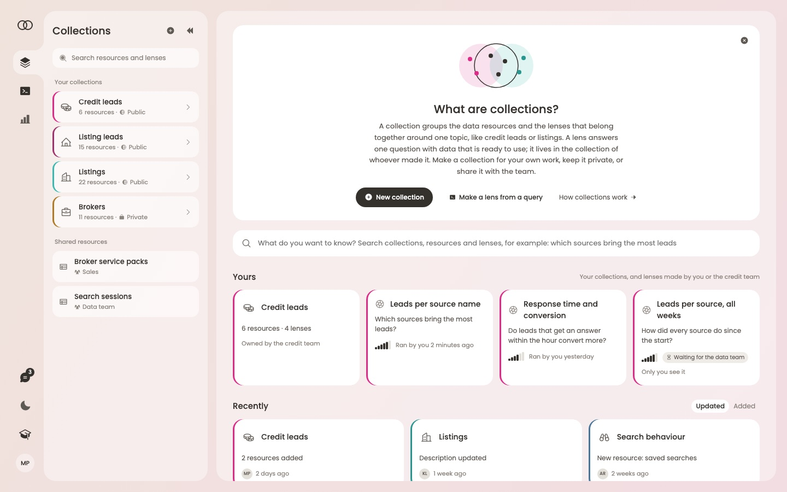

**The panel** ([FR-CO-18](../requirements/functional/03-collections.md#fr-co-18) to [FR-CO-24](../requirements/functional/03-collections.md#fr-co-24), Specified). One list of Collections, each unfolding to what it holds: first its Resources, then its Lenses, told apart by their icon ([FR-CO-36](../requirements/functional/03-collections.md#fr-co-36), [DEC-UX-65](../design/principles.md#dec-ux-65), from your review, 2026-10-26). An item shows the icon of its kind, its name on one line, and its Level; a Resource not published yet is shown as such. A long Collection shows its first eight items, then Show all. Search in the panel covers Collections and their Resources. Opening a Resource unfolds its Collection. Screen: `collections-start`.

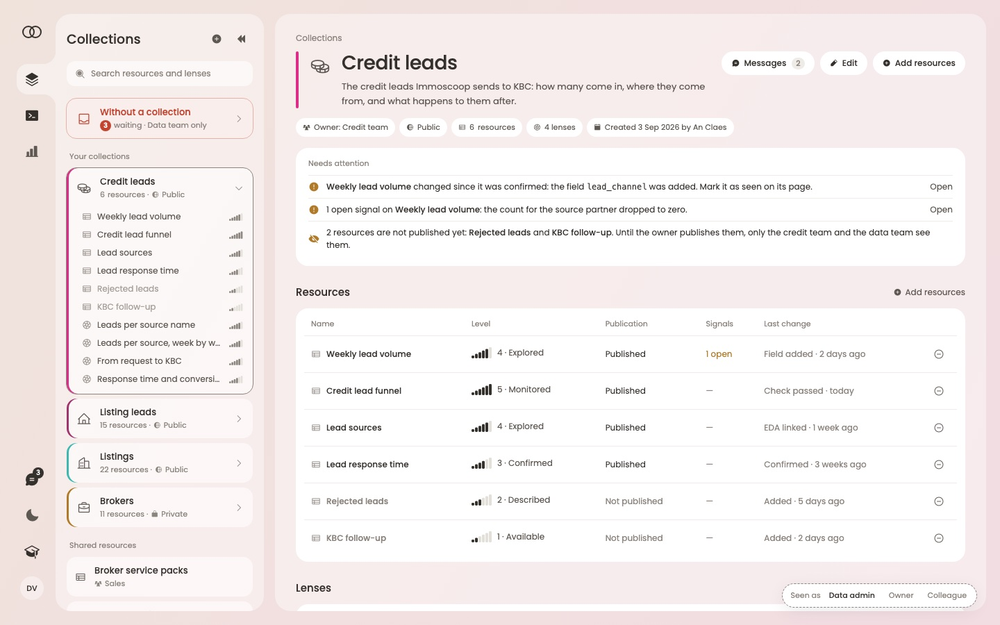

**The page of a Collection** ([FR-CO-25](../requirements/functional/03-collections.md#fr-co-25) to [FR-CO-31](../requirements/functional/03-collections.md#fr-co-31), Specified). Icon, name, description, Owner Unit, private or public, how many Resources and Lenses, and who created it when. To the Owner Unit and the Data Team it also shows what needs attention: a Level that dropped and waits for a Confirmation, open Signals, Resources not published yet, each with a link to where it is solved. Then the Resources and the Lenses of the Collection. The Owner Unit starts a new Lens from here, and edits the details in place. Screens: `collection-overview`, `collection-edit`.

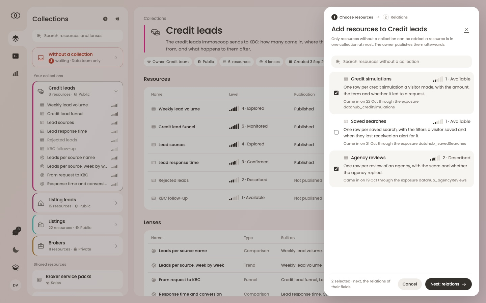

**Adding Resources** is the Data Team's job: from the page of a Collection, or from a Resource that waits for one. Screens: `collection-add-resources`, `resource-unassigned`.

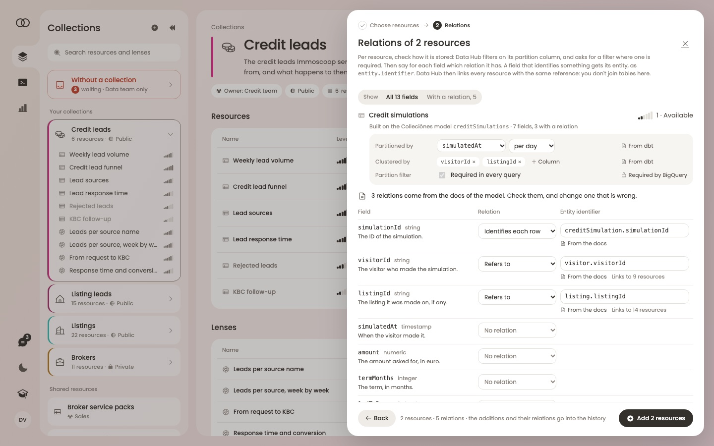

**Step 2: how each Resource is stored, and the relation of every field** ([FR-CO-33](../requirements/functional/03-collections.md#fr-co-33), [FR-CO-34](../requirements/functional/03-collections.md#fr-co-34), [DEC-UX-58](../design/principles.md#dec-ux-58), Proposed). "Next: relations" on the first step widens the sheet. Per Resource it first shows how it is stored: the partition column and the unit of its partitions, the cluster columns in their order, and whether a partition filter is required. Data Hub derives these from the dbt manifest and BigQuery where it can, marked "From dbt" ([OP-SR-12](../requirements/functional/04-stacks-and-resources.md#op-sr-12)); a filter that BigQuery requires is locked, and the Data Admin can require one where BigQuery does not. Then it lists every field with its type and description from dbt. For each field the Data Admin picks No relation, Identifies each row or Refers to, and gives the Entity identifier as `entity.identifier`. For a Colleciónes model the relations come from its docs; for another model Data Hub suggests them from the field names. Each reference says how many Resources it links to, and "Show" narrows the table to the fields with a relation. **What a relation records about its cardinality is under discussion:** eleven questions, each with a proposal ([OP-RC-07](../requirements/functional/05-resource-card.md#op-rc-07) to [OP-RC-17](../requirements/functional/05-resource-card.md#op-rc-17)). Also open: a field with no Entity in the Domain Model yet ([OP-CO-14](../requirements/functional/03-collections.md#op-co-14)), where relations change later ([OP-CO-15](../requirements/functional/03-collections.md#op-co-15)), and how the Pre-flight treats a query without a required partition filter ([OP-SR-15](../requirements/functional/04-stacks-and-resources.md#op-sr-15)). Screens: `collection-add-resources`, `collection-add-relations`.

### Behind it

**Service:** catalogue. **Schema:** `catalogue`.

| Table | What it keeps |
| --- | --- |
| `collections` | Name, description, colour, icon, the Owner Unit (its group ID, address and name at the time of choosing), private or public, who created it and when, and when it was dissolved |
| `collection_log` | Every change: the fixed Log ID, its parameters, who did it and when. catalogue builds the readable text from the Log ID |

| Endpoint | Purpose |
| --- | --- |
| `GET /collections`, `POST /collections` | The Collections the User sees; create one |
| `GET`, `PATCH`, `DELETE /collections/{id}` | Read one; change or dissolve it (Owner Unit and Data Team) |
| `GET /collections/{id}/log`, `GET /collections/{id}/resources` | Its history; its Resources as far as the User may see them |

The Owner Unit is chosen from `GET /me/groups` at identity. Whether a User is in it, catalogue checks against the group IDs in the Access Token, on every request.

**Not built yet for the new design:** the Lenses in a Collection, what needs attention, and the counts on its page.

### Open

- **Decided on 25 October,** see above: Lenses on what you can see ([OP-CO-07](../requirements/functional/03-collections.md#op-co-07)), the Data Team in a Collection it does not own ([OP-CO-12](../requirements/functional/03-collections.md#op-co-12)), handing a Collection over and keeping its group up to date ([OP-CO-06](../requirements/functional/03-collections.md#op-co-06), [OP-CO-08](../requirements/technical/03-collections.md#op-co-08)), the first Collections ([OP-CO-03](../requirements/functional/03-collections.md#op-co-03)), the palette ([OP-UX-05](../design/principles.md#op-ux-05), [OP-UX-08](../design/principles.md#op-ux-08)) and the icons ([OP-UX-07](../design/principles.md#op-ux-07)).
- How the Data Team finds every group of the domain to hand a Collection to, since identity lists only the groups of the User today ([OP-CO-18](../requirements/technical/03-collections.md#op-co-18)).
- Moving the icons of existing Collections from Tabler to Phosphor ([OP-CO-16](../requirements/functional/03-collections.md#op-co-16)), and who chooses the weight of an icon ([OP-CO-17](../requirements/functional/03-collections.md#op-co-17)).
- The relations of step 2: the cardinality ([OP-RC-07](../requirements/functional/05-resource-card.md#op-rc-07) to [OP-RC-17](../requirements/functional/05-resource-card.md#op-rc-17)), a field without an Entity ([OP-CO-14](../requirements/functional/03-collections.md#op-co-14)), changing relations later ([OP-CO-15](../requirements/functional/03-collections.md#op-co-15)), and a missing partition filter ([OP-SR-15](../requirements/functional/04-stacks-and-resources.md#op-sr-15)).

## Resources, the Resource Card and the Levels

**Built:** the Resource itself, from the exposures, with its Key, Display Name, description and Log. **Designed:** the page of a Resource and editing it in place. **Specified, not built:** the Resource Card beyond the description, and the Levels.

### What it does

- **A Resource** has an internal ID, a unique Key (the full name `project.dataset.table`) and a Display Name that can change ([FR-SR-04](../requirements/functional/04-stacks-and-resources.md#fr-sr-04), [FR-SR-05](../requirements/functional/04-stacks-and-resources.md#fr-sr-05)). Its description comes from the Artifacts ([FR-SR-06](../requirements/functional/04-stacks-and-resources.md#fr-sr-06)); next to it, the Owner and the Data Team write a Business Description, of the Resource and of every field ([FR-RC-01](../requirements/functional/05-resource-card.md#fr-rc-01), [FR-RC-16](../requirements/functional/05-resource-card.md#fr-rc-16)), and add to the card in Data Hub ([FR-SR-28](../requirements/functional/04-stacks-and-resources.md#fr-sr-28)).
- **The Log** keeps everything that happened to it, with fixed Log IDs, and survives a deregistration ([FR-SR-11](../requirements/functional/04-stacks-and-resources.md#fr-sr-11), [FR-SR-12](../requirements/functional/04-stacks-and-resources.md#fr-sr-12), [FR-SR-14](../requirements/functional/04-stacks-and-resources.md#fr-sr-14)).
- **The Resource Card** is everything we know about one Resource. Part is derived (description, columns, lineage, freshness, usage) and never stored again as a source ([DEC-DH-17](../overview/data-hub.md#dec-dh-17)). The rest only Data Hub knows:
  - **Specified:** model type and grain ([FR-RC-11](../requirements/functional/05-resource-card.md#fr-rc-11)), who published and who confirmed ([FR-RC-12](../requirements/functional/05-resource-card.md#fr-rc-12)), since when the data is reliable ([FR-RC-13](../requirements/functional/05-resource-card.md#fr-rc-13)), checks and incidents ([FR-RC-14](../requirements/functional/05-resource-card.md#fr-rc-14)), edited in place by the Owner and the Data Team ([FR-RC-15](../requirements/functional/05-resource-card.md#fr-rc-15)).
  - **Proposed:** a definition in business language, open questions, Known Gaps, a log of changes and Anomalies for people and for Claude, Stability, and relationships through an Entity and an identifier ([FR-RC-01](../requirements/functional/05-resource-card.md#fr-rc-01) to [FR-RC-10](../requirements/functional/05-resource-card.md#fr-rc-10)).
- **The Levels** ([FR-MR-01](../requirements/functional/06-maturity-and-release.md#fr-mr-01) to [FR-MR-10](../requirements/functional/06-maturity-and-release.md#fr-mr-10), all Specified):
  - Described when the table and every column have a description; Confirmed when the Owner confirms, from Described; Explored with a linked EDA document; Monitored with at least one active check.
  - A change to the schema never lowers the Level: a field added, removed, renamed or retyped since the last Confirmation gives a warning on the Resource and a Message to the Owner, until the Owner or the Data Team marks it seen ([DEC-MR-08](../requirements/functional/06-maturity-and-release.md#dec-mr-08), [FR-MR-12](../requirements/functional/06-maturity-and-release.md#fr-mr-12), from your review, 2026-10-26). A failing check does not lower it either; losing the last check or the EDA document does. A Confirmation does not expire, and there is no reconfirmation.
  - Every rise and drop is logged, and the Owner is alerted on a drop, which now only follows a trace that goes. The Level restricts nothing and is shown everywhere.

**Relationships, set up when a Resource is added** (from your review, 2026-10-24). At step 2 the Data Admin records the reference of the Resource: which column is which Entity identifier, such as `agency.agencyId`. Not the join itself: Data Hub links every Resource that carries the same reference ([FR-RC-08](../requirements/functional/05-resource-card.md#fr-rc-08), [FR-RC-09](../requirements/functional/05-resource-card.md#fr-rc-09)). For a Resource built on a Colleciónes model, the reference can normally be derived from the docs of that model, so the Data Admin confirms it rather than typing it. This answers where the reference is recorded ([OP-RC-05](../requirements/functional/05-resource-card.md#op-rc-05)), and is now [FR-CO-33](../requirements/functional/03-collections.md#fr-co-33). What a relation records about its cardinality is under discussion ([OP-RC-07](../requirements/functional/05-resource-card.md#op-rc-07) to [OP-RC-17](../requirements/functional/05-resource-card.md#op-rc-17)).

**Two descriptions side by side** (from your review, 2026-10-26). A Resource and each of its fields have the description from dbt and a Business Description, written in Data Hub by the Owner and the Data Team. Neither overrides the other; their only relation is that they describe the same table or field ([DEC-RC-01](../requirements/functional/05-resource-card.md#dec-rc-01)). Without a Business Description, the description from dbt is used alone; with one, both, each marked with where it comes from, on the card, in the Columns, in search and for Claude ([DEC-RC-02](../requirements/functional/05-resource-card.md#dec-rc-02), [FR-RC-18](../requirements/functional/05-resource-card.md#fr-rc-18)). Every Change to the description from dbt of the Resource or one of its fields is told to the Owner in a Message, which asks for no review ([DEC-RC-03](../requirements/functional/05-resource-card.md#dec-rc-03), [FR-RC-17](../requirements/functional/05-resource-card.md#fr-rc-17)). Nothing reaches the company before Level 3: the first Publication is the first Confirmation ([DEC-RC-04](../requirements/functional/05-resource-card.md#dec-rc-04)).

### The screens

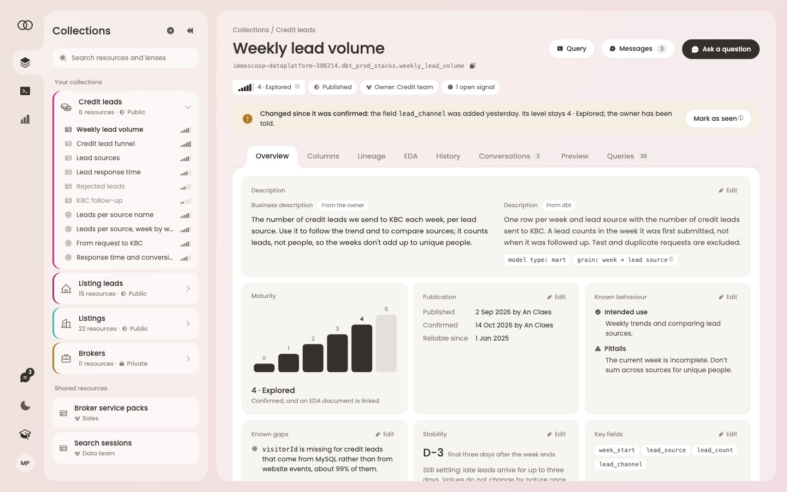

**The page of a Resource.** The header carries the Display Name, the Level, the Collection and a status row. Below it the tabs ([FR-SR-24](../requirements/functional/04-stacks-and-resources.md#fr-sr-24)): the Overview holds the Resource Card as tiles, then Columns, Preview, Queries and Conversations. Lineage, EDA and History are tabs without a design yet. The Description tile and the Columns tab show the Business Description and the description from dbt side by side ([DEC-UX-61](../design/principles.md#dec-ux-61)). The screen shows a change since the last Confirmation: a warning says a field was added, the Level stays 4 · Explored, and the Owner and the Data Team can mark it as seen ([DEC-UX-64](../design/principles.md#dec-ux-64)). Screen: `resource-detail`.

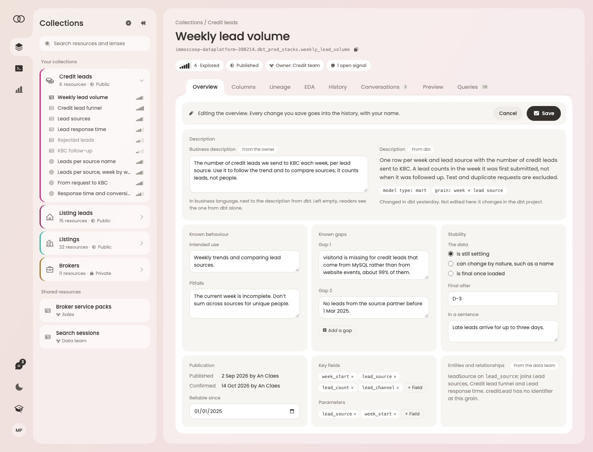

**Editing in place.** Edit on a tile turns the parts Data Hub keeps into fields, where they are. What comes from dbt or from the Data Team stays read-only and is marked as such ([DEC-UX-09](../design/principles.md#dec-ux-09)). Screen: `resource-edit`.

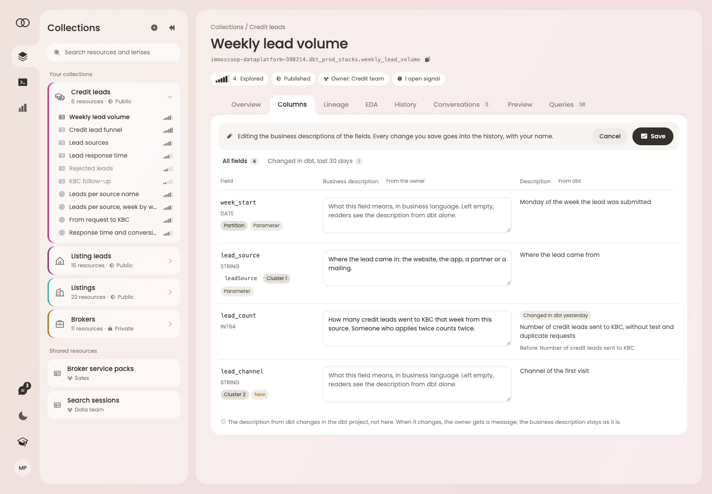

**Editing the fields.** Edit on the Columns tab gives one row per field: its Business Description as a field, its description from dbt next to it. A description from dbt that changed in the last 30 days says so, with the text before; a filter shows only those ([FR-RC-16](../requirements/functional/05-resource-card.md#fr-rc-16)). Screen: `resource-columns-edit`.

### Behind it

**Service:** catalogue, which reads the derived parts from registry with the token of the User. **Built tables:**

| Table | What it keeps |
| --- | --- |
| `resources` | ID, Key, dbt project, Node, name and kind, the Display Name asked for in the exposure and the one given, the description (a copy, refreshed at every sync; the source stays dbt), the exposures it is under, its Collection, and when it was registered, updated and withdrawn |
| `resource_log` | Every event of a Resource: Log ID, parameters, who and when |
| `resource_syncs` | Per dbt project, the last run whose exposures were synchronised, so a run is applied once |

| Endpoint | Purpose |
| --- | --- |
| `POST /internal/resources` | From registry: registers, renames, withdraws and brings back Resources |
| `GET /resources?collection=none` | The Resources waiting for a Collection (Data Team) |
| `PUT`, `DELETE /resources/{id}/collection` | Add to or remove from a Collection (Data Team) |
| `GET /resources/{id}/log` | Its history |

**Proposal for the Resource Card and the Levels**, for the technical analysis:

- **One append-only table per kind of knowledge,** in line with [DEC-DH-57](../overview/data-hub.md#dec-dh-57): the texts the Owner writes (definition, Known Gaps, Stability, since when reliable) as versions, each with who and when; Anomalies with their period and impact; links to EDA documents; and Confirmations with their Fingerprint (see Publishing and confirming). The current card is the latest version of each.
- **The Level is computed, its history logged.** catalogue computes the Level from the traces when it is asked: the descriptions from registry, the latest Confirmation, a linked EDA document, an active check. After every event that can move it (a new Artifact Set, a Confirmation, an EDA link, a check added or removed) it computes it again and writes a Log Entry when it differs from the last one. That keeps [DEC-DH-31](../overview/data-hub.md#dec-dh-31) (never stored as a label) and [FR-MR-09](../requirements/functional/06-maturity-and-release.md#fr-mr-09) (every rise and drop logged).
- **The warning needs the Changes:** a change since the last Confirmation only shows once registry compares versions and hands the Changes over ([FR-AR-11](../requirements/functional/01-artifact-registry.md#fr-ar-11), [FR-AR-12](../requirements/functional/01-artifact-registry.md#fr-ar-12)), so those come first in the build.
- **The page in one call:** `GET /resources/{id}` assembles the card from catalogue's own tables and registry's Node, and answers "not found" for a Resource the User may not see.

### Open

- What Described requires: only descriptions, or also `model_type` and `grain` ([OP-MR-03](../requirements/functional/06-maturity-and-release.md#op-mr-03)); the full list of drop causes ([OP-MR-04](../requirements/functional/06-maturity-and-release.md#op-mr-04)).
- How the definition in business language relates to the description from dbt ([OP-RC-01](../requirements/functional/05-resource-card.md#op-rc-01)), and where the Entity of a Resource is recorded ([OP-RC-05](../requirements/functional/05-resource-card.md#op-rc-05)).
- Whether a Business Description counts towards Described: proposed not, Described stays measured on dbt ([OP-RC-20](../requirements/functional/05-resource-card.md#op-rc-20)).
- The words for Known Gaps, the log of changes and Stability ([OP-RC-03](../requirements/functional/05-resource-card.md#op-rc-03), [OP-RC-04](../requirements/functional/05-resource-card.md#op-rc-04)), and a convention for Display Names ([OP-SR-01](../requirements/functional/04-stacks-and-resources.md#op-sr-01)).
- The tabs Lineage, EDA and History ([OP-UX-04](../design/principles.md#op-ux-04)), and the schema of the Resource Card ([OP-DH-14](../overview/open-themes.md#op-dh-14)).

## Publishing and confirming

**Designed and specified, not built.** Nothing in this part runs yet: today an unpublished Resource is visible to its Owner Unit and the Data Team only, and no Resource can be published.

### What it does

Release happens in two steps. The Data Team makes a Resource available to one Owner; only that Owner releases it to everyone who sees the Collection.

- **Only the Owner publishes** ([FR-SR-16](../requirements/functional/04-stacks-and-resources.md#fr-sr-16)), and only from Described. **The first Publication is the first Confirmation:** by publishing, the Owner confirms what the Resource is and what it stands for, and it rises to Confirmed. A Confirmation makes no claim about the data inside it; that is for the EDA ([DEC-MR-07](../requirements/functional/06-maturity-and-release.md#dec-mr-07), from your review, 2026-10-26) ([FR-SR-17](../requirements/functional/04-stacks-and-resources.md#fr-sr-17)).
- **Who sees it** follows the Publication and the Collection, not the Level ([FR-SR-31](../requirements/functional/04-stacks-and-resources.md#fr-sr-31)). Not published: the Data Team and the Owner Unit. Published: everyone who sees the Collection, which for a public Collection is the whole company.
- **A published Resource stays published when its Level drops** ([FR-SR-19](../requirements/functional/04-stacks-and-resources.md#fr-sr-19)). The Owner gets an alert and the lower Level shows everywhere. That way a Resource never disappears for those who use it. **An Owner cannot unpublish** (from your review, 2026-10-26): a Resource can be marked deprecated instead, its use discouraged, hiding and blocking nothing ([DEC-SR-28](../requirements/functional/04-stacks-and-resources.md#dec-sr-28), [FR-SR-50](../requirements/functional/04-stacks-and-resources.md#fr-sr-50)).
- **At every Confirmation** Data Hub keeps a Fingerprint of the schema; when the schema no longer matches it, a warning says what changed, and the Level stays ([DEC-MR-08](../requirements/functional/06-maturity-and-release.md#dec-mr-08)). A Confirmation does not expire ([FR-MR-08](../requirements/functional/06-maturity-and-release.md#fr-mr-08)).
- **Proposed:** publishing says who will see the Resource and asks for the Confirmation: the declaration, ticked in one bar with the button, which stays off until it is ticked ([FR-SR-49](../requirements/functional/04-stacks-and-resources.md#fr-sr-49), [DEC-UX-63](../design/principles.md#dec-ux-63)). The control figures are withdrawn ([FR-RC-03](../requirements/functional/05-resource-card.md#fr-rc-03)); confirming again shows what changed ([FR-MR-11](../requirements/functional/06-maturity-and-release.md#fr-mr-11)).

### The screens

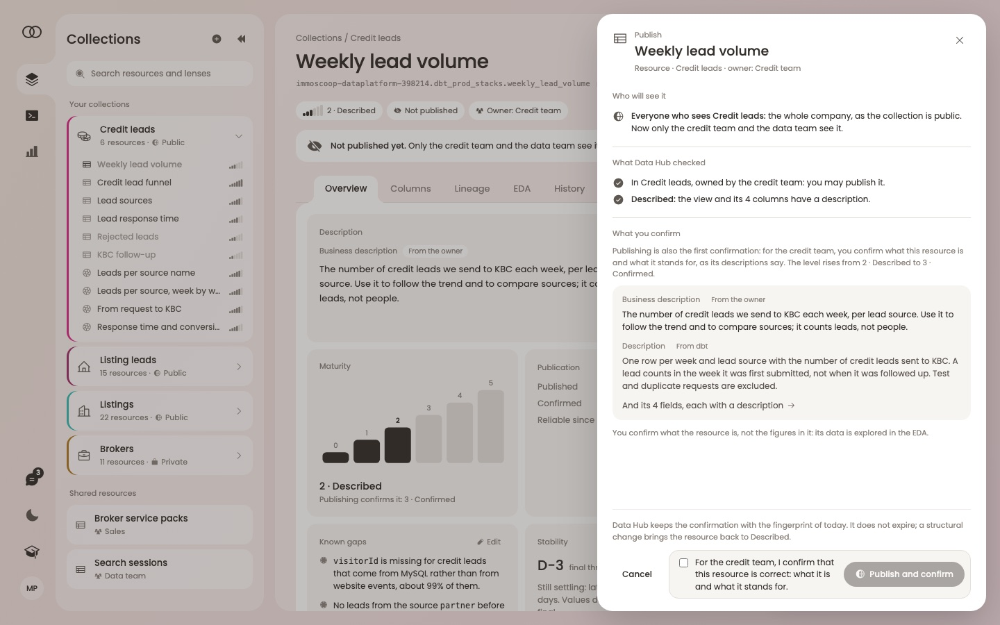

**Publish** opens a sheet over the page of the Resource, in three parts ([DEC-UX-31](../design/principles.md#dec-ux-31)): who will see it; what Data Hub checked (that the User may publish it, and that it is Described, naming any column without a description); and what the Owner confirms: what the Resource is and what it stands for, its Business Description and its description from dbt. At the foot, the declaration and the button are one bar; the button is off until the box is ticked. Until then the Resource reads "not published" in its status row and is grey in the panel. Screen: `resource-publish`.

### Behind it: proposal

**Service:** catalogue. Nothing is built; this is a starting point for the technical analysis.

| Table | What it would keep |
| --- | --- |
| `resources` (two new columns) | `published_at` and `published_by`: the current state, read on every request to decide who sees the Resource |
| `confirmations` | Append-only, one row per Confirmation: who and when, the Artifact Set it was made on, the Fingerprint (the columns and their types from the catalog), and whether it was the first Publication |
| `resource_log` (built) | The events themselves, with their Log IDs: published, confirmed, a change marked seen, deprecated |

| Endpoint | Purpose |
| --- | --- |
| `GET /resources/{id}/publication-check` | What the sheet shows before anything happens: who would see it, whether the User may publish, whether it is Described and which columns lack a description |
| `PUT /resources/{id}/publication` | Publish, together with the first Confirmation, in one transaction (Owner only) |
| `POST /resources/{id}/changes/seen` | Mark the changes since the last Confirmation as seen (Owner and Data Team) |
| `PUT`, `DELETE /resources/{id}/deprecation` | Mark deprecated, or take it away (Owner and Data Team) |

**Points for the analysis:**

- **Who sees what is one rule in one place:** catalogue answers it for its own pages, and for query through `POST /visibility`. A Resource the User may not see answers exactly like one that does not exist.
- **The warning on a change and the alert on a drop** need the Message Centre (see Messages), which reaches the whole Owner Unit ([FR-LN-01](../requirements/functional/07-log-and-notifications.md#fr-ln-01)). Until then, the page of the Collection lists what needs attention.

### Open

- What marking a Resource deprecated holds, and how it shows ([OP-SR-16](../requirements/functional/04-stacks-and-resources.md#op-sr-16), [OP-UX-25](../design/principles.md#op-ux-25)).

## Query

**Designed, not built.** The service `query` exists as an empty skeleton on Cloud Run; no query runs through Data Hub yet. The Preview, the Pre-flight, the section Query and the Query Log are designed.

### What it does

- **Every query is checked the same way,** whether it comes from a Preview, the section Query, a Lens or Claude:
  - It only touches Resources the User may see; otherwise it is refused ([FR-SR-26](../requirements/functional/04-stacks-and-resources.md#fr-sr-26), [FR-SR-41](../requirements/functional/04-stacks-and-resources.md#fr-sr-41)).
  - A **Pre-flight** says what it will read, per Resource how many partitions and through which column, and warns when a partitioned Resource has no partition filter ([FR-SR-36](../requirements/functional/04-stacks-and-resources.md#fr-sr-36), [FR-SR-40](../requirements/functional/04-stacks-and-resources.md#fr-sr-40)).
  - Above one threshold the User approves explicitly; above a second it is blocked ([FR-SR-37](../requirements/functional/04-stacks-and-resources.md#fr-sr-37)).
  - It runs with a byte limit and a label naming the User ([FR-SR-27](../requirements/functional/04-stacks-and-resources.md#fr-sr-27)).
  - It gets a **Query ID** in the Query Log, with its SQL, who, when, what it read and the Resources beneath it, and every output carries that ID ([FR-LN-05](../requirements/functional/07-log-and-notifications.md#fr-ln-05), [FR-LN-06](../requirements/functional/07-log-and-notifications.md#fr-ln-06)). The Query Log is readable by the Data Team and by whoever ran the query only, since SQL can hold values ([DEC-LN-01](../requirements/functional/07-log-and-notifications.md#dec-ln-01)).
- **The Preview** shows a limited number of rows, chosen with the Parameters of the Resource, with nothing to type ([FR-SR-25](../requirements/functional/04-stacks-and-resources.md#fr-sr-25), [FR-SR-38](../requirements/functional/04-stacks-and-resources.md#fr-sr-38)). A Resource shows how it is partitioned and clustered ([FR-SR-39](../requirements/functional/04-stacks-and-resources.md#fr-sr-39)).
- **The section Query** (all Proposed, [FR-SR-41](../requirements/functional/04-stacks-and-resources.md#fr-sr-41) to [FR-SR-48](../requirements/functional/04-stacks-and-resources.md#fr-sr-48)): SQL over every Resource the User may see, in an editor that formats and suggests. Every query has a name. A new query first shows the Lenses that already use its Resources, ranked by the words they share with its question, so nobody writes again what exists. The panel lists the queries that ran, and the page of a Resource lists the queries on it.
- **No high-volume or frequent exports** through Data Hub: a structural export goes to the Data Team ([FR-CH-01](../requirements/functional/13-channels.md#fr-ch-01), [FR-CH-02](../requirements/functional/13-channels.md#fr-ch-02)).

### The screens

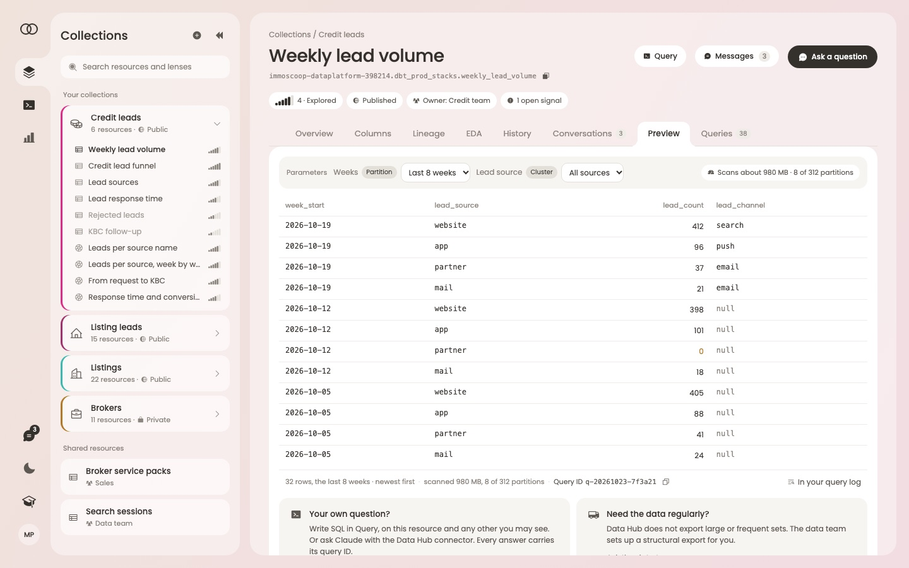

**The Preview** is a tab of the Resource: its Parameters choose which rows, a Pre-flight says what it scans, and the result carries its Query ID. Screen: `resource-preview`.

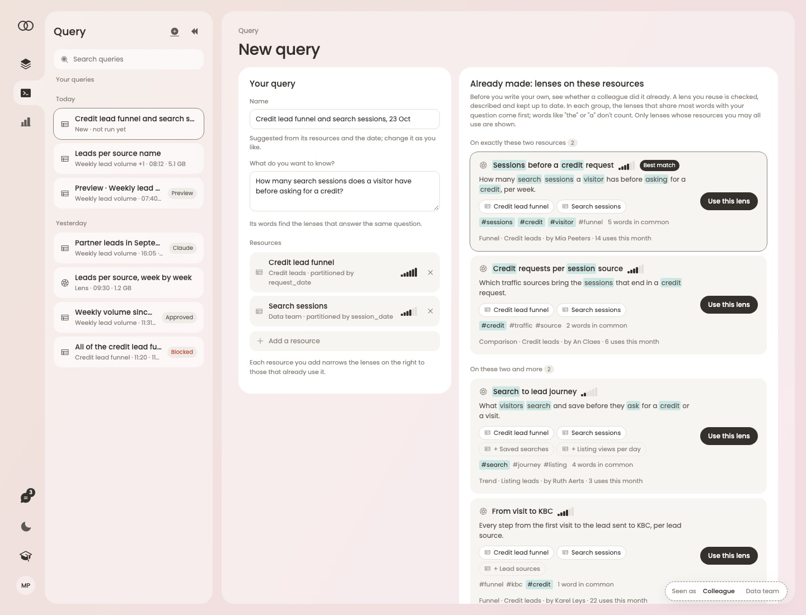

**A new query** asks for a name and the question, and its Resources. Before the editor, it shows the Lenses on those Resources. Screen: `query-new`.

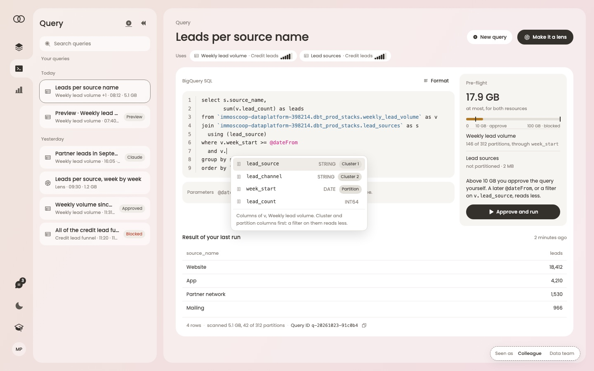

**Query** holds the editor, the Pre-flight with the partitions it reads, and the result with its Query ID. Its panel lists the queries that ran, grouped by day. For the Owner, Make it a lens starts step 7. Screen: `query`.

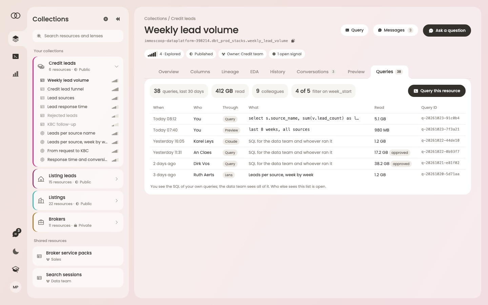

**The tab Queries** on a Resource lists every query on it, with a few numbers over the last 30 days. The SQL shows only to whoever ran it and the Data Team. Screen: `resource-queries`.

### Behind it: proposal

**Service:** query, the only service that reads BigQuery. Today it has no code beyond the skeleton.

**How a query would run:**

1. A dry run in BigQuery returns the tables the query touches and the bytes it would scan.
2. query asks catalogue which of those tables the User may see (`POST /visibility`, with the User's token). One table not visible, and the query is refused with the same answer as for a table that does not exist.
3. The Pre-flight goes back to the User with the bytes and the partitions; above the first threshold it waits for their approval, above the second it stops.
4. It runs with `maximumBytesBilled` and a label with the User, and writes the Query Log row with the ID of the BigQuery job.

| Table (new schema `query`) | What it would keep |
| --- | --- |
| `query_log` | Query ID, name, question, SQL, who, when, through what (Preview, Query, Lens, Claude, feed), the Resources beneath it, bytes estimated and billed, approved or blocked, the BigQuery job ID |

| Endpoint | Purpose |
| --- | --- |
| `POST /queries/preflight` | The dry run, the visibility check and the Pre-flight, without running |
| `POST /queries` | Run, with the approval when the Pre-flight asked for one |
| `GET /queries`, `GET /queries/{id}` | The User's own queries; all of them for the Data Team |
| `GET /resources/{id}/preview`, `GET /resources/{id}/queries` | The Preview; the queries on a Resource |

**Points for the analysis:**

- **The architecture page is out of step here.** It still says query has no schema because executed queries are not stored ([DEC-SR-18](../requirements/functional/04-stacks-and-resources.md#dec-sr-18)); that decision was replaced by the Query Log ([DEC-LN-01](../requirements/functional/07-log-and-notifications.md#dec-ln-01)). The page needs to follow when the analysis starts.
- **What query may read is not settled.** The overview says Data Hub's account reads only the Stacks, through authorised views ([DEC-DH-08](../overview/data-hub.md#dec-dh-08)). Since a Resource is any table under a `datahub` exposure, not necessarily in a Stack, that no longer holds by itself: read access on those datasets, or every Resource in a Stack after all ([OP-SR-10](../requirements/functional/04-stacks-and-resources.md#op-sr-10)), and who grants it, Terraform or dbt ([OP-PF-14](../requirements/technical/00-platform.md#op-pf-14)). This is also where confidentiality touches the build.
- **Partitions** come from the dbt manifest of the model beneath, through the lineage, and the sizes from BigQuery ([OP-SR-12](../requirements/functional/04-stacks-and-resources.md#op-sr-12), proposal).

### Open

- The byte limit, the rows of the Preview, and the thresholds of the Pre-flight and of making a Lens ([OP-SR-07](../requirements/functional/04-stacks-and-resources.md#op-sr-07)).
- Who sees the queries of others on a Resource ([OP-SR-13](../requirements/functional/04-stacks-and-resources.md#op-sr-13)); the proposal is everyone sees who, when, how and what it read, but not the SQL.
- How Data Hub reads Resources outside the Stacks, and who grants it ([OP-SR-10](../requirements/functional/04-stacks-and-resources.md#op-sr-10), [OP-PF-14](../requirements/technical/00-platform.md#op-pf-14)).

## Lenses

**Designed, all requirements Proposed.** Nothing is built and no service owns Lenses yet.

### What it does

A Lens is a way of looking at Resources, made by and for business: a query with Parameters that colleagues run without touching the SQL. Its Level is the lowest of the Resources beneath it.

- **A query becomes a Lens** with Make it a lens; its name, question and Resources come along, and the question is where its story starts ([FR-LE-07](../requirements/functional/09-lenses.md#fr-le-07), [FR-LE-05](../requirements/functional/09-lenses.md#fr-le-05)). It can also start from the page of a Collection, by its Owner Unit.
- **Its size is checked when it is made,** with a dry run, in three ranges ([FR-LE-08](../requirements/functional/09-lenses.md#fr-le-08)): within, published straight away; large, published with a warning to its author; very large, saved but not published until the Data Team accepts it ([FR-LE-09](../requirements/functional/09-lenses.md#fr-le-09)). A Lens that later outgrows its range is checked again ([FR-LE-10](../requirements/functional/09-lenses.md#fr-le-10)).
- **It runs on a page of its own** for everyone who may use it ([FR-LE-11](../requirements/functional/09-lenses.md#fr-le-11)). Its Parameters start at their defaults; a Parameter takes a value or a function, such as "today − 3 days" ([FR-LE-13](../requirements/functional/09-lenses.md#fr-le-13)). Every run is a query, with the Pre-flight and a Query ID ([FR-LE-12](../requirements/functional/09-lenses.md#fr-le-12)).
- **Plain language instead of SQL.** A colleague never sees the SQL of a Lens; only its Owner Unit does, when editing ([FR-LE-14](../requirements/functional/09-lenses.md#fr-le-14)). What it does is told step by step, written by a skill when the Lens is made ([FR-LE-03](../requirements/functional/09-lenses.md#fr-le-03)).
- **Who sees a Lens:** only whoever may use every Resource beneath it ([DEC-CO-16](../requirements/functional/03-collections.md#dec-co-16)). A Lens sits in a Collection, which its Owner Unit adds it to.
- **No section Lenses** (from your review, 2026-10-26): a Lens lives in its Collection, listed in the panel and on the page of the Collection, and its page sits under Collections ([DEC-UX-66](../design/principles.md#dec-ux-66)). The start screen of Collections finds Lenses by the words of a question, shows your own Lenses (with those waiting for the Data Team) and Lenses to discover ([FR-CO-37](../requirements/functional/03-collections.md#fr-co-37)). **A Lens always goes into a Collection its author owns,** even when its Resources are in other Collections: that is how Resources are inherited across Collections ([DEC-CO-20](../requirements/functional/03-collections.md#dec-co-20)).

### The screens

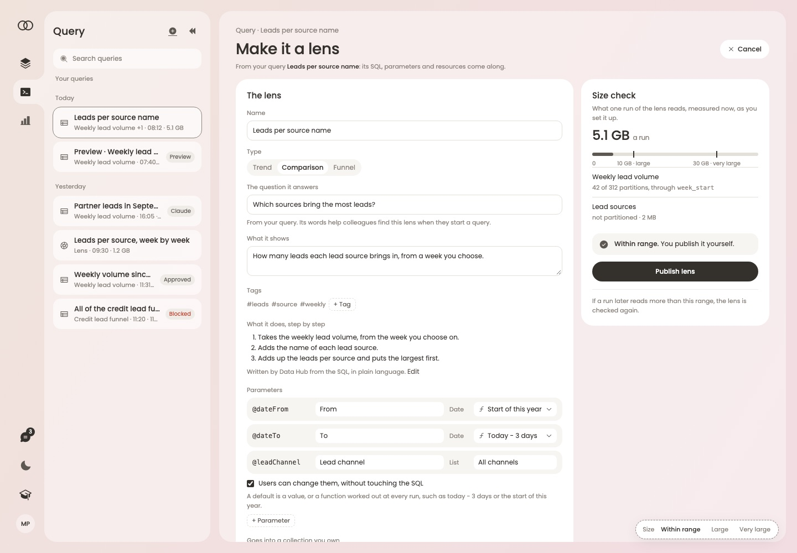

**Make it a lens** opens with what came from the query: name, question, Resources. The author adds the story and the Parameters with their defaults; the size check shows the range and what that means. Screen: `lens-new` (with `?size=within`, `large` or `verylarge`).

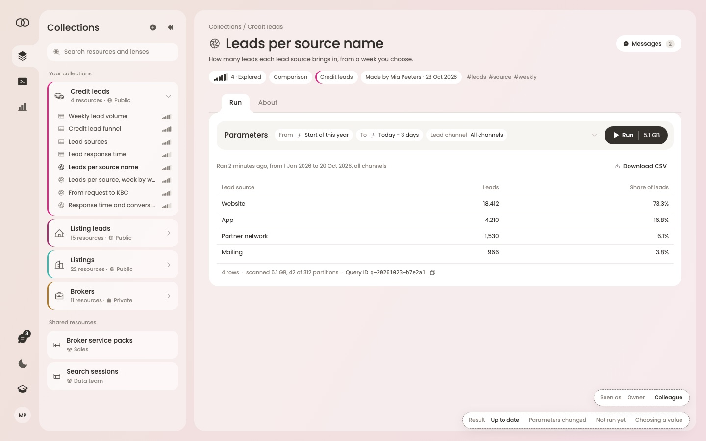

**The page of a Lens** runs it: its Parameters, Run, and the result with its Query ID. A second part, About, tells what it answers and what it does step by step. Screen: `lens`.

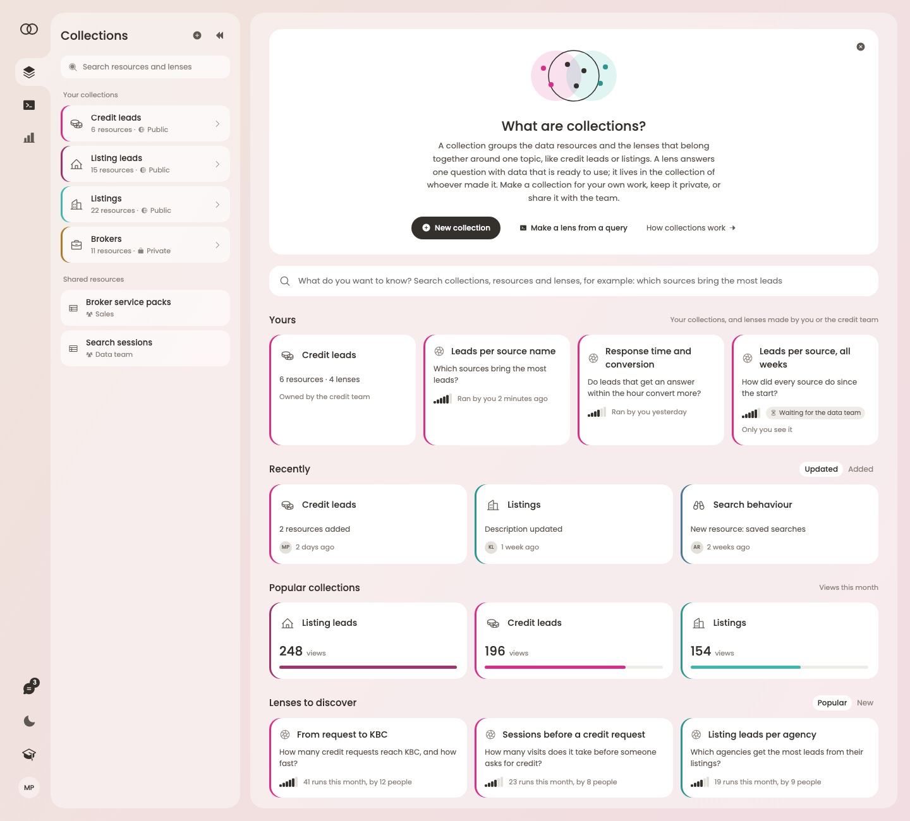

**The start of Collections** finds Lenses too: the search by question, "Yours" and Lenses to discover. Screen: `collections-start`.

### Behind it: proposal

The architecture leaves Lenses for later, "once their domain is specified". A starting point:

- **Where:** in catalogue for v1. It already owns Collections and who sees what, and a Lens's visibility depends on the Resources beneath it. A separate service can follow when Reports arrive.
- **What is stored,** append-only where it is history:

| Table | What it would keep |
| --- | --- |
| `lenses` | ID, Collection, name, short description and tags, question and story, its state (published, waiting for the Data Team, refused), the range it was accepted in, who made it and when |
| `lens_versions` | Every saved version: the SQL, the description in plain language, the Resources beneath it (from the dry run), who saved it |
| `lens_parameters` | Per version: name, type, and the default as a value or a function |
| `lens_reviews` | The Data Team's acceptance or refusal of a very large Lens, with the reason |

- **Running:** web or Claude asks catalogue for the Lens, then query runs its SQL with the chosen values bound as query parameters, never pasted into the SQL. The Query Log row carries the Lens ID, so the size of every run can be followed for [FR-LE-10](../requirements/functional/09-lenses.md#fr-le-10).
- **Visibility and Level** are computed from the Resources beneath the current version: visible when the User may see each one, Level the lowest of theirs.
- **The plain-language description** comes from a call to Claude when a version is saved; which service makes that call is part of the analysis.

### Open

- **The flavours of a Lens** next to the basic one, a query with Parameters: filtered, aggregated and others ([OP-LE-07](../requirements/functional/09-lenses.md#op-le-07)). The overview still says a Lens is always of a type that follows the chart language, with the funnel as example ([DEC-DH-13](../overview/data-hub.md#dec-dh-13), [OP-DH-09](../overview/open-themes.md#op-dh-09)), while the designed Lens returns a table. These two need to meet.
- Whether a Lens runs when it is opened ([OP-LE-06](../requirements/functional/09-lenses.md#op-le-06)), which functions a default may use ([OP-LE-08](../requirements/functional/09-lenses.md#op-le-08)). Where a Lens made from a query belongs is decided: in a Collection its author owns ([DEC-CO-20](../requirements/functional/03-collections.md#dec-co-20)); open is the author who owns none yet ([OP-CO-19](../requirements/functional/03-collections.md#op-co-19)).
- A very large Lens: does it keep running while it waits ([OP-LE-05](../requirements/functional/09-lenses.md#op-le-05)), and can it change while its Request waits ([OP-LE-09](../requirements/functional/09-lenses.md#op-le-09))?
- How the story is asked: a skill, a form or the interface ([OP-LE-01](../requirements/functional/09-lenses.md#op-le-01)).
- What happens to a Lens when a column it uses disappears, or its Resource is deregistered ([OP-DH-21](../overview/open-themes.md#op-dh-21), [OP-SR-03](../requirements/functional/04-stacks-and-resources.md#op-sr-03)).

## Messages

**Designed, all requirements Proposed.** Nothing is built. You asked to discuss Messages as a whole before they are built ([OP-CV-04](../requirements/functional/14-conversations.md#op-cv-04)); this part is the input for that. Slack is on hold.

### What it does

Messages are the margin notes of the library: colleagues talk about data, and the conversation stays attached to what it is about.

- **A Message is always about something,** a Collection, a Resource, a Lens or a query, and links to it ([FR-CV-01](../requirements/functional/14-conversations.md#fr-cv-01), [FR-CV-02](../requirements/functional/14-conversations.md#fr-cv-02)). It is placed on its object, not sent to a person ([FR-CV-03](../requirements/functional/14-conversations.md#fr-cv-03)).
- **Four kinds,** each notifying different people:

| Kind | On | Notifies |
| --- | --- | --- |
| Question | Collection, Resource, Lens | The Owner Unit of the object |
| Remark | Collection, Resource, Lens | The Owner Unit of the object |
| Signal | Resource, Lens: it is about data | The Owner Unit and the Data Team; it can become an Anomaly on the Resource Card ([FR-SR-30](../requirements/functional/04-stacks-and-resources.md#fr-sr-30)) |
| Request | A Lens, for now | The Data Team, which accepts or refuses; the decision notifies the sender ([FR-CV-08](../requirements/functional/14-conversations.md#fr-cv-08)) |

- **Who sees a Message** follows who sees its object, and none is private ([FR-CV-05](../requirements/functional/14-conversations.md#fr-cv-05)).
- **The Message Centre** in the top navigation, with the number unread: by default the Messages for you, on what your Owner Unit owns, what you wrote or answered, Signals for the Data Team, and what Data Hub itself tells you, such as a field changed since the last Confirmation ([FR-CV-06](../requirements/functional/14-conversations.md#fr-cv-06)).
- **On the object:** Messages on a Collection, Resource or Lens open in a slide-in, the Message Centre filtered on that object ([FR-CV-07](../requirements/functional/14-conversations.md#fr-cv-07)).
- **Open in context** opens the page of the object with the Message in a floating window over it, so you read the object while you answer ([FR-CV-09](../requirements/functional/14-conversations.md#fr-cv-09)).

### The screens

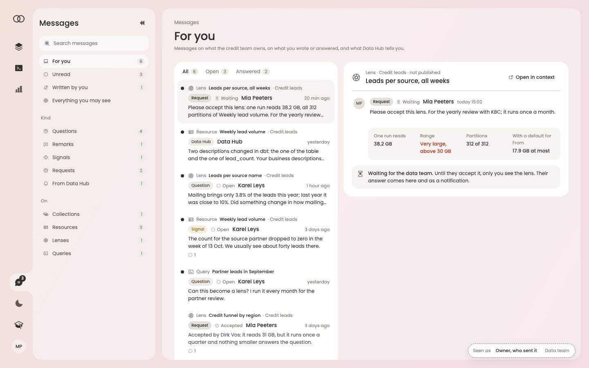

**The Message Centre.** Screen: `messages`.

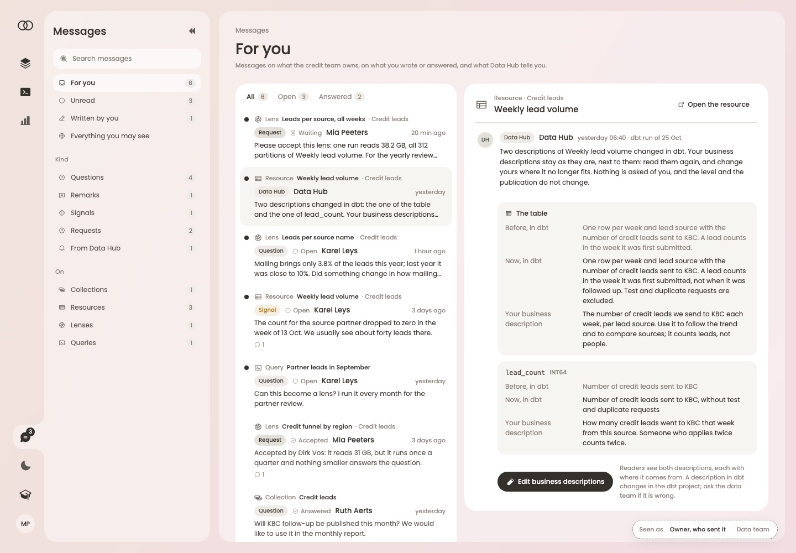

**A changed description in dbt** is told to the Owner, one Message per Resource and run: the text before and now, and their Business Description next to it. It asks for no review; "Edit business descriptions" opens the fields ([FR-RC-17](../requirements/functional/05-resource-card.md#fr-rc-17)). Screen: `messages?msg=described`.

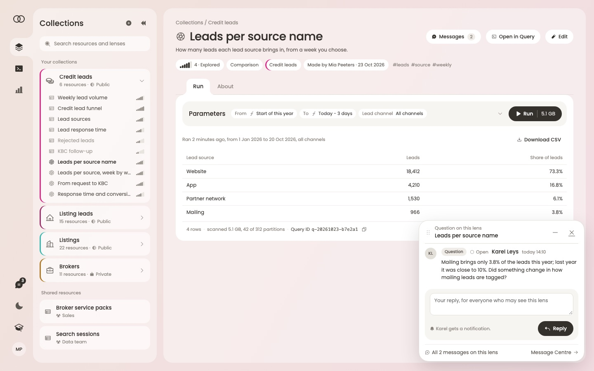

**Open in context.** The floating window can be folded and moved; the page stays usable behind it. For a Request it shows the decision of the Data Team, over the size check of the Lens. Screens: `lens-context`, `lens-new-context`.

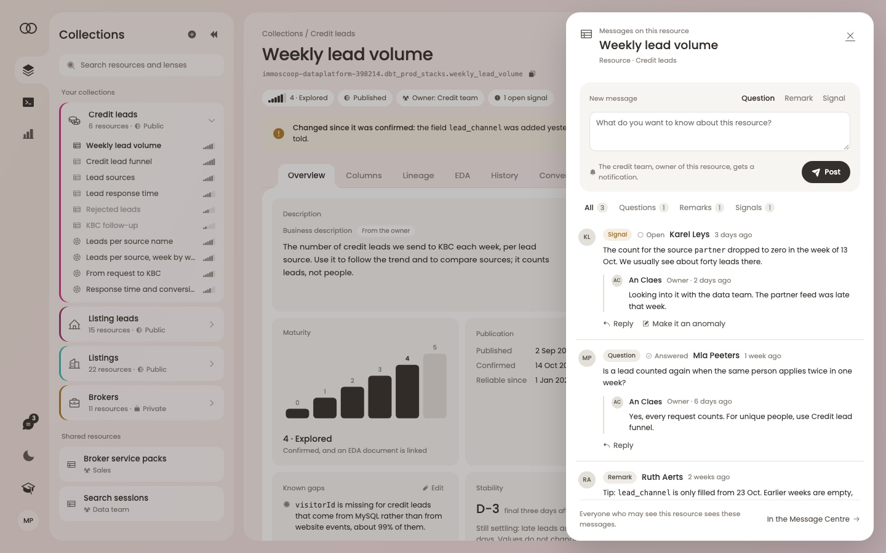

**The Messages of an object** in a slide-in, starting with a field for a new Message. Screens: `resource-messages`, `collection-messages`, `lens-messages`, `resource-conversations`.

### Behind it: proposal

**Where:** in catalogue for v1, as the architecture already plans ([OP-PF-06](../requirements/technical/00-platform.md#op-pf-06)), since catalogue owns the objects and who sees them. A query as object needs query's answer on who ran it.

| Table | What it would keep |
| --- | --- |
| `messages` | ID, the object (kind and ID), the Message it answers, kind, text, who and when; append-only, an edit is a new version |
| `requests` | Per Request: its state (waiting, accepted, refused), who decided, when, and the reason |
| `message_reads` | Per User, what they have read, for the count of unread |
| `notifications` | What Data Hub tells a User or an Owner Unit itself, such as a change since the last Confirmation, with a link to the object |

- **Who gets notified** is worked out when a Message is placed: the Owner Unit is a group ID, so a notification to an Owner reaches every member ([FR-LN-01](../requirements/functional/07-log-and-notifications.md#fr-ln-01)). For the Message Centre, matching group IDs from the Access Token is enough. For e-mail or Slack later, identity needs the members of a group: that is the group synchronisation of [FR-UM-07](../requirements/functional/02-user-management.md#fr-um-07).
- **Unread counts** are read when a page loads; no live connection is needed for v1.
- **The link in Open in context** is the address of the object's page with the Message ID in it, so it also works from an e-mail or Slack later.

### Open

- Messages as a whole, before they are built: what they are for, their kinds, and who is notified of which ([OP-CV-04](../requirements/functional/14-conversations.md#op-cv-04)).
- The channel and rhythm of notifications: in Data Hub only, e-mail or Slack, at once or as a digest ([OP-DH-20](../overview/open-themes.md#op-dh-20)).
- What follows Make it an anomaly on a Signal ([OP-SR-14](../requirements/functional/04-stacks-and-resources.md#op-sr-14)), and the Conversations tab of a Resource next to the slide-in ([OP-UX-19](../design/principles.md#op-ux-19)).
- When the object is gone, or a Resource moves to another Collection ([EC-CV-01](../requirements/functional/14-conversations.md#ec-cv-01), [EC-CV-02](../requirements/functional/14-conversations.md#ec-cv-02)).

## The learning centre

**Designed, to review.** Nothing is built, and every requirement is Proposed: 21 open, 16 withdrawn along the way. Since 25 October the Confluence page [Learning-centre: filosofie en guiding principles](https://immoscoop.atlassian.net/wiki/spaces/DATA/pages/1381138494) is the source of truth for its philosophy; the [analysis](../requirements/functional/16-learning.md) applies it in screens and flows, and records every clash as an open point instead of changing it silently ([DEC-LR-09](../requirements/functional/16-learning.md#dec-lr-09)).

### What it does

The learning centre offers knowledge when a User needs it, in small Learning Cards they go through freely, so they notice themselves that they can do something new. The cards are the topics of the [master learning plan](https://immoscoop.atlassian.net/wiki/spaces/DATA/pages/1351975139): the Compass for orientation, then four Learning Levels from easy to advanced.

- **Five steps, on a quick or a full path** ([DEC-LR-10](../requirements/functional/16-learning.md#dec-lr-10), [FR-LR-27](../requirements/functional/16-learning.md#fr-lr-27)): Why now, Core idea, See it, Check your understanding, You can now. The quick path skips the two middle steps, which stay in the row, muted. Every step fits on one screen and ends with "Next" in the same place; it never waits for an answer.
- **"I understand it" is always there** ([FR-LR-28](../requirements/functional/16-learning.md#fr-lr-28)): in the header of every step, every question screen included. It marks the card understood and closes it at any step. No question is mandatory.
- **Check your understanding** ([FR-LR-30](../requirements/functional/16-learning.md#fr-lr-30)): one question per screen, from a large set. The User predicts first, then sees the answer and why. A try-it question asks them to open something in Data Hub and say what they saw. Nothing is counted.
- **You can now** ([FR-LR-31](../requirements/functional/16-learning.md#fr-lr-31)): three fields. What the User can do now; what it brings them, the gain; and two or three ways on: deeper, a neighbouring concept, or "just apply it".
- **See it is a page of its own** ([FR-LR-29](../requirements/functional/16-learning.md#fr-lr-29)): the third step of a card, and reachable from context without the card. Its example is content of the card, never live data.
- **A marker on system text** ([FR-LR-35](../requirements/functional/16-learning.md#fr-lr-35)): ⓘ right after a button, a label or a chip that a card explains, small and in the colour of the text. Text that Users write never carries one.
- **Names carry the marker too** ([FR-LR-37](../requirements/functional/16-learning.md#fr-lr-37), [DEC-UX-59](../design/principles.md#dec-ux-59)): a name on a screen, such as `creditLead` or `visitorId`, is used as a definition, so its pop-out lists at least one Learning Card, a minimal one if there is nothing more yet. Decided on 25 October with the language principle; not in the prototypes yet. What a minimal card holds is [OP-LR-27](../requirements/functional/16-learning.md#op-lr-27).
- **The pop-out** ([FR-LR-36](../requirements/functional/16-learning.md#fr-lr-36)): resting the pointer on the text for a second opens a text bubble whose arrow points at the marker. Each card that explains the text is a tile: number and title, the gain of the card (the same sentence wherever it appears), whether and when the User saw it, and "See it". A click opens the card in a floating window over the page ([FR-LR-12](../requirements/functional/16-learning.md#fr-lr-12)).
- **The same steps everywhere** ([DEC-LR-08](../requirements/functional/16-learning.md#dec-lr-08), [FR-LR-26](../requirements/functional/16-learning.md#fr-lr-26)): on the page of the card, in the floating window, and in Claude as an MCP App. A Message can carry a card ([FR-LR-07](../requirements/functional/16-learning.md#fr-lr-07)).
- **No game** ([FR-LR-32](../requirements/functional/16-learning.md#fr-lr-32)): no score, badge, rank, streak, deadline or red dot; only a silent count of the cards seen. The badges, ranks, weekly goal, quests, team progress and Learning Profile of the first design are withdrawn.

In the rail the learning centre sits at the bottom, above the account, not among the main items, and the rail no longer has a button for settings ([DEC-UX-52](../design/principles.md#dec-ux-52), [DEC-UX-53](../design/principles.md#dec-ux-53)).

### The screens

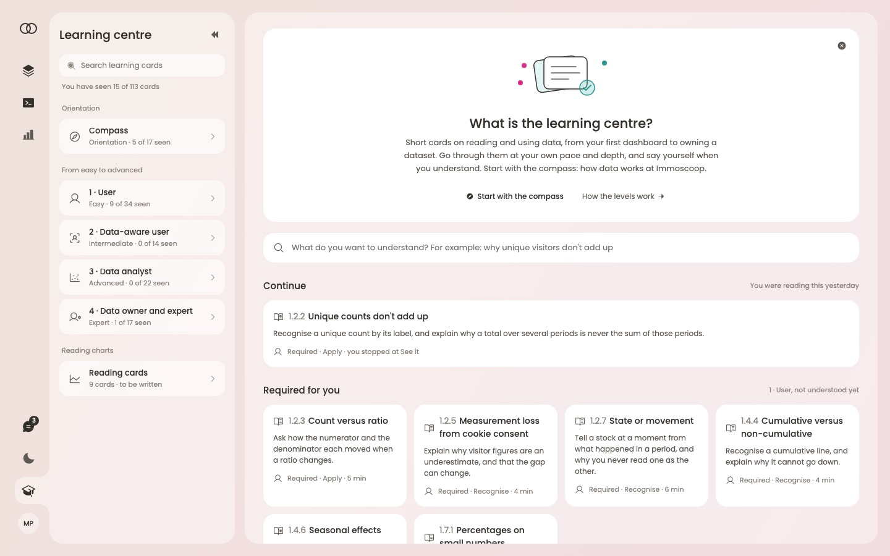

**The start screen and its panel** ([FR-LR-03](../requirements/functional/16-learning.md#fr-lr-03), [DEC-UX-38](../design/principles.md#dec-ux-38), [DEC-UX-51](../design/principles.md#dec-ux-51)). The panel is the index of every card: the Compass, then the four Learning Levels, each unfolding to its sections and cards, with how many the User has seen and a check where they understood one. On top a single count of the cards seen; no ring, no streak. Screen: `learning-start`.

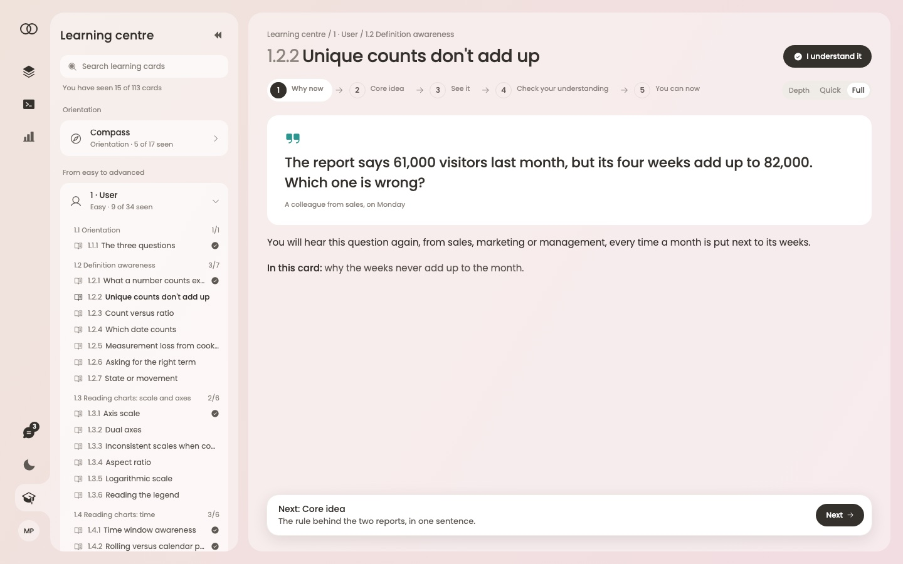

**A card in five steps** ([DEC-UX-48](../design/principles.md#dec-ux-48)). The steps stand in a row under the title, Quick and Full next to them; "I understand it" is the only button of the header. The bar at the foot, always in the same place, says what Next brings. Screen: `learning-card` (with `?step=core`, `see`, `check` or `can`, and `?path=quick`).

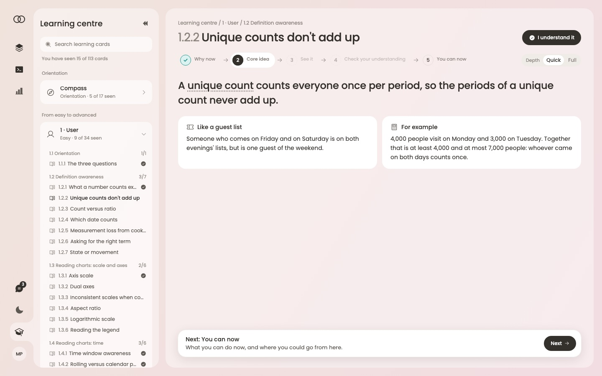

**The quick path** mutes See it and Check your understanding in the row; a click still opens them. Core idea holds the decision rule, one metaphor and one example.

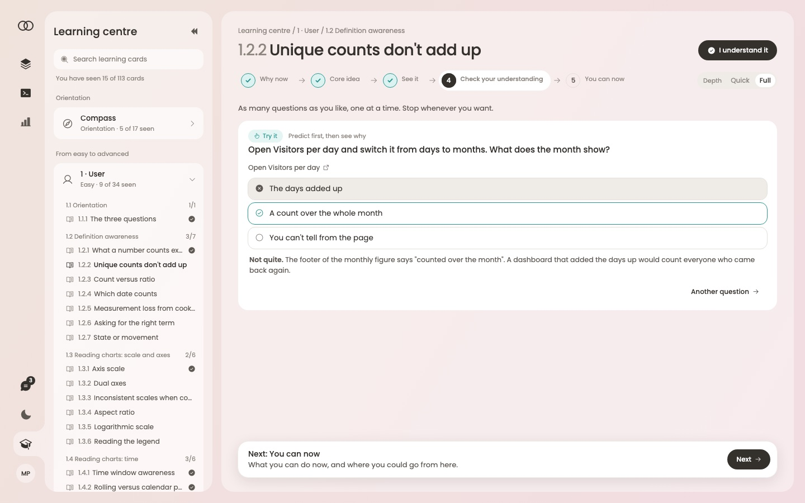

**Check your understanding** ([FR-LR-30](../requirements/functional/16-learning.md#fr-lr-30)). One question per screen; a click shows the answer and why, then "Another question", for as long as the User likes. This one is a try-it question, with a link to what to open. Whether the card says "Not quite." before the why is open ([OP-LR-19](../requirements/functional/16-learning.md#op-lr-19)).

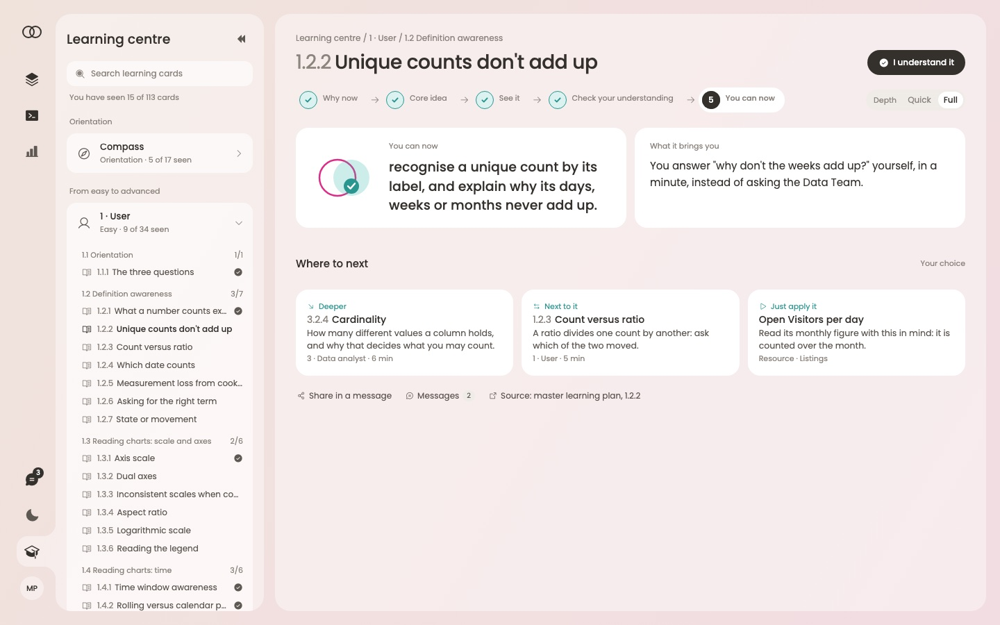

**You can now** ([DEC-UX-49](../design/principles.md#dec-ux-49)): the three fields, and at the foot "Share in a message" and the Messages on the card. Whether the small drawing of two circles stays is open ([OP-LR-21](../requirements/functional/16-learning.md#op-lr-21)).

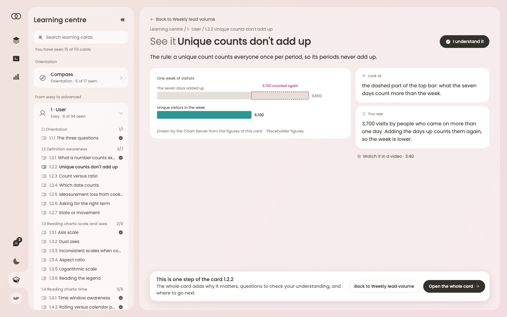

**See it on its own** ([DEC-UX-50](../design/principles.md#dec-ux-50)): the example of the card with "Look at …" and "You see …", the way back to where the User came from, and the whole card. Screen: `learning-see`.

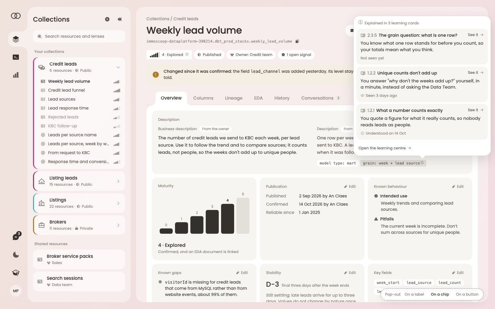

**The marker and its pop-out** ([DEC-UX-56](../design/principles.md#dec-ux-56), [DEC-UX-57](../design/principles.md#dec-ux-57)). On the page of a Resource, its Level, its grain and "Mark as seen" carry ⓘ. The pop-out opens after a one-second hold, so passing over the page opens nothing; keyboard focus opens it at once. Screens: `resource-detail` (rest the pointer on the grain), `learning-hover`.

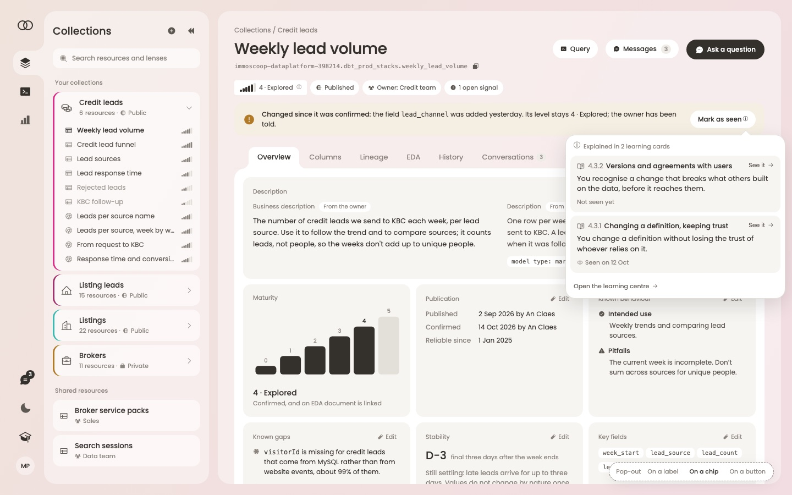

**On a button** the pop-out works the same, and the button keeps its own action; on a touch screen only a tap on the marker opens it.

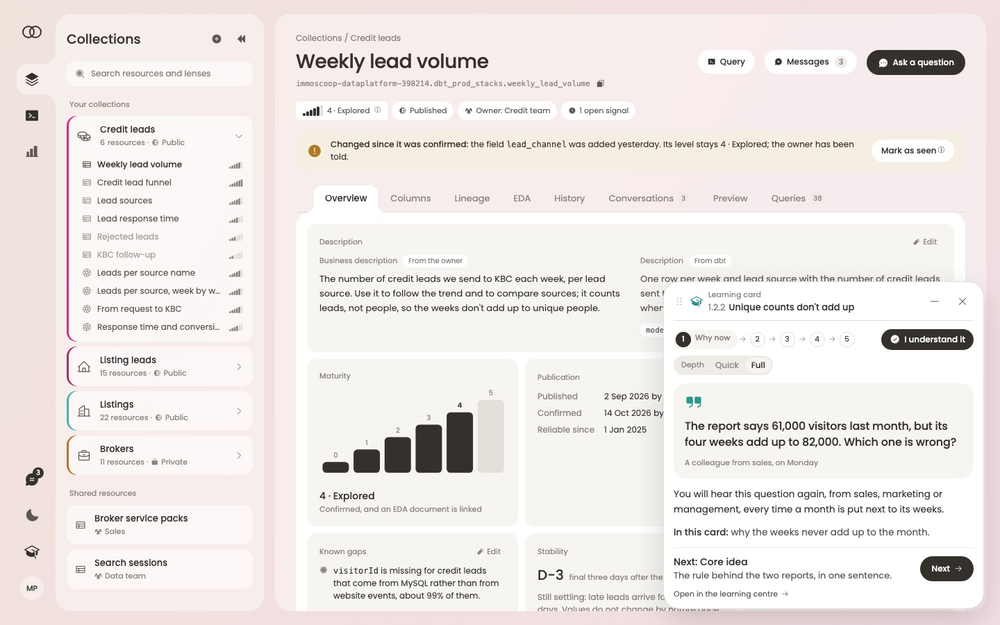

**Opening in place** ([DEC-UX-42](../design/principles.md#dec-ux-42), [FR-LR-12](../requirements/functional/16-learning.md#fr-lr-12)): a click on a tile opens the card in a floating window, as a Message opens in context; the User stays on the page. Screen: `learning-float`.

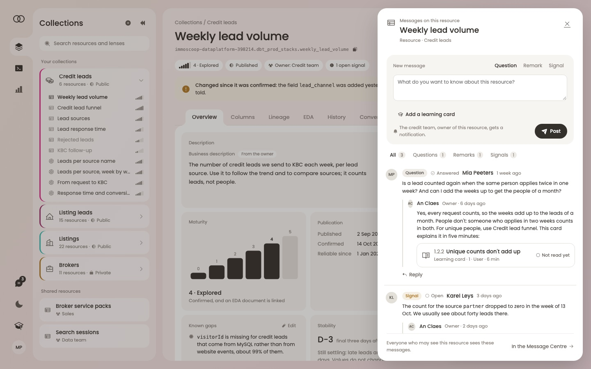

**In a Message** ([DEC-UX-41](../design/principles.md#dec-ux-41), [FR-LR-07](../requirements/functional/16-learning.md#fr-lr-07)): "Add a learning card" next to a new Message; the card shows as a small tile with its Learning Level and whether the reader read it. Screen: `learning-message`.

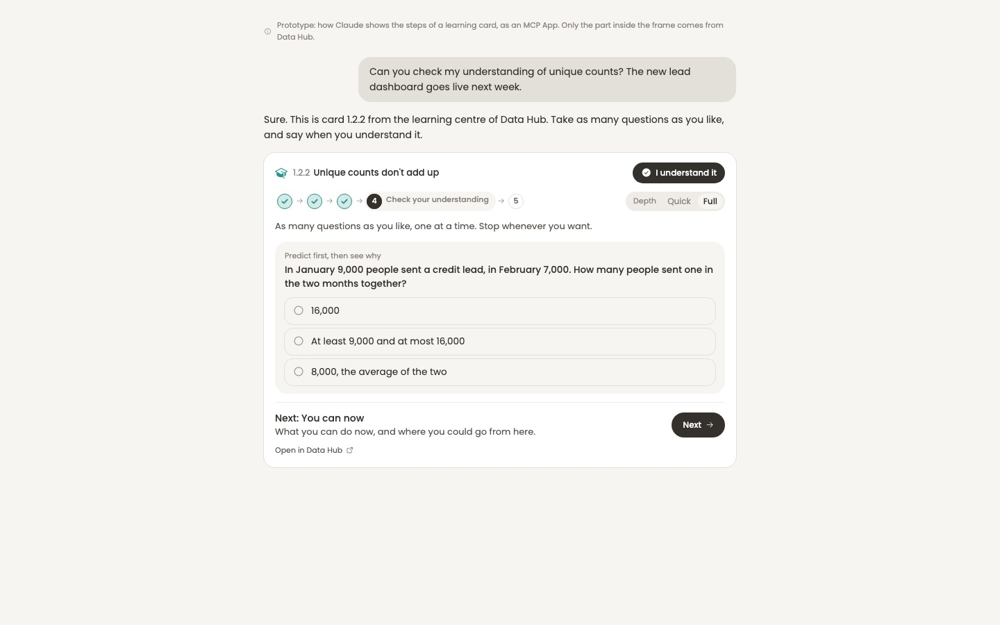

**In Claude** ([FR-LR-26](../requirements/functional/16-learning.md#fr-lr-26)): only the number and title above the five steps, "Next" at the foot, and "Open in Data Hub". Screen: `learning-mcp`.

### Behind it: proposal

**Where:** in catalogue, as a schema `learning`, beside the Messages that can carry a card; the architecture names no service for it yet. Where the cards themselves come from is open ([OP-LR-01](../requirements/functional/16-learning.md#op-lr-01)). Whatever the source, web and mcp show the same card, as its steps stand alone ([DEC-LR-08](../requirements/functional/16-learning.md#dec-lr-08)).

| Table | What it would keep |
| --- | --- |
| `cards` | Per card its number, Learning Level, section, title, the five steps, the gain and the questions, with a version; filled from wherever the cards live |
| `card_progress` | Per User and card, when they first saw it and when they understood it. Nothing else: no answers and no score ([FR-LR-32](../requirements/functional/16-learning.md#fr-lr-32)) |

- **The markers** stand on system text, so they can live in the code of web, next to the text they mark, each with the numbers of its cards. The pop-out then reads the titles, the gains and the progress of the User in one call. Who keeps them right is [OP-LR-26](../requirements/functional/16-learning.md#op-lr-26).
- **The endpoints,** as a start: the cards, and one card by its number; the progress of the signed-in User; marking a card seen, and marking or unmarking it understood. mcp calls the same ones for its MCP App, acting for the signed-in User ([OP-LR-16](../requirements/functional/16-learning.md#op-lr-16)).
- **The example in See it** is drawn by semgraph from figures in the card, never from a query ([FR-LR-29](../requirements/functional/16-learning.md#fr-lr-29)); whether that keeps it stable enough is [OP-LR-23](../requirements/functional/16-learning.md#op-lr-23).
- **The progress of a User** is readable only by that User until [OP-LR-04](../requirements/functional/16-learning.md#op-lr-04) decides who else sees it.

### Open

- **Clashes with the principles page,** to decide on that page, not in the analysis: "required" cards and the priority of the master learning plan ([OP-LR-18](../requirements/functional/16-learning.md#op-lr-18)); "Not quite." as a verdict ([OP-LR-19](../requirements/functional/16-learning.md#op-lr-19)); where a video fits in five steps ([OP-LR-20](../requirements/functional/16-learning.md#op-lr-20)); the drawing on You can now ([OP-LR-21](../requirements/functional/16-learning.md#op-lr-21)); a few cards around a theme, now that quests are gone ([OP-LR-22](../requirements/functional/16-learning.md#op-lr-22)); semgraph drawing the example ([OP-LR-23](../requirements/functional/16-learning.md#op-lr-23)).
- **The example of a decision rule on the principles page** says a Lens inherits the highest Level beneath it; in Data Hub it is the lowest. The page needs a correction ([OP-LR-24](../requirements/functional/16-learning.md#op-lr-24)).
- **The content:** where the cards live ([OP-LR-01](../requirements/functional/16-learning.md#op-lr-01)), their language, decided on 25 October: Dutch sentences with English names ([OP-LR-02](../requirements/functional/16-learning.md#op-lr-02), [NFR-LOC-08](../requirements/non-functional/localisation.md#nfr-loc-08)), the videos ([OP-LR-03](../requirements/functional/16-learning.md#op-lr-03)) and the questions ([OP-LR-17](../requirements/functional/16-learning.md#op-lr-17)). The master learning plan has no questions yet.
- **Who places the markers** on system text, which cards each lists, and how they stay right when a card or a screen changes, and what a minimal card for a name holds ([OP-LR-26](../requirements/functional/16-learning.md#op-lr-26), [OP-LR-27](../requirements/functional/16-learning.md#op-lr-27)).
- **The progress:** who sees what a User understood ([OP-LR-04](../requirements/functional/16-learning.md#op-lr-04)), what happens to "understood" when a card changes ([OP-LR-09](../requirements/functional/16-learning.md#op-lr-09)), and whether Claude counts ([OP-LR-16](../requirements/functional/16-learning.md#op-lr-16)).
- **Whether a card is ever a condition for an action,** such as publishing, the open decision of the principles page ([OP-LR-08](../requirements/functional/16-learning.md#op-lr-08)).

## Charts

**Built.** The Chart Server, semgraph, moved into Data Hub with its history and runs on uat; today's web app shows its gallery. Lenses and Reports do not draw with it yet, since they are not built.

### What it does

- **semgraph draws every chart of Data Hub by what it means,** following the chart language: for the web app, for Claude, and for others such as dashboards and documents ([DEC-PF-23](../requirements/technical/00-platform.md#dec-pf-23)).
- **It checks a request before drawing:** what would mislead is refused; what only informs the reader less well is drawn with a warning.
- **It never computes over days itself,** so it can never take an average of averages. The data warehouse computes the values per block (a mean with its standard deviation, a median with its quartiles, and the count); semgraph checks and draws, with title, reading cue and footer. Vega-Lite only draws what semgraph hands it.
- **It tells which question each chart answers,** with its contract and examples, so a person or Claude can choose. Eleven charts today: KPI tile and status, moving-window and calendar charts for an average, a median and a ratio, period comparison, category comparison and distribution.
- **Every chart carries the Level** of what lies beneath it, and a static chart carries the Level at the moment it was drawn, with the date and a link to the current Level ([DEC-DH-37](../overview/data-hub.md#dec-dh-37)).

### The screens

The gallery in today's web app (`#/charts`) lists each chart with the question it answers and its first example, and per chart all its examples, light and dark, in every size, including the ones semgraph refuses and why. The new design has no screen for charts yet; they will appear inside Lenses and Reports.

### Behind it

**Service:** semgraph. **Stores:** nothing; the data comes in the request.

| Endpoint | Purpose |
| --- | --- |
| `GET /semgraphs`, `GET /semgraphs/{id}` | The charts there are, the question each answers, its contract and examples |
| `POST /validate` | Checks a request without drawing |
| `POST /render` | Draws the chart as SVG, or refuses it (422) |
| `POST /mcp` | Its own MCP server for Claude, with an MCP App that shows the chart in the conversation |
| `GET /openapi.json`, `GET /health` | The API, and the health check |

**Open to everyone, without login** ([DEC-PF-24](../requirements/technical/00-platform.md#dec-pf-24)): it holds no data and has access to none, so pages of any site may call it from the browser. A load balancer with a rate limit per address is to go in front of it once Data Hub has a domain name; until then at most two instances run.

**The old version on AWS** keeps running for its current users until they move over.

### Open

- The requirements of semgraph, REQ-000 to REQ-107, are still in Dutch in its own register: translate them into `docs/requirements` or keep them apart ([OP-PF-16](../requirements/technical/00-platform.md#op-pf-16)).
- How semgraph knows who calls it within Data Hub, and where its MCP tools live, now that everyone may call it ([OP-PF-17](../requirements/technical/00-platform.md#op-pf-17)).
- The switch from AWS for its current users ([OP-PF-18](../requirements/technical/00-platform.md#op-pf-18)), and a domain name for the rate limit ([OP-PF-08](../requirements/technical/00-platform.md#op-pf-08)).
- Whether Lenses render in the browser or as SVG on the server ([OP-DH-11](../overview/open-themes.md#op-dh-11)); with semgraph drawing SVG, the second is already the practice.
- How Anomalies show as annotations on charts that cover their period ([OP-DH-15](../overview/open-themes.md#op-dh-15)).

## Access, visibility and confidentiality

**Built** for Collections and for unpublished Resources. **Specified or designed** for the rest. **Confidentiality is a concept still to be worked out**, on purpose not yet requirements ([OP-PL-01](../requirements/functional/12-permissions-and-library-cards.md#op-pl-01)).

### Who sees what, in one table

Every service decides this itself, on every request, with the Groups in the Access Token. The Level restricts nothing.

| Object | Who sees it | State |
| --- | --- | --- |
| Public Collection | Every User | Built |
| Private Collection | Its Owner Unit and the Data Team; to anyone else it does not exist | Built |
| Resource without a Collection | The Data Team | Built |
| Resource, not published | The Owner Unit of its Collection and the Data Team | Built |
| Resource, published | Everyone who sees its Collection | Specified |
| Lens | Whoever may see every Resource beneath it ([DEC-CO-16](../requirements/functional/03-collections.md#dec-co-16)) | Proposed |
| The SQL of a Lens | Its Owner Unit, and the Data Team through the Query Log | Proposed |
| A query and its SQL | Whoever ran it and the Data Team ([DEC-LN-01](../requirements/functional/07-log-and-notifications.md#dec-ln-01)) | Specified |
| A Message | Whoever sees its object; none is private | Proposed |
| The registry: Nodes, lineage, search | The Data Team, for now ([OP-AR-05](../requirements/functional/01-artifact-registry.md#op-ar-05)) | Built |
| Charts | Everyone; semgraph holds no data | Built |

### A link to something you may not see

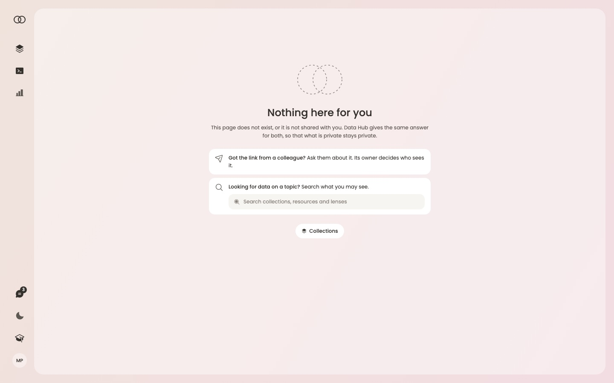

A link to anything a User may not see opens the same page as a link to nothing ([FR-CO-32](../requirements/functional/03-collections.md#fr-co-32), [DEC-UX-32](../design/principles.md#dec-ux-32)). It says what to do instead: ask whoever sent the link, or search. It has no Ask for access, since that would tell the object exists. Whether asking for access should be possible, and how, is open ([OP-CO-13](../requirements/functional/03-collections.md#op-co-13)). Screen: `not-found`.

### Library Cards, for Excel

Excel stays possible as a window on Data Hub: the data of a Lens comes in as a feed through Power Query, without direct BigQuery access ([DEC-DH-46](../overview/data-hub.md#dec-dh-46)). In the pilot, Power Query signs in with a personal key per User, the Library Card, which can be revoked and renewed; a Microsoft work account is a possible later step ([DEC-DH-47](../overview/data-hub.md#dec-dh-47)).

**Behind it, planned:** identity issues a Library Card and keeps only its hash; `@datahub/auth` exchanges it at identity for a short Access Token with the User's current Groups, so a feed sees exactly what its User sees today. Nothing of this is built, and no screen is designed for issuing or revoking a card ([OP-DH-25](../overview/open-themes.md#op-dh-25)). Whether Lenses in Excel are enough for the pilot is to test with Hannelore ([OP-DH-36](../overview/open-themes.md#op-dh-36)).

### Confidentiality

**Where it stands.** The workshop of 2026-10-22 gave the starting points ([REQ-DH-CONF](../workshops/2026-10-22-data-agents-and-governance.md#req-dh-conf)), and decided to work it out first as a concept on Confluence:

- Next to its maturity, every Resource gets a level of confidentiality.
- The level is set in dbt, in `meta`, so it travels with the model and is reviewed in a merge.
- A Lens or a Report takes the highest level of what lies beneath it.
- A matrix of levels against who may do what; the levels themselves are still to be chosen.

The overview also lists an access classification on the Resource Card, such as personal data, and an access axis ([OP-DH-22](../overview/open-themes.md#op-dh-22)). The concept is to say how those three relate.

**Questions the concept can answer,** gathered from the rest of this document:

1. **What a level restricts.** Today only the Collection and the Publication decide who sees a Resource. Does a level narrow that further (for example, personal data only for named groups), or does it govern what may be done with the data (export, Excel, Claude), or both?
2. **Lowering.** The workshop says a level can only be lowered, never raised, downstream, and also that a Lens takes the highest level beneath it. Whether an aggregating Lens may carry a lower level than its Resources, and who decides that, needs one rule.
3. **Columns or tables.** A level per Resource is simple. A level per column (an e-mail address in an otherwise open table) is finer, but asks more of the query check and of BigQuery.
4. **Claude.** Through the MCP server, query results go to Claude. Whether some levels never go to Claude, or only in aggregate, is part of the matrix.
5. **Excel and exports.** A feed leaves Data Hub. The matrix can say which levels may go out through a Library Card.

**Where it would land in the build,** whatever the answers:

- **registry** reads the level from `meta` with the rest of the Node; nothing new to fetch.
- **catalogue** applies it in the one rule of who sees what, and shows it on the Resource Card.
- **query** enforces it on every query, through the same visibility check, before anything runs; the Query Log is already restricted, as SQL can hold values.
- **BigQuery** can back it up, with authorised views or policy tags, so the account of query cannot read what Data Hub would refuse. This ties in with how query gets its read access at all ([OP-SR-10](../requirements/functional/04-stacks-and-resources.md#op-sr-10), [OP-PF-14](../requirements/technical/00-platform.md#op-pf-14)).

None of the designed screens shows a level of confidentiality yet.

### Open

- Confidentiality as a concept ([OP-PL-01](../requirements/functional/12-permissions-and-library-cards.md#op-pl-01)), the access axis ([OP-DH-22](../overview/open-themes.md#op-dh-22)), and the roles: what a reader, an Owner and the Data Team may do ([OP-DH-24](../overview/open-themes.md#op-dh-24)).
- Asking for access to something you may not see ([OP-CO-13](../requirements/functional/03-collections.md#op-co-13)).
- Library Cards: issuing, revoking, renewing ([OP-DH-25](../overview/open-themes.md#op-dh-25)).

## Look and feel

**Designed.** The new design is 60 decisions in [principles.md](../design/principles.md), its values in `tokens.css`, and 33 prototype screens in plain HTML and CSS. Today's web app is built in an earlier look; none of the new design is built ([DEC-UX-01](../design/principles.md#dec-ux-01): no Figma, the design lives in code next to the requirements).

### Navigation and structure

- **A rail on the left with a slide-out panel,** not navigation at the top ([DEC-UX-02](../design/principles.md#dec-ux-02)). The sections: Collections, Query and Reports; Lenses live in their Collections ([DEC-UX-66](../design/principles.md#dec-ux-66)). At the bottom: Messages with its count unread, the theme, the learning centre and the account; there is no button for settings ([DEC-UX-52](../design/principles.md#dec-ux-52), [DEC-UX-53](../design/principles.md#dec-ux-53)).
- **Each section opens on a start screen; the panel is its index** ([DEC-UX-03](../design/principles.md#dec-ux-03)). One panel for Collections and what they hold: a Collection unfolds in place, so switching is one click ([DEC-UX-10](../design/principles.md#dec-ux-10)).
- **Every item has the icon of its kind,** the same for every item of that kind, with its name on one line and its Level ([DEC-UX-11](../design/principles.md#dec-ux-11)). An unpublished Resource is a lighter grey.
- **Layers:** a sheet over a page for a task that belongs to it (publishing, your own queries), a slide-in for the Messages of an object, and a floating window for Open in context, which does not dim the page ([DEC-UX-30](../design/principles.md#dec-ux-30)).

### Colour, themes, type

- **Colour only on content** (charts, Collections, Resources), never on navigation. Hover and active are shades of grey.
- **Warm greys,** a deliberate step away from the cool greys of the brandbook, because Data Hub is an internal tool. Text is warm dark grey, never black.
- **Collections** each get a colour from a palette of six: magenta, bordeaux and teal from the brand, ochre, slate blue and olive added. The palette is one configuration file that colours are added to over time; it is tuned after testing on uat ([DEC-UX-60](../design/principles.md#dec-ux-60)). It shows as a thin bar on the left edge of its card and its page.
- **Signal colour** (ochre) only for a state that calls for action, such as a dropped Level; **urgent** (red) only for Resources waiting for a Collection and a run above the approval threshold.
- **Light and dark,** following the system by default; the User can switch. **Dutch by default,** with English available ([DEC-DH-65](../overview/data-hub.md#dec-dh-65)); see Language.
- **Icons:** Phosphor as the one family, the light weight favoured; the other weights stay possible ([DEC-CO-19](../requirements/functional/03-collections.md#dec-co-19)). Today's app still uses Tabler ([OP-CO-16](../requirements/functional/03-collections.md#op-co-16)).

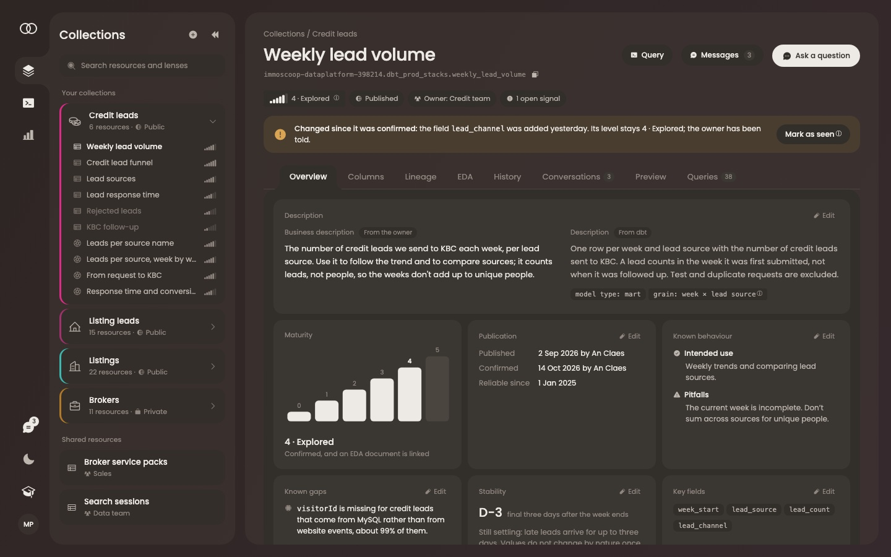

### Backgrounds and their photo sets

- **The default background** is a gradient of three colours, drifting slowly ([DEC-UX-05](../design/principles.md#dec-ux-05)).
- **A picture can take its place:** the painted counterpart of a photo, a watercolour made from the photo itself, drifting as slowly; the frames then blur it lightly ([DEC-UX-34](../design/principles.md#dec-ux-34), [DEC-UX-37](../design/principles.md#dec-ux-37)).
- **Sets with a story:** each photo has a title, a few lines and who took it. The light and the dark theme each have their own set; a photo is never darkened for the dark theme ([DEC-UX-36](../design/principles.md#dec-ux-36)). You provide the photos and write the stories; the prototype's stories are stand-ins.
- **So far:** light set Alpenglow and Spring snow; dark set Lights on, your blue-hour photo made into a night picture. The first ski painting, with the lift, has no photo in the set yet.

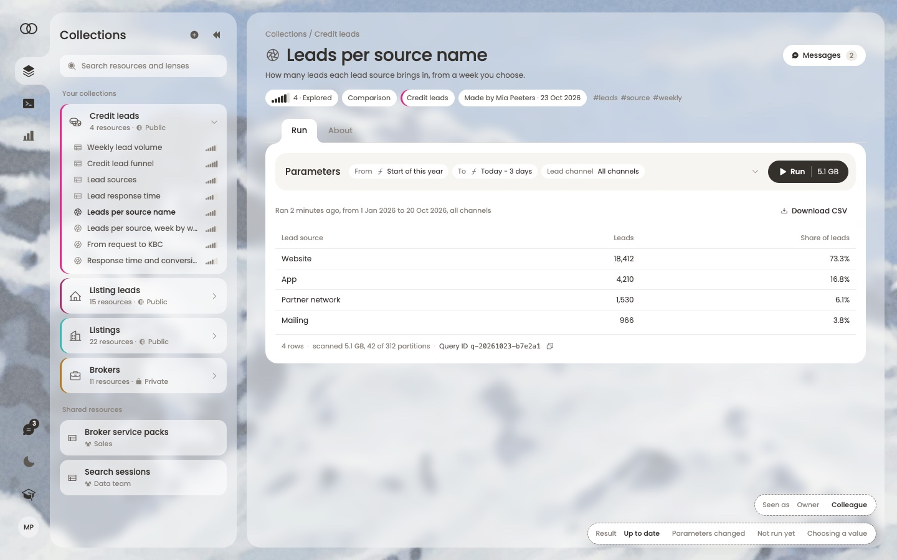

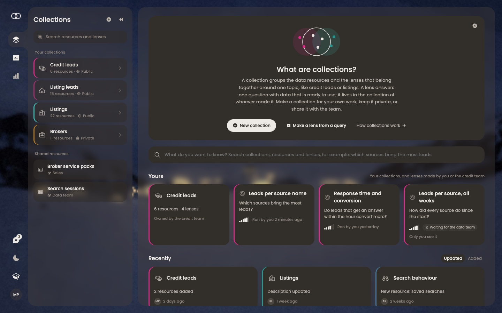

Any screen shows a picture with `?bg=alpenglow`, `?bg=spring` or `?bg=ski`; in the dark theme it shows the village at night.

### Behind it

The design is independent of the stack: its values are CSS variables, its prototypes plain HTML and CSS, and the glass of the sign-in is one CSS property (`backdrop-filter`). The pictures are static files served with the web app. Building the design starts from [handover-prompt.md](../design/handover-prompt.md), once the designs are final.

### Open

- **The stack that builds it:** React with Mantine, as built today and decided in [DEC-PF-06](../requirements/technical/00-platform.md#dec-pf-06), or Svelte, as other repositories of Immoscoop use ([OP-UX-10](../design/principles.md#op-ux-10)).
- **The look:** [DEC-PF-22](../requirements/technical/00-platform.md#dec-pf-22) asks for the brandbook colours, teal on larger areas, and one light look. This design has warm greys, colour on content only, and a dark theme. Whether the design replaces those parts ([OP-UX-09](../design/principles.md#op-ux-09)).
- **Where Charts and the registry search go** in the navigation ([OP-UX-11](../design/principles.md#op-ux-11)); **capitals in the interface** or sentence case ([OP-UX-12](../design/principles.md#op-ux-12)); **settings of a User** in the browser or in Data Hub ([OP-UX-13](../design/principles.md#op-ux-13)); **mobile** ([OP-UX-06](../design/principles.md#op-ux-06)).
- **The background of a User:** who chooses it, whether a User adds their own, the default, and how the sign-in picks its photo ([OP-UX-20](../design/principles.md#op-ux-20)).
- The start screens of Reports ([OP-UX-03](../design/principles.md#op-ux-03)).
- **Dutch prototypes:** a translation table with a switch to English, or the texts translated in place ([OP-UX-23](../design/principles.md#op-ux-23)).

## Language

**Decided, not built.** On 25 October you decided the language principle ([DEC-DH-65](../overview/data-hub.md#dec-dh-65)); its rules are in [localisation.md](../requirements/non-functional/localisation.md). It replaces the English-only interface of [DEC-DH-02](../overview/data-hub.md#dec-dh-02) and [FR-SR-15](../requirements/functional/04-stacks-and-resources.md#fr-sr-15). Today's web app and the prototypes are still English.

### What it does

- **Names are English and never translated** ([NFR-LOC-01](../requirements/non-functional/localisation.md#nfr-loc-01)): the terms of the Domain Model, such as `creditLead` or `visitorId`, the kinds of assets and the Levels, and the names of fields and columns as they are in dbt. There are no Dutch synonyms for them ([NFR-LOC-04](../requirements/non-functional/localisation.md#nfr-loc-04)), and the Glossary is their source and explanation ([NFR-LOC-05](../requirements/non-functional/localisation.md#nfr-loc-05)).
- **Sentences are Dutch by default, with English available** ([NFR-LOC-06](../requirements/non-functional/localisation.md#nfr-loc-06)): everything the interface says around the names, the texts of the Log included ([NFR-LOC-10](../requirements/non-functional/localisation.md#nfr-loc-10)). The translation files hold sentences only ([NFR-LOC-02](../requirements/non-functional/localisation.md#nfr-loc-02)), and the MCP server follows the same rule ([NFR-LOC-07](../requirements/non-functional/localisation.md#nfr-loc-07)).
- **A name always stands in a sentence that says what it is** ([NFR-LOC-03](../requirements/non-functional/localisation.md#nfr-loc-03)), and carries the marker of the learning centre with at least a minimal Learning Card ([FR-LR-37](../requirements/functional/16-learning.md#fr-lr-37)).
- **A name a User gives** is a name: the Display Name of a Resource, the name of a Collection, a Lens or a query keeps its spelling and is never translated ([NFR-LOC-11](../requirements/non-functional/localisation.md#nfr-loc-11)).
- **Learning Cards** have Dutch sentences and English names ([NFR-LOC-08](../requirements/non-functional/localisation.md#nfr-loc-08)); **metadata written by people** is in the language of the writer, Dutch as a guideline ([NFR-LOC-09](../requirements/non-functional/localisation.md#nfr-loc-09)).

### Behind it

web and mcp read their sentences from translation files, a key per sentence with its Dutch and English text; names are never in them. Which language a User gets is a setting of the User, Dutch unless chosen otherwise. Nothing of this is built.

### Open

- Whether Learning Cards ever come in English too ([OP-DH-40](../overview/open-themes.md#op-dh-40)), whether Dutch metadata is a guideline or a rule ([OP-DH-41](../overview/open-themes.md#op-dh-41)), and where the list of names lives ([OP-DH-42](../overview/open-themes.md#op-dh-42)).
- Where a User chooses their language, now that the rail has no button for settings ([OP-DH-46](../overview/open-themes.md#op-dh-46), [OP-UX-13](../design/principles.md#op-ux-13)).
- How the prototypes become Dutch ([OP-UX-23](../design/principles.md#op-ux-23)).

## Claude and the MCP server

**Built:** connecting Claude, signing in through identity, and one tool, `who_am_i`. **Specified or proposed:** everything Claude does with data.

### What it does

- **Claude works with data through the MCP of Data Hub only,** not through an open BigQuery connector ([FR-CH-03](../requirements/functional/13-channels.md#fr-ch-03)). It sees only what its User may see, with the same Pre-flights, thresholds and Query Log as the web app.
- **Free SQL through Claude** over visible Resources only ([FR-SR-26](../requirements/functional/04-stacks-and-resources.md#fr-sr-26)), and Claude mentions the Level of every Resource it uses ([FR-MR-10](../requirements/functional/06-maturity-and-release.md#fr-mr-10)).
- **Lenses and Reports look the same in Claude** as in Data Hub, as an MCP App: an interactive window in the conversation, built from the same component ([DEC-DH-15](../overview/data-hub.md#dec-dh-15)).
- **The steps of a Learning Card show in Claude too,** as an MCP App built from the same blocks as the page of the card ([DEC-LR-08](../requirements/functional/16-learning.md#dec-lr-08), [FR-LR-26](../requirements/functional/16-learning.md#fr-lr-26)); designed, not specified.
- **Documentation in the interface:** the repository explains how Data Hub works, and the web app and the MCP server point to the right passage in context ([FR-CH-04](../requirements/functional/13-channels.md#fr-ch-04)); updating it is part of every feature ([FR-CH-05](../requirements/functional/13-channels.md#fr-ch-05)).

### Connecting Claude today

1. In Claude: **Settings → Connectors → Add custom connector**; depending on the plan, an Owner first adds it for the organisation.
2. Give it a name such as `Data Hub (uat)` and the address of the MCP server, ending in `/mcp`.
3. Connect: Claude registers itself at identity, and a window opens to sign in with your Immoscoop account.
4. Ask "Who am I in Data Hub?": Claude calls `who_am_i`.

Claude stays connected for 30 days after its last use. No screen tells a User this yet; the address has to be asked for ([OP-CH-02](../requirements/functional/13-channels.md#op-ch-02)).

### Behind it

**Application:** mcp, on Cloud Run, publicly reachable because Claude calls it from Anthropic's servers. **Stores:** nothing.

- It is an OAuth client of identity: without a valid Access Token it answers `401` with a pointer to identity as the place to sign in. Only Claude's callback addresses may register.
- `/mcp` speaks Streamable HTTP without sessions: every request gets its own MCP server, for the User of its token, so nothing of one User can reach another.
- It holds no logic of its own: every tool calls catalogue, registry or query with the User's token.

**Proposal for the tools,** following the order of the build:

| Tool | Calls | Ready when |
| --- | --- | --- |
| Search Resources and Lenses | catalogue | Publication is built |
| Read a Resource Card | catalogue, registry | The Resource Card is built |
| Read lineage | registry | The registry opens beyond the Data Team ([OP-AR-05](../requirements/functional/01-artifact-registry.md#op-ar-05)) |
| Preview a Resource, run SQL | query | query is built, with the Pre-flight and Query Log |
| Run a Lens, as an MCP App | catalogue, query, semgraph | Lenses are built |
| Place a Message | catalogue | Messages are built |
| Go through a Learning Card, as an MCP App | catalogue, semgraph | The learning centre is built |

semgraph has its own MCP server, open to everyone. Whether Data Hub's charts go through it or through mcp is [OP-PF-17](../requirements/technical/00-platform.md#op-pf-17).

### Open

- The page that tells a User how to connect Claude ([OP-CH-02](../requirements/functional/13-channels.md#op-ch-02)), and where the in-context documentation lives ([OP-CH-01](../requirements/functional/13-channels.md#op-ch-01)).
- The relation to our own manifest MCP server under construction and to the broader connector rollout ([OP-DH-32](../overview/open-themes.md#op-dh-32)).
- Which levels of confidentiality may reach Claude (see Access, visibility and confidentiality).

## Not designed yet, or postponed

Five domains have no requirements yet, and two have only a few proposals. None of them has a screen. What each would touch matters most here: postponing one is fine as long as what depends on it is known.

| Domain | Scope | Where it stands | What depends on it |
| --- | --- | --- | --- |
| [EDA](../requirements/functional/15-eda.md) | How an exploration runs and is linked to a Resource | To be specified ([OP-MR-01](../requirements/functional/06-maturity-and-release.md#op-mr-01)); builds on the EDA framework on Confluence | Level 4, Explored; the EDA tab of a Resource; the descriptive form of documentation; the key fields on the Resource Card |
| [Checks and monitoring](../requirements/functional/08-checks-and-monitoring.md) | Automatic checks after a Change, derived from the EDA, and the monitors of an Owner | To be specified ([OP-MR-02](../requirements/functional/06-maturity-and-release.md#op-mr-02), [OP-DH-19](../overview/open-themes.md#op-dh-19)) | Level 5, Monitored; checks and incidents on the Resource Card ([FR-RC-14](../requirements/functional/05-resource-card.md#fr-rc-14)) |
| [Reports](../requirements/functional/10-reports.md) | Lenses bundled around a question, with text and shared Parameters | To be specified; the section is in the navigation, without a start screen ([OP-UX-03](../design/principles.md#op-ux-03)) | Lenses first; Parameters named so they combine across Lenses ([DEC-DH-11](../overview/data-hub.md#dec-dh-11)) |
| [Beta and promotion](../requirements/functional/11-beta-and-promotion.md) | Concepts business defines itself, and how they harden into a Resource | To be specified ([OP-DH-07](../overview/open-themes.md#op-dh-07), [OP-DH-08](../overview/open-themes.md#op-dh-08), [OP-DH-26](../overview/open-themes.md#op-dh-26), [OP-BP-01](../requirements/functional/11-beta-and-promotion.md#op-bp-01)) | Level 0, Beta; whether a Lens can define a new concept |
| [Permissions and library cards](../requirements/functional/12-permissions-and-library-cards.md) | Roles, access and personal keys | To be specified; confidentiality first as a concept ([OP-PL-01](../requirements/functional/12-permissions-and-library-cards.md#op-pl-01)) | Excel; what may reach Claude; the access axis |
| [Log and notifications](../requirements/functional/07-log-and-notifications.md) | The Log Catalogue, the Message Centre, who hears what, through which channel | Two Specified (the Query Log), four Proposed | Alerts on a drop, warnings on a change, Requests, notifying Consumers of a changed field |
| [Channels](../requirements/functional/13-channels.md) | Through which channels each asset is released | Five Proposed | Excel feeds, exports, HTML reports |

### Postponing EDA: what it means

Postponing EDA keeps the Release in two steps intact: Available, Described and Confirmed do not depend on it, so steps 1 to 7 of the story can all be built. What it changes:

- **The ladder stops at Confirmed in practice.** Explored needs a linked EDA document ([FR-MR-03](../requirements/functional/06-maturity-and-release.md#fr-mr-03)), and Monitored, if checks follow from the EDA, waits as well. The Level stays honest: it shows what exists.
- **The EDA tab** of a Resource stays out of the design for now ([OP-UX-04](../design/principles.md#op-ux-04)).
- **The descriptive documentation** (how the data actually behaves) has no home yet. Known Behaviour and Anomalies on the Resource Card can carry part of it in the meantime.
- **Semantics on semantics** ([OP-BP-01](../requirements/functional/11-beta-and-promotion.md#op-bp-01)) asks for EDA and monitoring on a source before business derives a concept from it, so Beta and promotion wait too.

The overview still says EDAs move to Data Hub as their source, and lists EDA results as part of the documentation of every Resource. A short note there would record the postponement.

### Other things the design does not cover yet

- **The Domain Model:** browsing to an Entity, and the Entities derived from the manifest and the lineage ([FR-SR-23](../requirements/functional/04-stacks-and-resources.md#fr-sr-23), [OP-DH-06](../overview/open-themes.md#op-dh-06)), and the relationships between Resources, whose Entity reference is now set at step 2 ([FR-CO-33](../requirements/functional/03-collections.md#fr-co-33)), with the cardinality under discussion ([OP-RC-07](../requirements/functional/05-resource-card.md#op-rc-07) to [OP-RC-17](../requirements/functional/05-resource-card.md#op-rc-17)), ([FR-RC-08](../requirements/functional/05-resource-card.md#fr-rc-08) to [FR-RC-10](../requirements/functional/05-resource-card.md#fr-rc-10)).
- **Usage:** which Lenses, Reports and feeds use a Resource, for the Data Team ([OP-DH-04](../overview/open-themes.md#op-dh-04)); the Query Log is the natural source.
- **The Lineage and History tabs** of a Resource ([OP-UX-04](../design/principles.md#op-ux-04)).
- **Issuing a Library Card** and **connecting Claude** ([OP-CH-02](../requirements/functional/13-channels.md#op-ch-02)): no screen yet.
- **Mobile** and narrow windows ([OP-UX-06](../design/principles.md#op-ux-06)).
- **Slack:** on hold.

## Decisions before the technical analysis

Of the 145 open points, most can wait. This section sorts the ones that matter for the analysis and the (re)build into three groups. The sorting is a proposal: move a point to another group where you see it differently.

### A. Decide now: they shape the data model or the split of services

| # | Question | Why it cannot wait | Proposal |
| --- | --- | --- | --- |
| A1 | **Confidentiality: the shape of the concept** ([OP-PL-01](../requirements/functional/12-permissions-and-library-cards.md#op-pl-01), [OP-DH-22](../overview/open-themes.md#op-dh-22)) | Per Resource or per column, and whether it restricts seeing or doing, decides where it is enforced: catalogue, query, BigQuery | Settle the shape now (per Resource, set in dbt `meta`, enforced in the same visibility check); the levels and the matrix can follow |
| A2 | **How query reads Resources** ([OP-SR-10](../requirements/functional/04-stacks-and-resources.md#op-sr-10), [OP-PF-14](../requirements/technical/00-platform.md#op-pf-14)) | Nothing can be queried without it, and it is where A1 meets BigQuery | Decide together with A1 |
| A3 | **The stack and the look of the web app** ([OP-UX-10](../design/principles.md#op-ux-10), [OP-UX-09](../design/principles.md#op-ux-09)) | The rebuild of web starts from it; the design itself is stack-independent | Decide before the first screen is built |
| A4 | **What a Lens is: flavours or types** ([OP-LE-07](../requirements/functional/09-lenses.md#op-le-07), [OP-DH-09](../overview/open-themes.md#op-dh-09)) | The overview's Lens follows the chart language; the designed one returns a table. The tables of Lenses depend on which | Start with the basic flavour (a query with Parameters), with room for a type later |
| A5 | **Messages as a whole** ([OP-CV-04](../requirements/functional/14-conversations.md#op-cv-04)) and where they live ([OP-PF-06](../requirements/technical/00-platform.md#op-pf-06)) | The warnings on a change and the Requests for a very large Lens run through them | In catalogue for v1; in Data Hub only, no e-mail or Slack yet |
| A6 | **What Described requires** ([OP-MR-03](../requirements/functional/06-maturity-and-release.md#op-mr-03); which part of the Fingerprint drops a Resource is decided: none, [OP-MR-05](../requirements/functional/06-maturity-and-release.md#op-mr-05)) | The Level computation and the Confirmation table depend on it | Decide with the Resource Card |
| A7 | **Who reads the registry** ([OP-AR-05](../requirements/functional/01-artifact-registry.md#op-ar-05)) | Lineage on a Resource, and Claude's lineage tool, need it for everyone | Everyone, for the Nodes beneath what they may see |
| A8 | **Who sees the queries of others** ([OP-SR-13](../requirements/functional/04-stacks-and-resources.md#op-sr-13)) | Shapes the Query Log's read rules | Who, when, how and what it read; never the SQL |
| A9 | **The Data Team in a Collection it does not own** ([OP-CO-12](../requirements/functional/03-collections.md#op-co-12)) | Today's code lets it edit every Collection | **Decided on 25 October:** the Data Team may do everything in every Collection ([DEC-CO-18](../requirements/functional/03-collections.md#dec-co-18)) |
| A10 | **Settings of a User** ([OP-UX-13](../design/principles.md#op-ux-13)) and **capitals in the interface** ([OP-UX-12](../design/principles.md#op-ux-12)) | Small, but cheaper before the first screen than after | Settings in Data Hub; sentence case in the interface. The rail no longer has a button for settings (DEC-UX-53), so where the switches of a User live belongs here too |
| A11 | **The relations of a Resource and their cardinality** ([OP-RC-05](../requirements/functional/05-resource-card.md#op-rc-05), [OP-RC-07](../requirements/functional/05-resource-card.md#op-rc-07) to [OP-RC-17](../requirements/functional/05-resource-card.md#op-rc-17)) | Step 2 and the tables of catalogue get fields for them, and the relationships of [FR-RC-09](../requirements/functional/05-resource-card.md#fr-rc-09) follow from them | Recorded at step 2 ([FR-CO-33](../requirements/functional/03-collections.md#fr-co-33)), derived from the docs for Colleciónes models. What a relation records about its cardinality is under discussion: eleven questions, each with a proposal |
| A12 | **The language principle in the screens** ([OP-UX-23](../design/principles.md#op-ux-23), [OP-DH-46](../overview/open-themes.md#op-dh-46)) | Every sentence of the design moves to a translation file, and the language of a User needs a place | A translation table in the prototypes, Dutch by default with a switch; the language among the settings of a User (A10) |

### B. Postpone on purpose, and write down that it is postponed

| Topic | Points | What waits with it |
| --- | --- | --- |
| EDA | [OP-MR-01](../requirements/functional/06-maturity-and-release.md#op-mr-01) | Level 4, the EDA tab, descriptive documentation |
| Checks and monitoring | [OP-MR-02](../requirements/functional/06-maturity-and-release.md#op-mr-02), [OP-DH-19](../overview/open-themes.md#op-dh-19) | Level 5, checks on the Resource Card |
| Reports | Domain 10, [OP-UX-03](../design/principles.md#op-ux-03) | Bundling Lenses; shared Parameters |
| Beta and promotion | [OP-DH-07](../overview/open-themes.md#op-dh-07), [OP-DH-08](../overview/open-themes.md#op-dh-08), [OP-DH-26](../overview/open-themes.md#op-dh-26), [OP-DH-28](../overview/open-themes.md#op-dh-28), [OP-BP-01](../requirements/functional/11-beta-and-promotion.md#op-bp-01) | Level 0, concepts made by business |
| The Domain Model | [OP-DH-06](../overview/open-themes.md#op-dh-06), [OP-RC-05](../requirements/functional/05-resource-card.md#op-rc-05) | Browsing to Entities; the Entity reference of a Resource moved to step 2 (A11) |
| Notifications outside Data Hub | [OP-DH-20](../overview/open-themes.md#op-dh-20), Slack | E-mail, Slack, digests; the group synchronisation can wait with it |
| Deprecating, asking for access | [OP-SR-16](../requirements/functional/04-stacks-and-resources.md#op-sr-16), [OP-CO-13](../requirements/functional/03-collections.md#op-co-13) | Nothing in the first build |
| Data Hub and Domain Hub | [OP-DH-31](../overview/open-themes.md#op-dh-31) | Whether they merge |
| Mobile | [OP-UX-06](../design/principles.md#op-ux-06) | Narrow screens |

Excel and the Library Card ([OP-DH-25](../overview/open-themes.md#op-dh-25), [OP-DH-36](../overview/open-themes.md#op-dh-36)) fit here too, unless the pilot with Hannelore needs them early.

### C. Decide during the build: values and details that do not change the shape

- **Limits and thresholds:** the byte limit, the rows of the Preview, the Pre-flight and Lens thresholds ([OP-SR-07](../requirements/functional/04-stacks-and-resources.md#op-sr-07)); the frequency of the group synchronisation ([OP-UM-05](../requirements/functional/02-user-management.md#op-um-05)).
- **Lenses in detail:** runs on opening ([OP-LE-06](../requirements/functional/09-lenses.md#op-le-06)), functions for defaults ([OP-LE-08](../requirements/functional/09-lenses.md#op-le-08)), a very large Lens while it waits ([OP-LE-05](../requirements/functional/09-lenses.md#op-le-05), [OP-LE-09](../requirements/functional/09-lenses.md#op-le-09)), how the story is asked ([OP-LE-01](../requirements/functional/09-lenses.md#op-le-01)).
- **Words and conventions:** Display Names ([OP-SR-01](../requirements/functional/04-stacks-and-resources.md#op-sr-01)), Known Gaps and Stability ([OP-RC-03](../requirements/functional/05-resource-card.md#op-rc-03), [OP-RC-04](../requirements/functional/05-resource-card.md#op-rc-04)), the Log Catalogue ([OP-SR-02](../requirements/functional/04-stacks-and-resources.md#op-sr-02)).
- **The edge cases** of each domain ([OP-AR-03](../requirements/functional/01-artifact-registry.md#op-ar-03), [OP-UM-06](../requirements/functional/02-user-management.md#op-um-06), [OP-CO-05](../requirements/functional/03-collections.md#op-co-05), [OP-SR-09](../requirements/functional/04-stacks-and-resources.md#op-sr-09)), worked out with each part as it is built.
- **Platform:** domain names ([OP-PF-08](../requirements/technical/00-platform.md#op-pf-08)), a Terraform plan in pull requests ([OP-PF-13](../requirements/technical/00-platform.md#op-pf-13)), the semgraph points ([OP-PF-16](../requirements/technical/00-platform.md#op-pf-16) to [OP-PF-18](../requirements/technical/00-platform.md#op-pf-18)).
- **Design details:** the palette and icons are decided ([OP-UX-05](../design/principles.md#op-ux-05), [OP-UX-07](../design/principles.md#op-ux-07), [OP-UX-08](../design/principles.md#op-ux-08)); open are moving the icons ([OP-CO-16](../requirements/functional/03-collections.md#op-co-16)) and their weight ([OP-CO-17](../requirements/functional/03-collections.md#op-co-17)), the background of a User ([OP-UX-20](../design/principles.md#op-ux-20)), the page to connect Claude ([OP-CH-02](../requirements/functional/13-channels.md#op-ch-02)), where the in-app documentation lives ([OP-CH-01](../requirements/functional/13-channels.md#op-ch-01)).
- **Language:** English Learning Cards later ([OP-DH-40](../overview/open-themes.md#op-dh-40)), Dutch metadata as a guideline ([OP-DH-41](../overview/open-themes.md#op-dh-41)), the list of names ([OP-DH-42](../overview/open-themes.md#op-dh-42)).
- **The learning centre:** its clashes with the principles page are decided on that page ([OP-LR-18](../requirements/functional/16-learning.md#op-lr-18) to [OP-LR-24](../requirements/functional/16-learning.md#op-lr-24)); where the cards live ([OP-LR-01](../requirements/functional/16-learning.md#op-lr-01)), now that their language is decided ([OP-LR-02](../requirements/functional/16-learning.md#op-lr-02)), what a minimal card holds ([OP-LR-27](../requirements/functional/16-learning.md#op-lr-27)), and who places the markers ([OP-LR-26](../requirements/functional/16-learning.md#op-lr-26)) before its first card is built.

### Found while writing this review

These are places where the documents do not say the same thing yet. None blocks the review; each needs a small fix or a decision.

1. **The query service page** still says executed queries are not stored ([DEC-SR-18](../requirements/functional/04-stacks-and-resources.md#dec-sr-18)); the Query Log replaced that decision ([DEC-LN-01](../requirements/functional/07-log-and-notifications.md#dec-ln-01)).
2. **The architecture's data table** lists Groups and memberships in the schema of identity. They are not stored today: identity reads them from Workspace at every sign-in and renewal. They arrive with the group synchronisation.
3. **Data Hub's account reads only the Stacks** ([DEC-DH-08](../overview/data-hub.md#dec-dh-08)), while a Resource can now be any exposed table, in a Stack or not. Recorded as [OP-SR-10](../requirements/functional/04-stacks-and-resources.md#op-sr-10); see A2.
4. **A Lens is always of a type that follows the chart language** ([DEC-DH-13](../overview/data-hub.md#dec-dh-13)), while the designed Lens returns a table; see A4.
5. **Confidentiality** is "only lowered, never raised, downstream" and "a Lens takes the highest level beneath it" in the same workshop note; see A1.
6. **EDA** is still described in the overview as part of the documentation of every Resource; a note would record that it is postponed.

## Sources

Everything in this review comes from the repository [immoscoop-dataplatform-datahub](https://github.com/maximethenextimmoscoopbe/immoscoop-dataplatform-datahub), branch `uat`, plus the code and migrations of the services, read on 2026-10-24 and brought up to date on 2026-10-25. Where this review and a source differ, the source wins.

| What | Where |
| --- | --- |
| What Data Hub is, and the decisions that span domains | [overview/data-hub.md](../overview/data-hub.md), [overview/open-themes.md](../overview/open-themes.md) |
| The Defined Terms and the Levels | [definitions.md](../definitions.md) |
| The functional requirements, per domain | [requirements/functional/](../requirements/functional) |
| The language principle | [requirements/non-functional/localisation.md](../requirements/non-functional/localisation.md), and the translation reference in [definitions.md](../definitions.md) |
| The technical requirements and platform decisions | [requirements/technical/00-platform.md](../requirements/technical/00-platform.md), and one file per built domain |
| Status per requirement, with the commits | [requirements/traceability.md](../requirements/traceability.md) (generated) |
| The architecture, one page per service | [architecture/](../architecture), with build and deploy and the GCP setup |
| The design rules, values and screens | [design/principles.md](../design/principles.md), `design/tokens.css`, `design/screens/` (open `index.html`) |
| How the design is to be built | [design/handover-prompt.md](../design/handover-prompt.md) |
| The workshop on data agents and governance | [workshops/2026-10-22-data-agents-and-governance.md](../workshops/2026-10-22-data-agents-and-governance.md) |
| The philosophy of the learning centre, and its topics | [Learning-centre: filosofie en guiding principles](https://immoscoop.atlassian.net/wiki/spaces/DATA/pages/1381138494) and the [master learning plan](https://immoscoop.atlassian.net/wiki/spaces/DATA/pages/1351975139), on Confluence |
| The newest screens, waiting to be merged | [Pull request 31](https://github.com/maximethenextimmoscoopbe/immoscoop-dataplatform-datahub/pull/31) |
| The seven steps with their screens | [Walkthrough on Confluence](https://immoscoop.atlassian.net/wiki/spaces/DATA/pages/1380253717) |
| What is stored, as built | `services/<name>/src/migrations` in the repository |
| The infrastructure | `infra/` in the repository (Terraform) |

## Every open point

Every point that was open in the documentation, 142 still open, generated on 2026-10-25 from the files under `docs/` and brought up to date since, plus three things to confirm at the end. Each has its ID; the ID links to the point in its source file, where the context is. To answer, write your answer under the point (or just tick it when the proposal is right); I then record the decision in the source file, where the point gets `[x]` and *Decided on …*, and this list follows.

Where to start: the points that shape the build are in group A of **Decisions before the technical analysis**; the newest are the cardinality questions of step 2 ([OP-RC-07](../requirements/functional/05-resource-card.md#op-rc-07) to [OP-RC-17](../requirements/functional/05-resource-card.md#op-rc-17)) and the language points.

### Open themes

Source: [overview/open-themes.md](../overview/open-themes.md) · 39 open

- [ ] **[OP-DH-03](../overview/open-themes.md#op-dh-03)** · Work out what happens to Users, Lenses, Reports and feeds when a Resource disappears from the Stacks or is renamed.
- [ ] **[OP-DH-04](../overview/open-themes.md#op-dh-04)** · Work out how Data Hub keeps track, per Resource, of which Lenses, Reports, feeds and EDAs use it, for example via the tables touched in the BigQuery job log of its own account.
- [ ] **[OP-DH-05](../overview/open-themes.md#op-dh-05)** · Find out whether model contracts on the mart views in the Stacks make sense, so that structural Changes become a deliberate step.
- [ ] **[OP-DH-06](../overview/open-themes.md#op-dh-06)** · Work out how Entities from the Domain Model are mapped onto the manifest of the dbt project of the Domain Model.
- [ ] **[OP-DH-07](../overview/open-themes.md#op-dh-07)** · Work out whether and how a Beta Concept or a beta report can be shared outside its own context before it is hardened.
- [ ] **[OP-DH-08](../overview/open-themes.md#op-dh-08)** · Agree how a Beta Concept relates to a Lens: when does a Lens define a new concept, and is it therefore at Beta?
- [ ] **[OP-DH-09](../overview/open-themes.md#op-dh-09)** · Work out the Lens types. Provisional candidates: funnel, trend, breakdown, distribution, ranking, number, cohort and list.
- [ ] **[OP-DH-10](../overview/open-themes.md#op-dh-10)** · Work out how Parameters are named and typed, and whether Entity Parameters such as agency or office take their type from the Domain Model.
- [ ] **[OP-DH-11](../overview/open-themes.md#op-dh-11)** · Choose whether Lenses render in the browser (interactive) or on the server as SVG (guaranteed identical), and whether the rendering in Claude follows the light or dark mode of the host.
- [ ] **[OP-DH-12](../overview/open-themes.md#op-dh-12)** · Exercise: for each asset (Resource, Lens, Report), map through which channels it is released (Data Hub itself, Claude as an MCP App, HTML report, Excel connector) and which form each channel carries, data or visual.
- [ ] **[OP-DH-13](../overview/open-themes.md#op-dh-13)** · Settle the final name of the dataset; the working name is `dbt_prod_stacks`.
- [ ] **[OP-DH-14](../overview/open-themes.md#op-dh-14)** · Work out the schema of the Resource Card in Postgres, with migrations in the Data Hub repository.
- [ ] **[OP-DH-15](../overview/open-themes.md#op-dh-15)** · Work out how Anomalies, with their period, appear as annotations on Lenses and charts that cover that period.
- [ ] **[OP-DH-16](../overview/open-themes.md#op-dh-16)** · Find out whether the Resource Cards are exported periodically to BigQuery, so that reporting on the Catalogue is possible as well.
- [ ] **[OP-DH-17](../overview/open-themes.md#op-dh-17)** · At build time, record how the dbt projects (dbt-prod and Colleciónes) and their prod job are identified in dbt Cloud.
- [ ] **[OP-DH-18](../overview/open-themes.md#op-dh-18)** · Find out whether dbt Cloud can send a webhook after a successful run, or whether Data Hub polls after the scheduled time.
- [ ] **[OP-DH-19](../overview/open-themes.md#op-dh-19)** · Decide which automatic checks follow from the EDA and the monitors, and what happens when a check fails.
- [ ] **[OP-DH-20](../overview/open-themes.md#op-dh-20)** · Choose the channel and rhythm of notifications: Slack, email or only in Data Hub, immediately or as a digest.
- [ ] **[OP-DH-21](../overview/open-themes.md#op-dh-21)** · Work out what happens to a Lens when a column it uses disappears.
- [ ] **[OP-DH-22](../overview/open-themes.md#op-dh-22)** · Work out access: how Owner Units and the access axis affect what someone sees through Data Hub. *Note of 2026-10-19: who sees a Collection and its Resources is decided in [DEC-CO-10](../requirements/functional/03-collections.md#dec-co-10) to [DEC-CO-12](../requirements/functional/03-collections.md#dec-co-12); the access axis remains open.*
- [ ] **[OP-DH-24](../overview/open-themes.md#op-dh-24)** · Define the roles in Data Hub: what a reader, an Owner and the Data Team may do. *Note of 2026-10-19: for Collections, see [DEC-CO-08](../requirements/functional/03-collections.md#dec-co-08) and [DEC-CO-11](../requirements/functional/03-collections.md#dec-co-11).*
- [ ] **[OP-DH-25](../overview/open-themes.md#op-dh-25)** · Work out the issuing, revoking and renewing of personal keys, the Library Cards.
- [ ] **[OP-DH-26](../overview/open-themes.md#op-dh-26)** · Work out where and how promotion happens technically, from a concept in Data Hub to a Resource in the Stacks.
- [ ] **[OP-DH-27](../overview/open-themes.md#op-dh-27)** · Decide the form of the request to the Data Team, and how it is linked to the Owner Unit, the Collection and the Domain Model.
- [ ] **[OP-DH-28](../overview/open-themes.md#op-dh-28)** · Work out how the working version is realigned to the new Resource after promotion.
- [ ] **[OP-DH-29](../overview/open-themes.md#op-dh-29)** · Draw up the functional and technical analysis of Data Hub, following the example of the one for the Chart Server. *Migration note: this analysis is now being built up under [requirements](../requirements/README.md).*
- [ ] **[OP-DH-30](../overview/open-themes.md#op-dh-30)** · Decide the scope of the documentation: which forms, in which order, and what the pilot needs.
- [ ] **[OP-DH-31](../overview/open-themes.md#op-dh-31)** · Decide whether Data Hub stays a separate application next to Domain Hub or merges with it.
- [ ] **[OP-DH-32](../overview/open-themes.md#op-dh-32)** · Decide the relation to our own manifest MCP server under construction, and to the broader connector rollout.
- [ ] **[OP-DH-33](../overview/open-themes.md#op-dh-33)** · Choose the form of the communication between colleagues. *Note of 2026-10-23: every Message carries its Subject, the object it is about, a Resource, a Lens, a query or any other, links to it, and can be found by it ([DEC-CV-01](../requirements/functional/14-conversations.md#dec-cv-01), [FR-CV-04](../requirements/functional/14-conversations.md#fr-cv-04)); the form remains open.*
- [ ] **[OP-DH-34](../overview/open-themes.md#op-dh-34)** · Check with Sibe and Philippe whether Colleciónes can provide `model_type` and `grain`.
- [ ] **[OP-DH-35](../overview/open-themes.md#op-dh-35)** · Connect to the existing Cloud Run setup of the Colleciónes server: deploy, internal reachability under internal-immoscoop.be, and monitoring. *Note of 2026-10-17: Data Hub is publicly reachable ([DEC-PF-10](../requirements/technical/00-platform.md#dec-pf-10)), so internal reachability under internal-immoscoop.be no longer applies; deploy and monitoring remain open.*
- [ ] **[OP-DH-36](../overview/open-themes.md#op-dh-36)** · In the pilot with Hannelore, test whether Lenses in Excel are enough, or whether business also needs whole Resources.
- [ ] **[OP-DH-37](../overview/open-themes.md#op-dh-37)** · Bring the description of Q&A in the Glossary (Woordenlijst, Confluence) in line with the principle that is still open.
- [ ] **[OP-DH-39](../overview/open-themes.md#op-dh-39)** · Later, on the roadmap: a process for data onboarding with new features, the chain IT → Data → business, which touches Data Hub through taking in new Resources (post-it 6).
- [ ] **[OP-DH-40](../overview/open-themes.md#op-dh-40)** · Decide whether Learning Cards ever come in English too. The first version is Dutch ([NFR-LOC-08](../requirements/non-functional/localisation.md#nfr-loc-08)); decide after the pilot. The structure of a card, its five steps, does not depend on the language, so this closes nothing off.
- [ ] **[OP-DH-41](../overview/open-themes.md#op-dh-41)** · Decide whether metadata written by people is Dutch as a guideline or as a hard rule ([NFR-LOC-09](../requirements/non-functional/localisation.md#nfr-loc-09)). Proposal: a guideline, without validation.
- [ ] **[OP-DH-42](../overview/open-themes.md#op-dh-42)** · Decide where the list of names lives ([NFR-LOC-05](../requirements/non-functional/localisation.md#nfr-loc-05)). Proposal: derived from the Domain Model, plus a fixed list of the kinds of assets, so that the analysis does not keep a list by hand.
- [ ] **[OP-DH-46](../overview/open-themes.md#op-dh-46)** · Decide where a User chooses their language ([NFR-LOC-06](../requirements/non-functional/localisation.md#nfr-loc-06)), now that the rail has no button for settings ([DEC-UX-53](../design/principles.md#dec-ux-53), [OP-UX-13](../design/principles.md#op-ux-13)).

### Data Hub design principles

Source: [design/principles.md](../design/principles.md) · 14 open

- [ ] **[OP-UX-01](../design/principles.md#op-ux-01)** · **Popular:** which measure? Views, the number of colleagues, or use in Lenses.
- [ ] **[OP-UX-02](../design/principles.md#op-ux-02)** · **Shared resources** in the panel: align with the model of Publication (visibility hangs on Publication, ownership runs through the Collection).
- [ ] **[OP-UX-03](../design/principles.md#op-ux-03)** · **Start screens** for Lenses and Reports. *Note of 2026-10-24: Lenses is designed (`lenses-start`, withdrawn on 2026-10-26, [DEC-UX-33](../design/principles.md#dec-ux-33)); Reports remains.* *Note of 2026-10-26: the start screen of Lenses is withdrawn with its section ([DEC-UX-66](../design/principles.md#dec-ux-66)); Reports remains.*
- [ ] **[OP-UX-04](../design/principles.md#op-ux-04)** · **Tabs** Lineage, EDA, History, Conversations and Preview. *Note of 2026-10-22: Conversations is designed ([resource-conversations](../design/screens/resource-conversations.html)); Lineage, EDA, History and Preview remain.* *Note of 2026-10-23: Preview and Queries are designed ([resource-preview](../design/screens/resource-preview.html), [resource-queries](../design/screens/resource-queries.html)), to review; SQL went to its own section ([DEC-UX-17](../design/principles.md#dec-ux-17)).*
- [ ] **[OP-UX-06](../design/principles.md#op-ux-06)** · **Screens on mobile** or in narrow windows.
- [ ] **[OP-UX-09](../design/principles.md#op-ux-09)** · **Look:** [DEC-PF-22](../requirements/technical/00-platform.md#dec-pf-22) asks for the colours of the brandbook, with teal on larger areas, and one light look without a dark mode. This design has warm greys, colour only on content, and a light and a dark theme. Decide whether this design replaces those parts of DEC-PF-22.
- [ ] **[OP-UX-10](../design/principles.md#op-ux-10)** · **Stack:** decide what builds this design: React with Mantine, as [DEC-PF-06](../requirements/technical/00-platform.md#dec-pf-06) and DEC-PF-22 decide, or Svelte, as other repositories of Immoscoop use (raised on 2026-10-20). The design itself does not depend on it: its values are CSS variables and its prototypes plain HTML and CSS.
- [ ] **[OP-UX-11](../design/principles.md#op-ux-11)** · **Sections:** the navigation holds Collections, Lenses and Reports. The web app today also has Charts, the gallery of the Chart Server, and for the Data Team the search through the dbt projects. Decide where they go. *Note of 2026-10-23: Query joins them as a main section ([DEC-UX-17](../design/principles.md#dec-ux-17)).*
- [ ] **[OP-UX-12](../design/principles.md#op-ux-12)** · **Capitals in the interface:** the documentation writes Defined Terms with capitals, and so does the interface of the web app today ("New Collection", "Owner Unit"). The prototypes write the interface in sentence case ("New collection", "Your collections", "Owner: Credit team"). Decide which applies to the interface. *Note of 2026-10-25: the language principle writes the kinds of assets as names in lower case inside a sentence ("Wil je deze lens publiek maken?"), which fits sentence case ([NFR-LOC-02](../requirements/non-functional/localisation.md#nfr-loc-02)).*
- [ ] **[OP-UX-13](../design/principles.md#op-ux-13)** · **Settings of a User:** the state of the panel and the dismissed intros, per section and with their version, are kept per User in the settings, and the theme is remembered. Data Hub has no settings of a User yet, and no requirement for them; the prototypes keep them in the browser. Decide where they are kept: in the browser, or in Data Hub, so that they follow the User to another device. *Note of 2026-10-25: the rail no longer has a button for settings ([DEC-UX-53](../design/principles.md#dec-ux-53)). Where the switches of a User live, such as "reduce motion" and the background ([OP-UX-20](../design/principles.md#op-ux-20)), is part of this.* *Note of 2026-10-25: the language of a User is one more such choice ([OP-DH-46](../overview/open-themes.md#op-dh-46)).*
- [x] **[OP-UX-15](../design/principles.md#op-ux-15)** · **Lenses and Reports in the panel:** they are to join the list of a Collection later, each with the icon of its kind ([DEC-UX-11](../design/principles.md#dec-ux-11)). [DEC-DH-64](../overview/data-hub.md#dec-dh-64) has a Collection group Resources only. Decide whether a Collection holds Lenses and Reports too, and if so, whether its list is one mixed list or a small group per kind. Proposal: a group per kind, as a long mixed list is hard to scan. *Note of 2026-10-23: the page of a Collection lists the Lenses built on its Resources ([DEC-UX-14](../design/principles.md#dec-ux-14)); the panel does not yet.* *Decided on 2026-10-26, by Max: the panel lists the Lenses of a Collection too, as a group of their own after the Resources ([DEC-UX-65](../design/principles.md#dec-ux-65)).*
- [x] **[OP-UX-18](../design/principles.md#op-ux-18)** · **The panel of Lenses:** the section Lenses has no panel yet. Proposal, as [designed](../design/screens/lens.html): the Lenses the User may use, grouped by Collection in the same tree as the panel of Collections, each with the icon of a Lens and its Level. Decide whether this is it, and how it relates to Lenses in the panel of Collections ([OP-UX-15](../design/principles.md#op-ux-15)). *Raised on 2026-10-23.* *Note of 2026-10-24: the start screen of Lenses has the same panel (`lenses-start`, withdrawn on 2026-10-26).* *Decided on 2026-10-26, by Max: there is no section Lenses and no panel of Lenses; Lenses are listed in their Collection ([DEC-UX-66](../design/principles.md#dec-ux-66)).*
- [ ] **[OP-UX-19](../design/principles.md#op-ux-19)** · **The Conversations tab of a Resource:** the slide-in shows the Messages on every object, a Resource among them ([DEC-UX-29](../design/principles.md#dec-ux-29)). Decide whether the tab Conversations of a Resource goes, so that all objects work the same, or stays next to the slide-in. Proposal: it goes.
- [ ] **[OP-UX-20](../design/principles.md#op-ux-20)** · **The background of a User:** a picture can take the place of the gradient ([DEC-UX-34](../design/principles.md#dec-ux-34)), from the sets of [DEC-UX-36](../design/principles.md#dec-ux-36), each photo with its painting ([DEC-UX-37](../design/principles.md#dec-ux-37)). Decide who chooses it, each User in their settings ([OP-UX-13](../design/principles.md#op-ux-13)) or one for everyone; whether a User can add a picture of their own; which background is the default; how signing in picks its photo, such as a new one each day; and whether the app then shows the painting of the photo the User saw when signing in.
- [ ] **[OP-UX-23](../design/principles.md#op-ux-23)** · **Dutch prototypes:** decide how the prototypes follow the language principle ([DEC-DH-65](../overview/data-hub.md#dec-dh-65)). Proposal: a translation table in the prototypes, a key per sentence with its Dutch and English text, Dutch by default and a switch to English, so that [NFR-LOC-02](../requirements/non-functional/localisation.md#nfr-loc-02) shows at work and a name in the table stands out. The alternative is translating the texts in place, which is faster and keeps no English. Either way names stay untouched, and the markers on names ([DEC-UX-59](../design/principles.md#dec-ux-59)) come in the same pass.
- [x] **[OP-UX-24](../design/principles.md#op-ux-24)** · **Overriding a description from dbt, and reviewing it** ([FR-RC-16](../requirements/functional/05-resource-card.md#fr-rc-16), [FR-RC-17](../requirements/functional/05-resource-card.md#fr-rc-17)): editing in place ([DEC-UX-09](../design/principles.md#dec-ux-09)) covers the Overview only, and no screen yet overrides the description of a field or reviews a text after a Change in dbt. Proposal: on the Columns tab, an action per field, "Override the description from dbt", that opens a field with the description from dbt under it; on the Overview, the definition takes the same action. The review is a sheet over the page, reached from the Message, with the description from dbt before and after the Change, the text of the Owner, and three choices: keep, change, or remove it. *Raised on 2026-10-26, in the review of Max.* *Decided on 2026-10-26: Max chose two descriptions side by side instead of an override, and a Message without a review; designed in resource-detail, resource-edit, resource-columns-edit and messages, to review ([DEC-UX-61](../design/principles.md#dec-ux-61)).*
- [ ] **[OP-UX-25](../design/principles.md#op-ux-25)** · **A deprecated Resource** ([FR-SR-50](../requirements/functional/04-stacks-and-resources.md#fr-sr-50), [OP-SR-16](../requirements/functional/04-stacks-and-resources.md#op-sr-16)): design how the mark shows on the page of the Resource, in the panel, in search and on the Lenses built on it, and where the Owner and the Data Team set it. Proposal: a label "Deprecated" next to the Level, with the reason on hover and on the page; set from the header of the Resource. *Raised on 2026-10-26, in the review of Max.*

### Artifact registry

Source: [requirements/functional/01-artifact-registry.md](../requirements/functional/01-artifact-registry.md) · 2 open

- [ ] **[OP-AR-03](../requirements/functional/01-artifact-registry.md#op-ar-03)** · Confirm or adjust the edge cases above.
- [ ] **[OP-AR-05](../requirements/functional/01-artifact-registry.md#op-ar-05)** · Decide who besides the Data Team may read the registry: its search, Nodes and lineage. Until then only the Data Team may ([TR-AR-05](../requirements/technical/01-artifact-registry.md#tr-ar-05)); the domain [Permissions and library cards](../requirements/functional/12-permissions-and-library-cards.md) decides ([OP-DH-24](../overview/open-themes.md#op-dh-24)).

### User management

Source: [requirements/functional/02-user-management.md](../requirements/functional/02-user-management.md) · 4 open

- [ ] **[OP-UM-03](../requirements/functional/02-user-management.md#op-um-03)** · Give the service account of Data Hub the Groups Reader admin role in Workspace, per environment (uat and prod). *Done for uat on 2026-10-18, together with the Data Hub user reader role ([TR-PF-26](../requirements/technical/00-platform.md#tr-pf-26)); prod follows once its service account exists.*
- [ ] **[OP-UM-05](../requirements/functional/02-user-management.md#op-um-05)** · Decide the frequency of the Synchronisation.
- [ ] **[OP-UM-06](../requirements/functional/02-user-management.md#op-um-06)** · Confirm or adjust the edge cases above.
- [ ] **[OP-UM-07](../requirements/functional/02-user-management.md#op-um-07)** · Decide whether accounts of `immoscoop.be` get in too, next to `thenextimmoscoop.be` ([DEC-UM-06](../requirements/functional/02-user-management.md#dec-um-06)): Max answered "thenextimmoscoop.be, immoscoop.be" in a comment on the review of 2026-10-25. Identity checks one domain today, reads the groups of one Workspace and checks its accounts. So first: is `immoscoop.be` a second domain of the same Google Workspace? If it is a Workspace of its own, its groups and accounts cannot be read.

### Collections

Source: [requirements/functional/03-collections.md](../requirements/functional/03-collections.md) · 8 open

- [ ] **[OP-CO-02](../requirements/functional/03-collections.md#op-co-02)** · Let Daniel know that Collections use the Paul Tol palette as a recognition colour in the interface, separate from the chart language.
- [ ] **[OP-CO-04](../requirements/functional/03-collections.md#op-co-04)** · Work out the line of thought of whether promotion happens within a Collection.
- [ ] **[OP-CO-05](../requirements/functional/03-collections.md#op-co-05)** · Confirm or adjust the edge cases above.
- [ ] **[OP-CO-13](../requirements/functional/03-collections.md#op-co-13)** · Decide whether a User can ask for access to something they may not see, and how ([FR-CO-32](../requirements/functional/03-collections.md#fr-co-32)). Asking on the page would tell them that it exists, which [FR-CO-17](../requirements/functional/03-collections.md#fr-co-17) rules out for a private Collection; and access comes from the Owner Unit, a group in Workspace ([FR-UM-09](../requirements/functional/02-user-management.md#fr-um-09)), or from a public Collection and a Publication. Proposal: no asking in Data Hub; whoever shared the link speaks to the owner.
- [ ] **[OP-CO-14](../requirements/functional/03-collections.md#op-co-14)** · Decide what happens to a field that identifies something the Domain Model has no Entity for yet, such as the ID of an agency review ([FR-CO-33](../requirements/functional/03-collections.md#fr-co-33)): it stays without a relation until the Entity exists, or the Data Admin proposes the Entity from here. The design leaves it without a relation.
- [ ] **[OP-CO-15](../requirements/functional/03-collections.md#op-co-15)** · Decide where the relations of a Resource can be changed after it is added, and by whom: on the page of the Resource, by a Data Admin only, or also by its Owner ([FR-CO-33](../requirements/functional/03-collections.md#fr-co-33)).
- [ ] **[OP-CO-16](../requirements/functional/03-collections.md#op-co-16)** · Decide how the icons of existing Collections move from Tabler to Phosphor ([DEC-CO-19](../requirements/functional/03-collections.md#dec-co-19)): the two sets name their icons differently. Proposal: map the names, by name and search words, and show the Data Team the icons without a match, to choose again.
- [ ] **[OP-CO-17](../requirements/functional/03-collections.md#op-co-17)** · Decide who chooses the weight of the icon of a Collection, now that the light weight is favoured and the others are possible ([DEC-CO-19](../requirements/functional/03-collections.md#dec-co-19)): whoever chooses the icon, next to it, or Data Hub, light everywhere. Proposal: light by default, with the weight to choose next to the icon.

### Stacks and resources

Source: [requirements/functional/04-stacks-and-resources.md](../requirements/functional/04-stacks-and-resources.md) · 13 open

- [ ] **[OP-SR-01](../requirements/functional/04-stacks-and-resources.md#op-sr-01)** · Agree a convention for the Display Names of Resources. *Note of 2026-10-19: the Display Name is the `label` of the exposure ([DEC-SR-24](../requirements/functional/04-stacks-and-resources.md#dec-sr-24)), so the convention applies to those labels.*
- [ ] **[OP-SR-02](../requirements/functional/04-stacks-and-resources.md#op-sr-02)** · Complete the [Log catalogue](../requirements/functional/log-catalogue.md), with the Log IDs from the other domains.
- [ ] **[OP-SR-03](../requirements/functional/04-stacks-and-resources.md#op-sr-03)** · Work out what happens to Lenses and Reports when their Resource is deregistered.
- [ ] **[OP-SR-04](../requirements/functional/04-stacks-and-resources.md#op-sr-04)** · Work out the Message Centre of the Data Admins in the domain [Log and notifications](../requirements/functional/07-log-and-notifications.md).
- [x] **[OP-SR-05](../requirements/functional/04-stacks-and-resources.md#op-sr-05)** · Later: work out whether an Owner can unpublish a Resource, and what then happens to the Lenses and Reports of colleagues that depend on it. *Decided on 2026-10-26, by Max: an Owner cannot unpublish; a Resource can be marked deprecated instead ([DEC-SR-28](../requirements/functional/04-stacks-and-resources.md#dec-sr-28), [FR-SR-50](../requirements/functional/04-stacks-and-resources.md#fr-sr-50)).*
- [ ] **[OP-SR-07](../requirements/functional/04-stacks-and-resources.md#op-sr-07)** · Decide the limit on scanned bytes and the number of rows in the Preview. *Note of 2026-10-22: decide together with the thresholds X and Y of the Pre-flight ([FR-SR-37](../requirements/functional/04-stacks-and-resources.md#fr-sr-37)).* *Note of 2026-10-23: and the two thresholds that check the making of a Lens ([FR-LE-08](../requirements/functional/09-lenses.md#fr-le-08)).*
- [ ] **[OP-SR-08](../requirements/functional/04-stacks-and-resources.md#op-sr-08)** · Later: query history in Data Hub, and the Usage tab. *Note of 2026-10-22: the Query Log keeps every query ([DEC-LN-01](../requirements/functional/07-log-and-notifications.md#dec-ln-01)); the Usage tab remains open.* *Note of 2026-10-23: a history per User ([FR-SR-43](../requirements/functional/04-stacks-and-resources.md#fr-sr-43)) and per Resource ([FR-SR-44](../requirements/functional/04-stacks-and-resources.md#fr-sr-44)) are proposed.*
- [ ] **[OP-SR-09](../requirements/functional/04-stacks-and-resources.md#op-sr-09)** · Confirm or adjust the edge cases above.
- [ ] **[OP-SR-10](../requirements/functional/04-stacks-and-resources.md#op-sr-10)** · Decide how Data Hub reads the data of Resources outside the Stacks, for the Preview and for queries: read access for its service account on those datasets, or the tables of Resources always in a Stack after all ([DEC-SR-23](../requirements/functional/04-stacks-and-resources.md#dec-sr-23)).
- [ ] **[OP-SR-12](../requirements/functional/04-stacks-and-resources.md#op-sr-12)** · Decide how Data Hub finds the partition and cluster columns of a Resource. A Resource is a view in the Stacks: it has no partitions of its own, and a filter on it reads fewer partitions of the table beneath only when the view passes the partition column through unchanged. Proposal: take `partition_by`, `cluster_by` and `require_partition_filter` from the dbt manifest of the model beneath the view, through the lineage, and the size and the number of partitions from BigQuery; when the view derives the column, say so instead of promising savings. *Note of 2026-10-25: the Data Admin confirms them when adding the Resource, and sets what cannot be derived ([FR-CO-34](../requirements/functional/03-collections.md#fr-co-34)).*
- [ ] **[OP-SR-13](../requirements/functional/04-stacks-and-resources.md#op-sr-13)** · Decide who sees the queries of others: on a Resource ([FR-SR-44](../requirements/functional/04-stacks-and-resources.md#fr-sr-44)) and under "All" in the panel of Query ([FR-SR-43](../requirements/functional/04-stacks-and-resources.md#fr-sr-43)). *Note of 2026-10-23: "All" in the panel is for the Data Team only ([DEC-UX-20](../design/principles.md#dec-ux-20)); what remains is the tab Queries of a Resource, where the same rule would show a colleague only their own queries and the numbers.* The Query Log is readable only by the Data Team and whoever ran a query ([DEC-LN-01](../requirements/functional/07-log-and-notifications.md#dec-ln-01)). Max asked on 2026-10-23 for an "All" in the panel of Query, next to your own. Proposal: every User sees the queries of others on what they may see, with who, when, how and what it read, but not their SQL.
- [ ] **[OP-SR-14](../requirements/functional/04-stacks-and-resources.md#op-sr-14)** · Work out what follows "Make it an anomaly" on a Signal ([FR-SR-30](../requirements/functional/04-stacks-and-resources.md#fr-sr-30)): how the Anomaly shows on the Resource Card and in its History ([FR-RC-04](../requirements/functional/05-resource-card.md#fr-rc-04), [FR-RC-05](../requirements/functional/05-resource-card.md#fr-rc-05)), who resolves it, and when it is closed. The link is in the Messages on a Resource; what it leads to is not designed.
- [ ] **[OP-SR-15](../requirements/functional/04-stacks-and-resources.md#op-sr-15)** · Decide how the Pre-flight treats a query without a partition filter on a Resource that requires one ([FR-CO-34](../requirements/functional/03-collections.md#fr-co-34)): BigQuery refuses such a query when the table beneath requires it, and the Data Admin can require it in Data Hub too. Proposal: the Pre-flight blocks it, names the partition column, and offers to add the filter, instead of the warning of [FR-SR-40](../requirements/functional/04-stacks-and-resources.md#fr-sr-40).
- [ ] **[OP-SR-16](../requirements/functional/04-stacks-and-resources.md#op-sr-16)** · Work out what marking a Resource deprecated holds ([FR-SR-50](../requirements/functional/04-stacks-and-resources.md#fr-sr-50)): whether it asks for a reason and what to use instead, how it shows in search, on a Lens and for Claude, and whether a new Lens can still be built on it. Proposal: a reason is asked, what to use instead is optional; a label next to the Level, wherever the Level shows; a new Lens on it is possible, with a warning. *Raised on 2026-10-26, in the review of Max.*

### Resource card

Source: [requirements/functional/05-resource-card.md](../requirements/functional/05-resource-card.md) · 16 open

- [x] **[OP-RC-01](../requirements/functional/05-resource-card.md#op-rc-01)** · Decide how the definition in business language ([FR-RC-01](../requirements/functional/05-resource-card.md#fr-rc-01)) relates to the description from the Artifacts ([FR-SR-06](../requirements/functional/04-stacks-and-resources.md#fr-sr-06)): a separate text kept in Data Hub, and if so who writes it, given that what can be derived is not stored again ([DEC-DH-17](../overview/data-hub.md#dec-dh-17)). *Raised while taking in the workshop of 2026-10-22.* *Note of 2026-10-26: answered with [OP-RC-18](../requirements/functional/05-resource-card.md#op-rc-18), if its proposal holds.* *Decided on 2026-10-26, by Max: the definition in business language is the Business Description of the Resource; it and the description from dbt live side by side, and their only relation is that they describe the same table ([DEC-RC-01](../requirements/functional/05-resource-card.md#dec-rc-01)).*
- [ ] **[OP-RC-02](../requirements/functional/05-resource-card.md#op-rc-02)** · Decide whether the open questions ([FR-RC-02](../requirements/functional/05-resource-card.md#fr-rc-02)) are the open Questions on a Resource ([FR-SR-29](../requirements/functional/04-stacks-and-resources.md#fr-sr-29)), or a list of their own.
- [ ] **[OP-RC-03](../requirements/functional/05-resource-card.md#op-rc-03)** · Choose the term for Known Gaps and for the log of changes: the meeting notes say "audit log" does not quite cover it. Decide whether Known Gaps belong to the Known Behaviour ([DEC-DH-18](../overview/data-hub.md#dec-dh-18)), next to intended use, pitfalls and Anomalies.
- [ ] **[OP-RC-04](../requirements/functional/05-resource-card.md#op-rc-04)** · Choose the term for Stability. The meeting notes name the professional terms: late-arriving data with a settling period, and slowly changing dimensions for attributes that change. Add it to the EDA template on Confluence as well.
- [ ] **[OP-RC-05](../requirements/functional/05-resource-card.md#op-rc-05)** · Decide where the Entity and identifier of a Resource ([FR-RC-08](../requirements/functional/05-resource-card.md#fr-rc-08)) are recorded: in the dbt project, in the Domain Model or in Data Hub, building on the Entities derived from the manifest and the lineage ([FR-SR-23](../requirements/functional/04-stacks-and-resources.md#fr-sr-23)) and on the relationships tests in dbt. *Note of 2026-10-25: after the review of Max (2026-10-24), the Data Admin records the reference of each field when adding a Resource, filled in from the docs for a Colleciónes model ([FR-CO-33](../requirements/functional/03-collections.md#fr-co-33)). Open remains where it is kept for other models: only in Data Hub, or also in the meta of the dbt project.*
- [x] **[OP-RC-06](../requirements/functional/05-resource-card.md#op-rc-06)** · Decide whether a Confirmation needs at least one control figure ([FR-RC-03](../requirements/functional/05-resource-card.md#fr-rc-03)). Proposal: no; the figures are asked for, but a Confirmation is possible without them, so that an Owner is never blocked, and the Resource Card then shows that there are none. *Raised on 2026-10-24, while designing publishing.* *Decided on 2026-10-26, by Max: no control figures at all at a Confirmation; they belong to the EDA ([DEC-MR-07](../requirements/functional/06-maturity-and-release.md#dec-mr-07)).*
- [ ] **[OP-RC-07](../requirements/functional/05-resource-card.md#op-rc-07)** · Decide what a relationship records about its cardinality ([FR-RC-08](../requirements/functional/05-resource-card.md#fr-rc-08), [FR-CO-33](../requirements/functional/03-collections.md#fr-co-33)). For Max the relation is above all the cardinality it holds. Proposal: per field, towards its Entity, so that Data Hub derives the cardinality between any two Resources that share the Entity and warns of a join that fans out; not directly between Resources.
- [ ] **[OP-RC-08](../requirements/functional/05-resource-card.md#op-rc-08)** · Decide how a Resource built on a Colleciónes model shows its relations. In the Domain Model the [relation type](https://github.com/immoscoop-be/compilacion-colleciones-domain-model/blob/main/models/root/vocabulary/relationTypes.yaml) implies the cardinality, but on one side only, the number of targets per row; the other side comes from its inverse type, which is almost always many. Proposal: the relation type and the cardinality it implies, read-only, with the description of the type, for the Data Admin to confirm.
- [ ] **[OP-RC-09](../requirements/functional/05-resource-card.md#op-rc-09)** · Decide what a Resource built on another model records: only its cardinality, prefilled from dbt (an array column means many per row; a unique test means one row per value), or also a relation type from the sixteen of the Domain Model. Proposal: the cardinality, with the type optional.
- [ ] **[OP-RC-10](../requirements/functional/05-resource-card.md#op-rc-10)** · Decide how a cardinality is shown. Proposal: in words, "each row: one visitor · each visitor: many rows", with a small badge such as N:1, rather than the notation of crow's feet.
- [ ] **[OP-RC-11](../requirements/functional/05-resource-card.md#op-rc-11)** · Decide whether Data Hub records the cardinality of the Domain Model, that of the Resource, or both. They differ by the grain of the Resource: a listing represents one property, but a Resource with the views of listings per day has many rows per listing.
- [ ] **[OP-RC-12](../requirements/functional/05-resource-card.md#op-rc-12)** · Decide how "identifies each row" works when a row is identified by more than one field, such as the week and the lead source of Weekly lead volume: several fields together, or the grain as a notion of its own.
- [ ] **[OP-RC-13](../requirements/functional/05-resource-card.md#op-rc-13)** · Decide where the second side of a relation comes from. To know whether a join fans out, Data Hub needs both sides; the Domain Model states one. Proposal: derive it from the grain of the Resource, and let the Data Admin state it where that is not possible.
- [ ] **[OP-RC-14](../requirements/functional/05-resource-card.md#op-rc-14)** · Decide whether a relation records that a value can be missing. The Domain Model knows one and many, not zero or one; whether every row has a `visitorId` decides between an inner and a left join, and whether rows fall out of a count.
- [ ] **[OP-RC-15](../requirements/functional/05-resource-card.md#op-rc-15)** · Decide whether and how Data Hub shows a reference that holds only while attributes are equal on both sides: `matchOn` in the Domain Model, such as `homeLoanBorrowingCapacity` to `homeLoanProfile` on `inputSignature`. The join then needs the identifier and the attribute.
- [ ] **[OP-RC-16](../requirements/functional/05-resource-card.md#op-rc-16)** · Decide how Data Hub shows a reference with cardinality many that lands as an array column, such as the `listingId`s of an `email`, which must be unnested before a join; next to a many that means many rows per value.
- [ ] **[OP-RC-17](../requirements/functional/05-resource-card.md#op-rc-17)** · Decide what Data Hub derives and what it asks. dbt gives the type of a column and its tests (`unique`, `not_null`, `relationships`); the Colleciónes models give the relation type and cardinality, but for a state mart only as text in the description of a column. Proposal: derive what dbt gives, and ask the domain model to carry the references of an entity in structured meta.
- [x] **[OP-RC-18](../requirements/functional/05-resource-card.md#op-rc-18)** · Decide whether a text that overrides a description from dbt ([FR-RC-16](../requirements/functional/05-resource-card.md#fr-rc-16)) hides it or stands above it, and whether the definition in business language ([FR-RC-01](../requirements/functional/05-resource-card.md#fr-rc-01)) is that text for the Resource itself. Proposal: above it, never hiding it, as the Overview already shows the definition above the description from dbt; and yes, the definition is the override of the Resource, which answers [OP-RC-01](../requirements/functional/05-resource-card.md#op-rc-01). Hiding the description from dbt would make Data Hub a second source next to dbt, which [DEC-DH-17](../overview/data-hub.md#dec-dh-17) rules out. *Raised on 2026-10-26, in the review of Max.* *Decided on 2026-10-26, by Max: no override; the two live side by side ([DEC-RC-01](../requirements/functional/05-resource-card.md#dec-rc-01)).*
- [x] **[OP-RC-19](../requirements/functional/05-resource-card.md#op-rc-19)** · Decide which Changes ask for a review ([FR-RC-17](../requirements/functional/05-resource-card.md#fr-rc-17)). A description Change is followed downstream through the whole lineage, into the Log of every Resource it reaches ([FR-AR-12](../requirements/functional/01-artifact-registry.md#fr-ar-12)). Proposal: only a Change to the description of the Resource itself, or of the field the text is on; a Change further upstream stays an entry in the Log. A field that is renamed or removed is a structural Change: its text is kept and asks for a review as well. *Raised on 2026-10-26, in the review of Max.* *Decided on 2026-10-26, by Max: never a review, always a Message to the Owner ([DEC-RC-03](../requirements/functional/05-resource-card.md#dec-rc-03), [FR-RC-17](../requirements/functional/05-resource-card.md#fr-rc-17)).*
- [ ] **[OP-RC-20](../requirements/functional/05-resource-card.md#op-rc-20)** · Decide whether a text on a field counts towards Described when the field has no description in dbt ([FR-MR-01](../requirements/functional/06-maturity-and-release.md#fr-mr-01)). Proposal: no; Described stays measured on dbt ([DEC-MR-01](../requirements/functional/06-maturity-and-release.md#dec-mr-01)), so a missing description is written at its source, and an override is not a way around it. *Raised on 2026-10-26, in the review of Max.* *Note of 2026-10-26: Max: they are not overrides, the two live side by side ([DEC-RC-01](../requirements/functional/05-resource-card.md#dec-rc-01)). Still to confirm, so: a Business Description does not count towards Described, which stays measured on the descriptions from dbt.*
- [x] **[OP-RC-21](../requirements/functional/05-resource-card.md#op-rc-21)** · Decide what happens when nobody reviews a text after a Change in dbt ([FR-RC-17](../requirements/functional/05-resource-card.md#fr-rc-17)), and who may answer. Proposal: the text stays, with its marker; the Message Centre reminds the Owner after two weeks; the Level does not change, because the description from dbt is still there; and the Data Team can answer as well, as it can edit the text ([FR-RC-15](../requirements/functional/05-resource-card.md#fr-rc-15)). *Raised on 2026-10-26, in the review of Max.* *Decided on 2026-10-26, by Max: there is no review to wait for; nothing is made available to the company before Level 3, Confirmed ([DEC-RC-04](../requirements/functional/05-resource-card.md#dec-rc-04)).*

### Maturity and release

Source: [requirements/functional/06-maturity-and-release.md](../requirements/functional/06-maturity-and-release.md) · 4 open

- [ ] **[OP-MR-01](../requirements/functional/06-maturity-and-release.md#op-mr-01)** · Work out a new domain, [EDA](../requirements/functional/15-eda.md): how an exploration runs and is linked to a Resource (builds on the [EDA framework](https://immoscoop.atlassian.net/wiki/spaces/DATA/pages/1352237168), Confluence, Dutch).
- [ ] **[OP-MR-02](../requirements/functional/06-maturity-and-release.md#op-mr-02)** · Work out the domain [Checks and monitoring](../requirements/functional/08-checks-and-monitoring.md): kinds of checks, incidents and alerts.
- [ ] **[OP-MR-03](../requirements/functional/06-maturity-and-release.md#op-mr-03)** · Align the definition of Described. [DEC-DH-34](../overview/data-hub.md#dec-dh-34) requires, at a minimum, a description on the table and on every column plus `model_type` and `grain` in `meta`. [DEC-MR-01](../requirements/functional/06-maturity-and-release.md#dec-mr-01) and [FR-MR-01](../requirements/functional/06-maturity-and-release.md#fr-mr-01) only require the descriptions.
- [ ] **[OP-MR-04](../requirements/functional/06-maturity-and-release.md#op-mr-04)** · Complete the drop causes in [Rising and dropping](../requirements/functional/06-maturity-and-release.md#rising-and-dropping). Two drops defined elsewhere are not in the table: removal from a Collection drops a Resource to Described ([FR-CO-08](../requirements/functional/03-collections.md#fr-co-08)), and an Owner Unit that empties should make its Resources drop, with this domain to define how ([EC-UM-01](../requirements/functional/02-user-management.md#ec-um-01), [EC-CO-01](../requirements/functional/03-collections.md#ec-co-01)). *Note of 2026-10-26: a structural Change is no longer a cause of a drop ([DEC-MR-08](../requirements/functional/06-maturity-and-release.md#dec-mr-08)); the causes named here remain to complete.*
- [x] **[OP-MR-05](../requirements/functional/06-maturity-and-release.md#op-mr-05)** · Clarify which part of the Fingerprint makes a Resource drop to Described. [DEC-DH-35](../overview/data-hub.md#dec-dh-35) says any deviation of the schema from the Fingerprint taken at Confirmation drops it, and [FR-SR-08](../requirements/functional/04-stacks-and-resources.md#fr-sr-08) includes a hash of the types in the Fingerprint. [DEC-DH-26](../overview/data-hub.md#dec-dh-26) and [FR-MR-05](../requirements/functional/06-maturity-and-release.md#fr-mr-05) say a type Change does not lower the Level; only the structure hash does. *Decided on 2026-10-26, by Max: no part of the Fingerprint makes a Resource drop; a change to the schema gives a warning ([DEC-MR-08](../requirements/functional/06-maturity-and-release.md#dec-mr-08)).*

### Log and notifications

Source: [requirements/functional/07-log-and-notifications.md](../requirements/functional/07-log-and-notifications.md) · 1 open

- [ ] **[OP-LN-02](../requirements/functional/07-log-and-notifications.md#op-ln-02)** · Work out what making a Lens public means, on which [FR-LN-04](../requirements/functional/07-log-and-notifications.md#fr-ln-04) depends: Lenses have no visibility of their own yet ([OP-CO-07](../requirements/functional/03-collections.md#op-co-07)).

### Lenses

Source: [requirements/functional/09-lenses.md](../requirements/functional/09-lenses.md) · 6 open

- [ ] **[OP-LE-01](../requirements/functional/09-lenses.md#op-le-01)** · Decide the form in which the story of a Lens is asked ([FR-LE-05](../requirements/functional/09-lenses.md#fr-le-05)): a skill, a form or the interface. The meeting notes ask Hannelore to help shape how a question becomes actionable before a Lens is built.
- [x] **[OP-LE-04](../requirements/functional/09-lenses.md#op-le-04)** · Decide where a Lens made from a query belongs ([FR-LE-07](../requirements/functional/09-lenses.md#fr-le-07)). Only the Owner Unit adds Lenses to a Collection ([DEC-CO-15](../requirements/functional/03-collections.md#dec-co-15)), so a Lens made by someone outside it needs a place: for example with its author until an Owner Unit takes it in. *Raised on 2026-10-23.* *Note of 2026-10-23: the [design](../design/principles.md#making-a-lens) shows an author in the Owner Unit, whose Lens goes into the Collection of that unit.* *Decided on 2026-10-26, by Max: a Lens always goes into a Collection its author owns, even with Resources of other Collections ([DEC-CO-20](../requirements/functional/03-collections.md#dec-co-20)).*
- [ ] **[OP-LE-05](../requirements/functional/09-lenses.md#op-le-05)** · Decide whether a published Lens that grows into very large keeps running for its Users while it waits for the Data Team ([FR-LE-10](../requirements/functional/09-lenses.md#fr-le-10)), or stops until it is accepted again. A proposal: it keeps running, so that nobody who uses it loses it, as a published Resource stays published when its Level drops ([DEC-DH-40](../overview/data-hub.md#dec-dh-40)).
- [ ] **[OP-LE-06](../requirements/functional/09-lenses.md#op-le-06)** · Decide whether a Lens runs when it is opened ([FR-LE-12](../requirements/functional/09-lenses.md#fr-le-12)). A proposal, as designed: it does not, as every run is a query with its Pre-flight; the User runs it. Whether it then shows the result of their last run is open too.
- [ ] **[OP-LE-07](../requirements/functional/09-lenses.md#op-le-07)** · Decide the flavours of a Lens, such as filtered or aggregated, next to the basic one of [FR-LE-11](../requirements/functional/09-lenses.md#fr-le-11), a query with Parameters, and how they relate to the type of a Lens, such as Trend, Comparison or Funnel ([DEC-DH-13](../overview/data-hub.md#dec-dh-13)).
- [ ] **[OP-LE-08](../requirements/functional/09-lenses.md#op-le-08)** · Decide which functions a default may use ([FR-LE-13](../requirements/functional/09-lenses.md#fr-le-13)). A first list: today, today minus a number of days, the start of this week, month or year, and the last complete week or month.
- [ ] **[OP-LE-09](../requirements/functional/09-lenses.md#op-le-09)** · Decide whether a very large Lens can change while its Request waits for the Data Team ([FR-LE-09](../requirements/functional/09-lenses.md#fr-le-09)), by its author or by the Data Team, and what then happens to the Request: a change can bring the Lens into another range, such as a default for From that makes it large.

### Beta and promotion

Source: [requirements/functional/11-beta-and-promotion.md](../requirements/functional/11-beta-and-promotion.md) · 1 open

- [ ] **[OP-BP-01](../requirements/functional/11-beta-and-promotion.md#op-bp-01)** · Later, on the roadmap: semantics on semantics. Set the conditions under which business may derive a new concept from Resources, with no derivation without EDA and monitoring on the source, and work out how a derived concept can inherit the EDA and monitoring of its source as a proxy. From the [workshop of 2026-10-22](../workshops/2026-10-22-data-agents-and-governance.md#5-later-roadmap-not-for-now) (post-it 15).

### Permissions and library cards

Source: [requirements/functional/12-permissions-and-library-cards.md](../requirements/functional/12-permissions-and-library-cards.md) · 1 open

- [ ] **[OP-PL-01](../requirements/functional/12-permissions-and-library-cards.md#op-pl-01)** · Work out confidentiality as a concept first, on Confluence, before it becomes requirements here. The starting points of the workshop ([REQ-DH-CONF](../workshops/2026-10-22-data-agents-and-governance.md#req-dh-conf)): next to its maturity, every Resource gets a level of confidentiality, set in dbt (`meta`), only ever lowered downstream, and taken at its highest by a Lens or a Report, with a matrix of levels against who may do what. Settle as well how it relates to the access classification on the Resource Card ([The Resource Card](../overview/data-hub.md#the-resource-card)) and to the access axis of [OP-DH-22](../overview/open-themes.md#op-dh-22). *Decided on 2026-10-22: a concept to work out first, not yet requirements.*

### Channels

Source: [requirements/functional/13-channels.md](../requirements/functional/13-channels.md) · 2 open

- [ ] **[OP-CH-01](../requirements/functional/13-channels.md#op-ch-01)** · Decide where the documentation of [FR-CH-04](../requirements/functional/13-channels.md#fr-ch-04) lives and how it is served: as part of `docs/`, which describes what Data Hub must do, or as a guide of its own; and how the web app and the MCP server link to the right passage.
- [ ] **[OP-CH-02](../requirements/functional/13-channels.md#op-ch-02)** · Design a page that tells a User how to connect Claude to Data Hub: the address of the MCP server, the steps in Claude, and what Claude can then do ([FR-CH-03](../requirements/functional/13-channels.md#fr-ch-03), [FR-CH-04](../requirements/functional/13-channels.md#fr-ch-04)). Today the address has to be asked for.

### Conversations

Source: [requirements/functional/14-conversations.md](../requirements/functional/14-conversations.md) · 1 open

- [ ] **[OP-CV-04](../requirements/functional/14-conversations.md#op-cv-04)** · Discuss Messages as a whole before they are built: what they are for, enriching the data and informing colleagues, their kinds, and who is notified of which, as Max asked.

### Learning

Source: [requirements/functional/16-learning.md](../requirements/functional/16-learning.md) · 19 open

- [ ] **[OP-LR-01](../requirements/functional/16-learning.md#op-lr-01)** · Decide where the content of a Learning Card lives: the master learning plan on Confluence stays the source and Data Hub shows it, or the cards move into Data Hub, for example as files in this repository. Today the master learning plan describes each topic (learning goal, core, misconception, examples), not the lesson itself: the articles, videos and questions are still to be made ("learning material: —").
- [ ] **[OP-LR-03](../requirements/functional/16-learning.md#op-lr-03)** · Decide where the videos live and who makes them, and whether they have captions.
- [ ] **[OP-LR-04](../requirements/functional/16-learning.md#op-lr-04)** · Decide who sees what a User marked understood and how they answered: only the User, or also the Data Team, as numbers per card or per person. *Note of 2026-10-24: the design shows team progress as shares without names ([FR-LR-17](../requirements/functional/16-learning.md#fr-lr-17)).* *Note of 2026-10-25: team progress is withdrawn. A Message that carries a card still shows its writer whether the reader understood it ([FR-LR-07](../requirements/functional/16-learning.md#fr-lr-07)), which touches the autonomy of the reader ([principles, 2](https://immoscoop.atlassian.net/wiki/spaces/DATA/pages/1381138494)); to decide there.*
- [ ] **[OP-LR-06](../requirements/functional/16-learning.md#op-lr-06)** · Decide whether Data Hub suggests the Learning Levels a User works on, for example from their role (an Owner the cards of Learning Level 4), or the User chooses them. The master learning plan adds priorities and role profiles to the Compass later. *Note of 2026-10-25: suggesting from a role segments by persona, which the principles leave out: "we don't segment by persona; we let people choose" ([principles, 3.9](https://immoscoop.atlassian.net/wiki/spaces/DATA/pages/1381138494)). To decide there.*
- [ ] **[OP-LR-07](../requirements/functional/16-learning.md#op-lr-07)** · Decide whether a Learning Card shows in context, where the reader meets the topic: next to a field on a Resource Card, in the footer of a chart ([FR-LR-10](../requirements/functional/16-learning.md#fr-lr-10)), in Claude through the MCP server, or in the Domain Hub, where the Compass says the explanations of the master learning plan show up. *Note of 2026-10-24: a link inline anywhere in Data Hub that opens the card in a floating window is designed ([DEC-LR-05](../requirements/functional/16-learning.md#dec-lr-05), [FR-LR-11](../requirements/functional/16-learning.md#fr-lr-11), [FR-LR-12](../requirements/functional/16-learning.md#fr-lr-12)); Claude and the Domain Hub remain open.* *Note of 2026-10-25: Claude is designed too, with the steps of a card as an MCP App ([FR-LR-26](../requirements/functional/16-learning.md#fr-lr-26)); the Domain Hub remains open.*
- [ ] **[OP-LR-08](../requirements/functional/16-learning.md#op-lr-08)** · Confirm that learning restricts nothing ([DEC-LR-03](../requirements/functional/16-learning.md#dec-lr-03)), or decide that some cards are needed first, for example before an Owner publishes a Resource. *Note of 2026-10-25: this is the open decision of the principles page: if a card is ever a condition for an action, then as an offer with the action, never as a quiz to pass ([principles, 5](https://immoscoop.atlassian.net/wiki/spaces/DATA/pages/1381138494)).*
- [ ] **[OP-LR-09](../requirements/functional/16-learning.md#op-lr-09)** · Decide what happens to the mark "understood" when a card changes: it stays, or the User sees that the card changed since.
- [ ] **[OP-LR-12](../requirements/functional/16-learning.md#op-lr-12)** · Decide whether learning is recognised outside Data Hub, for example with a certificate per Rank, or in team meetings. *Note of 2026-10-25: a certificate or other recognition is an extrinsic reward, which the principles say undermines the motivation they build ([principles, 2 and 3.7](https://immoscoop.atlassian.net/wiki/spaces/DATA/pages/1381138494)). To decide there.*
- [ ] **[OP-LR-16](../requirements/functional/16-learning.md#op-lr-16)** · Decide whether what a User does in Claude counts towards their progress: their answers, the cards they understood, their Weekly Goal. The design counts it, as the MCP App acts for the signed-in User ([FR-LR-26](../requirements/functional/16-learning.md#fr-lr-26)). *Note of 2026-10-25: with nothing scored, only a card seen and "I understand it" can count ([DEC-LR-09](../requirements/functional/16-learning.md#dec-lr-09)).*
- [ ] **[OP-LR-17](../requirements/functional/16-learning.md#op-lr-17)** · Decide how many questions a card needs for Check yourself, in which order they come, and what another round asks once they run out ([FR-LR-23](../requirements/functional/16-learning.md#fr-lr-23)). Today the master learning plan has no questions yet ([OP-LR-01](../requirements/functional/16-learning.md#op-lr-01)). *Note of 2026-10-25: the principles decide the set is large, and one question at a time ([principles, 5](https://immoscoop.atlassian.net/wiki/spaces/DATA/pages/1381138494)); how many, their order and what happens when they run out stay open. There are no rounds any more ([FR-LR-30](../requirements/functional/16-learning.md#fr-lr-30)).*
- [ ] **[OP-LR-18](../requirements/functional/16-learning.md#op-lr-18)** · The master learning plan gives every card a priority, and the analysis shows "required": on the cards in the panel and on the start screen, in "Required for you" ([FR-LR-01](../requirements/functional/16-learning.md#fr-lr-01), [FR-LR-08](../requirements/functional/16-learning.md#fr-lr-08)). The principles say no card is mandatory, and speak of an invitation, never a "must" ([principles, 3.2 and 4](https://immoscoop.atlassian.net/wiki/spaces/DATA/pages/1381138494)); a list of required cards not understood yet also reads as "still to do" ([principles, 3.7](https://immoscoop.atlassian.net/wiki/spaces/DATA/pages/1381138494)). Decide on the principles page whether the priority shows, and in which words.
- [ ] **[OP-LR-19](../requirements/functional/16-learning.md#op-lr-19)** · After an answer, the card says "Right." or "Not quite." before the why ([FR-LR-04](../requirements/functional/16-learning.md#fr-lr-04)). The principles want feedback that informs ("because") and never judges ("wrong") ([principles, 3.5](https://immoscoop.atlassian.net/wiki/spaces/DATA/pages/1381138494)). Decide there whether the card names the answer and why without a verdict.
- [ ] **[OP-LR-20](../requirements/functional/16-learning.md#op-lr-20)** · A card can hold a video ([FR-LR-02](../requirements/functional/16-learning.md#fr-lr-02), [OP-LR-03](../requirements/functional/16-learning.md#op-lr-03)), but the five steps have no place for it: See it is one example with the rest cut away, and every step fits on one screen ([principles, 4](https://immoscoop.atlassian.net/wiki/spaces/DATA/pages/1381138494)). The design offers it as a link in See it that opens the player. Decide there whether a card has a video, and in which step.
- [ ] **[OP-LR-21](../requirements/functional/16-learning.md#op-lr-21)** · You can now opens with a drawing of two overlapping circles and a check ([DEC-UX-46](../design/principles.md#dec-ux-46)). The principles end a card on growth, not applause, and without a badge ([principles, 3.8 and 4](https://immoscoop.atlassian.net/wiki/spaces/DATA/pages/1381138494)). Decide there whether the drawing stays.
- [ ] **[OP-LR-22](../requirements/functional/16-learning.md#op-lr-22)** · Without Quests ([FR-LR-16](../requirements/functional/16-learning.md#fr-lr-16)), decide whether the Data Team can still offer a few cards around a theme, for example before a new dashboard goes live. It fits offering knowledge at the right moment ([principles, 3.1](https://immoscoop.atlassian.net/wiki/spaces/DATA/pages/1381138494)), as long as it carries no deadline and no count to complete ([principles, 3.7](https://immoscoop.atlassian.net/wiki/spaces/DATA/pages/1381138494)).
- [ ] **[OP-LR-23](../requirements/functional/16-learning.md#op-lr-23)** · The example of a card is drawn by the Chart Server, from figures in the card ([FR-LR-29](../requirements/functional/16-learning.md#fr-lr-29)), so it looks like the charts the User meets. The principles want no live data and no technical links, so that the example stays stable ([principles, 3.4](https://immoscoop.atlassian.net/wiki/spaces/DATA/pages/1381138494)). Decide there whether drawing through the Chart Server is such a link, or the example is kept as a picture.
- [ ] **[OP-LR-24](../requirements/functional/16-learning.md#op-lr-24)** · The principles give "a lens always inherits the highest level of what lies beneath it" as an example of a decision rule ([principles, 3.3](https://immoscoop.atlassian.net/wiki/spaces/DATA/pages/1381138494)). In Data Hub the Level of a Lens is the lowest Level of the Resources beneath it ([Lens](../definitions.md#lens)). Correct the example on the principles page, or this.
- [ ] **[OP-LR-26](../requirements/functional/16-learning.md#op-lr-26)** · Decide who places the markers on system text and which cards each lists, and how they stay right when a card or a screen changes ([FR-LR-35](../requirements/functional/16-learning.md#fr-lr-35)). *Note of 2026-10-25: for names, where the markers stand follows from the list of names ([FR-LR-37](../requirements/functional/16-learning.md#fr-lr-37), [OP-DH-42](../overview/open-themes.md#op-dh-42)).*
- [ ] **[OP-LR-27](../requirements/functional/16-learning.md#op-lr-27)** · Decide what a minimal Learning Card for a name holds, and who writes it ([FR-LR-37](../requirements/functional/16-learning.md#fr-lr-37)). Proposal: the quick path, Why now, Core idea and You can now, with the Core idea taken from the explanation of the name in the Glossary; See it and Check your understanding come when the card grows. Check it against the principles page, which wants every card to work with a recognisable example ([principles, 3.4](https://immoscoop.atlassian.net/wiki/spaces/DATA/pages/1381138494)).

### Platform: technical requirements

Source: [requirements/technical/00-platform.md](../requirements/technical/00-platform.md) · 9 open

- [ ] **[OP-PF-06](../requirements/technical/00-platform.md#op-pf-06)** · Decide where the Message Centre lives: in catalogue for v1, or in a separate notifications service once [Log and notifications](../requirements/functional/07-log-and-notifications.md) is specified.
- [ ] **[OP-PF-08](../requirements/technical/00-platform.md#op-pf-08)** · Choose the public domain names under which Data Hub and its services are reachable, per environment.
- [ ] **[OP-PF-10](../requirements/technical/00-platform.md#op-pf-10)** · Run the one-time bootstrap in both projects and set up the GitHub environments and variables, as described in [GCP setup](../architecture/gcp-setup.md).
- [ ] **[OP-PF-12](../requirements/technical/00-platform.md#op-pf-12)** · Set up the branch rules in GitHub: rulesets for `main` and `uat`, the required checks, and `uat` as the default branch ([Build and deploy](../architecture/build-and-deploy.md#rules-in-github)).
- [ ] **[OP-PF-13](../requirements/technical/00-platform.md#op-pf-13)** · Decide whether pull requests show a Terraform plan before merging. That needs a separate, read-only identity that pull requests may use, because the Terraform identities only trust `uat` and `main`.
- [ ] **[OP-PF-14](../requirements/technical/00-platform.md#op-pf-14)** · Decide who gives query its read access on the Stacks: Terraform, which then needs rights on the Stacks dataset, or dbt, which creates that dataset.
- [ ] **[OP-PF-16](../requirements/technical/00-platform.md#op-pf-16)** · Decide how the requirements of semgraph, REQ-000 to REQ-107 in Dutch with a register of their own, become part of `docs/requirements`: translated into English, under which domain code, keeping REQ-xxx as an alias the way the Confluence IDs are kept. Decide too where new requirements of the chart language are collected from then on; today that is Confluence, and the most recent decision wins. *Note of 2026-10-18: semgraph has moved in without its register; until it is translated, the register stays in Dutch in the former repository `immoscoop-be/immoscoop-ptditt-semgraph`, and a requirement implemented in the meantime is described in its pull request.*
- [ ] **[OP-PF-17](../requirements/technical/00-platform.md#op-pf-17)** · Decide how semgraph knows who calls it within Data Hub: Access Tokens of identity, instead of the login of the internal-tools platform for its API and the Cognito tokens of its MCP server. Decide too whether its MCP tools and its MCP App stay on its own `/mcp`, or move into mcp ([DEC-PF-03](../requirements/technical/00-platform.md#dec-pf-03)). *Partly decided on 2026-10-18: no login at all, everyone may call it ([DEC-PF-24](../requirements/technical/00-platform.md#dec-pf-24)); where its MCP tools and MCP App live is still open.*
- [ ] **[OP-PF-18](../requirements/technical/00-platform.md#op-pf-18)** · Plan the switch from AWS: the current users of the Chart Server (dashboards, documents, Claude) move to its address in Data Hub, its dev environment becomes uat and its prod becomes prod, and after that the deploy through the internal-tools platform and the old repository stop. Users find the address on [Chart server - Environments and documentation](https://immoscoop.atlassian.net/wiki/spaces/DATA/pages/1361412109) (Confluence, Dutch), which then changes. *Note of 2026-10-18: the code has moved in ([DEC-PF-25](../requirements/technical/00-platform.md#dec-pf-25)) and runs on Cloud Run as `datahub-semgraph`; changes to semgraph are made here from now on. Until the switch, the former repository keeps deploying the version on the internal-tools platform.*

### Collections: technical requirements

Source: [requirements/technical/03-collections.md](../requirements/technical/03-collections.md) · 2 open

- [ ] **[OP-CO-18](../requirements/technical/03-collections.md#op-co-18)** · Decide how the Data Team finds every group of the domain to hand a Collection to ([FR-CO-35](../requirements/functional/03-collections.md#fr-co-35)): identity lists only the groups of the User today (`GET /me/groups`). Proposal: an endpoint in identity that searches the groups of the domain, for the Data Team only.
- [ ] **[OP-CO-19](../requirements/functional/03-collections.md#op-co-19)** · Decide what happens when the author of a Lens owns no Collection yet ([DEC-CO-20](../requirements/functional/03-collections.md#dec-co-20)). Proposal: "Make it a lens" offers to make a Collection in the same step, private by default, for their own Owner Unit; anyone may create one ([FR-CO-12](../requirements/functional/03-collections.md#fr-co-12)). *Raised on 2026-10-26, in the review of Max.*

### To confirm

Three decisions recorded on 25 October where I filled in a detail you did not say in so many words. Each has an ID of its own, CF for confirm.

- [ ] **CF-01** · [OP-CO-08](../requirements/technical/03-collections.md#op-co-08) is recorded as: by hand, in the form to edit the Collection; choosing the group again brings its name and address up to date, which its Owner Unit and the Data Team can do; the Synchronisation can take it over later. Right?
- [ ] **CF-02** · [NFR-LOC-11](../requirements/non-functional/localisation.md#nfr-loc-11) adds one sentence: a name a User gives is not in the Glossary, what it names explains it. Keep it, or drop it?
- [ ] **CF-03** · [OP-CO-07](../requirements/functional/03-collections.md#op-co-07) is decided for Lenses only ([DEC-CO-17](../requirements/functional/03-collections.md#dec-co-17)); Reports and dashboards follow when their domain is specified. Right?
