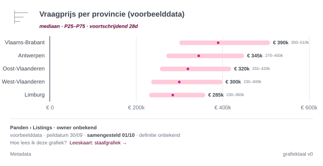
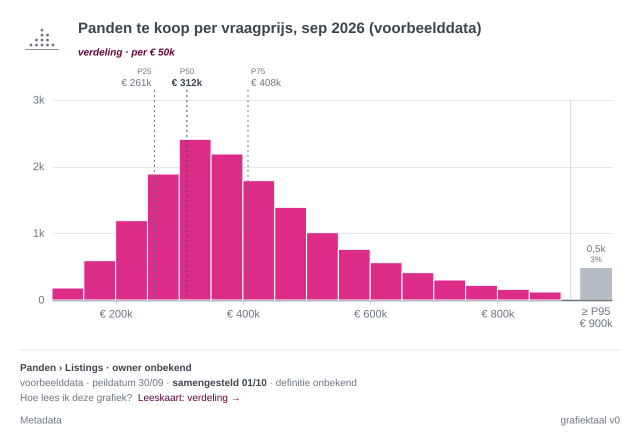
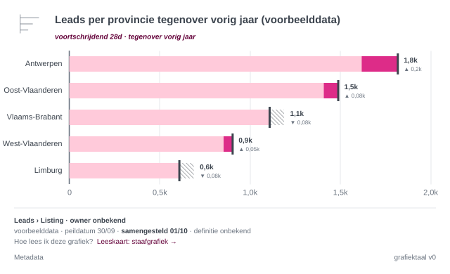
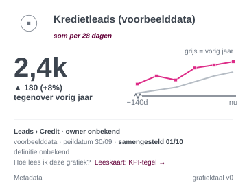
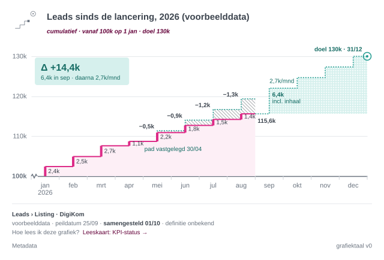
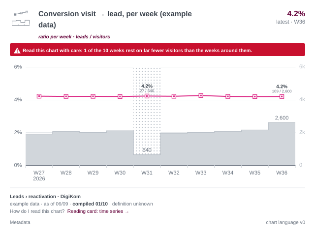

# immoscoop-ptditt-semgraph

Semantic chart service: renders charts by meaning (e.g. `movingWindowAverage`), not form, following the Immoscoop
chart language. The data warehouse computes the values per block; the service checks them against the chart
language and draws, with title, reading cue and footer (REQ-058).

- Analysis (functional and technical): [ptditt - Tooling - Grafiekserver](https://immoscoop.atlassian.net/wiki/spaces/DATA/pages/1352106324)
- Chart language, the source of the visual rules: [Figma, file grafiektaal](https://www.figma.com/design/X9FMecd5iH6jIced8nZQf6)
- Requirements: collected on [Confluence](https://immoscoop.atlassian.net/wiki/spaces/DATA/pages/1359872021); once
  implemented, [docs/requirements](docs/requirements/README.md) in this repository is their source of truth. How we
  handle requirements, also conflicting ones, is in [CLAUDE.md](CLAUDE.md).

## Philosophy

- **Ask by meaning, not by form.** You ask for what you want to show (a moving window average), never for "a line
  chart". The semgraph knows which calculation, axis, spread and rules belong to it.
- **The warehouse computes, the service checks and draws (REQ-058).** Manipulating data belongs in the data
  warehouse, where it is managed and tested. Whoever fetches the data delivers it per block (a window or a
  period) with what the semgraph asks for: a mean with its standard deviation, a median with P25 and P75, and n.
  The service never computes over days, so it can never take an average of averages (REQ-056). It only works when
  it gets the right data, and it refuses or flags what it cannot trust. This changes the principle of the analysis
  ("the caller sends raw values; the service computes").
- **The rules of the chart language live in the service.** Everything smart about the drawing happens in our code;
  Vega-Lite only draws what it gets.
- **Absence is never polished away.** Missing data is drawn as missing, never as zero, and unknown context is
  printed as unknown.
- **Bad practice is supported, but never silently.** What would mislead is refused. What only informs the reader
  less well is drawn, under a red block that tells the reader how to read it with care (REQ-032, REQ-038,
  REQ-040). It speaks to the reader, never about whoever made the chart: reading your own chart stays
  comfortable, delivering it does not (REQ-041).
- **Compare with what is not on the screen.** What is on the screen, the reader compares by eye. A comparison
  therefore always brings in the period just before the screen, as long as what the screen shows, and never a
  period that is already visible (REQ-037).

## Status: v0

Eleven semgraphs, end to end as SVG over REST, in English and Dutch (nl-BE), packaged as one Docker image: seven on a
time axis (two of them for a ratio), one for categories, one for the distribution of a value, and two for a KPI.

| Semgraph | One block | Drawn as |
| --- | --- | --- |
| `movingWindowAverage` | a window of days (windows do not overlap), named after its last day: mean, sd, n | line of diamonds over thin bars, ±1 sd |
| `movingWindowMedian` | a window of days, named after its last day: median, P25, P75, n | line of dots in wide bars, P25–P75 |
| `calendarAverage` | an ISO week, month, quarter or year, named by its ISO name: mean, sd, n | line of diamonds over thin bars, ±1 sd |
| `calendarMedian` | an ISO week, month, quarter or year: median, P25, P75, n | line of dots in wide bars, P25–P75 |
| `movingWindowRatio` | a window of days, named after its last day: numerator and denominator | a line of squares in a square, over the denominator as a grey step area on a right axis |
| `calendarRatio` | an ISO week, month, quarter or year: numerator and denominator | the same, per calendar period |
| `periodComparison` | a window or a calendar period: the total, mean or median, and the same value of the block before the screen | a line in the focus colour against a grey line, a shortfall hatched |
| `categoryComparison` | a category: the total, mean or median; a total may carry its previous value | bars: lying and sorted by value without order, upright in their order; a dot or diamond with its spread for a median or mean; a comparison inside one bar |
| `kpiTile` | a window or a calendar period, as in `periodComparison`, with the value it is compared with | the number of the last block with its difference, and a mini trend |
| `kpiStatus` | a period: the real and the planned cumulative level at its end | the real staircase against the fixed path to the target, a loss hatched, what is still to be won dotted |
| `distribution` | a bin of a continuous value: its count; plus P25, P50, P75 and the open bin above the threshold | touching bins, quartile guides, the tail in one grey bin |

Claude can use the service through an MCP server on `/mcp`, which shows the chart in the conversation (REQ-090 to
REQ-093, see [MCP: charts in Claude](#mcp-charts-in-claude)). PNG, the interactive HTML page, the widget, the choice
aid (`/choose`, REQ-095) and the other semgraphs come later, on the same core.









## Run it

Requires Node 24 (`.nvmrc`; Node ≥ 22.18 also works). Node runs the TypeScript sources directly, so there is no
build step.

```sh
npm ci
npm start                 # http://localhost:8080
npm test                  # unit, API, conformance and golden SVG tests
npm run typecheck
npm run render:examples   # every example to out/*.svg, to compare with Figma
```

With Docker:

```sh
docker build -t semgraph .
docker run --rm -p 8080:8080 semgraph
```

Then open <http://localhost:8080/gallery> in a browser for every semgraph and its examples,
<http://localhost:8080/docs> for the API in Swagger UI (where "Try it out" draws any example), one example such as
<http://localhost:8080/semgraphs/movingWindowAverage/examples/basic>, or:

```sh
curl -X POST http://localhost:8080/render \
  -H 'content-type: application/json' \
  --data @semgraphs/movingWindowAverage/examples/basic.json > basic.svg
```

The container is stateless, needs no secrets and listens on `PORT` (default 8080). It has no login of its own:
that comes from the platform it is deployed on, so do not expose it publicly. The one exception is `/mcp`, which
checks OAuth tokens itself (REQ-091) and refuses everything until it is configured; see
[MCP: charts in Claude](#mcp-charts-in-claude). `LOG_LEVEL` sets the log level (default `info`).

## Examples

Every example request, with a link to render it on a local server (`npm start`) and to its golden SVG. The requests
are in `semgraphs/{id}/examples/{name}.json`. All are in nl-BE unless marked en.

### movingWindowAverage

| Example | Shows | Outcome | Open |
| --- | --- | --- | --- |
| `basic` | 7 windows of 7 days, mean ±1 sd | ok | [local](http://localhost:8080/semgraphs/movingWindowAverage/examples/basic) · [golden](test/golden/movingWindowAverage-basic.svg) |
| `daily` | window of 1 day, 28 days: the daily values themselves | ok | [local](http://localhost:8080/semgraphs/movingWindowAverage/examples/daily) · [golden](test/golden/movingWindowAverage-daily.svg) |
| `long-horizon` | 78 windows of 7 days (a year and a half), with a thinned time axis | ok | [local](http://localhost:8080/semgraphs/movingWindowAverage/examples/long-horizon) · [golden](test/golden/movingWindowAverage-long-horizon.svg) |
| `long-horizon-dark` | the same, dark (`theme: dark`, REQ-094): the empty window on the dark checkerboard (REQ-096) | ok | [local](http://localhost:8080/semgraphs/movingWindowAverage/examples/long-horizon-dark) · [golden](test/golden/movingWindowAverage-long-horizon-dark.svg) |
| `missing-days` | a window without data (`mean: null`), drawn as empty; en | ok | [local](http://localhost:8080/semgraphs/movingWindowAverage/examples/missing-days) · [golden](test/golden/movingWindowAverage-missing-days.svg) |
| `with-metadata` | the metadata block (`meta`): question, asked and built by, references, query | ok | [local](http://localhost:8080/semgraphs/movingWindowAverage/examples/with-metadata) · [golden](test/golden/movingWindowAverage-with-metadata.svg) |
| `zoomed` | `valueAxis: zoom`: the value axis starts just below the data, with a zigzag | ok | [local](http://localhost:8080/semgraphs/movingWindowAverage/examples/zoomed) · [golden](test/golden/movingWindowAverage-zoomed.svg) |
| `window-10` | a window of 10 days, not a multiple of 7 | deviation `windowNotMultipleOf7` | [local](http://localhost:8080/semgraphs/movingWindowAverage/examples/window-10) · [golden](test/golden/movingWindowAverage-window-10.svg) |
| `without-spread` | blocks without `sd`: the mean without its spread | deviation `meanWithoutSpread` | [local](http://localhost:8080/semgraphs/movingWindowAverage/examples/without-spread) · [golden](test/golden/movingWindowAverage-without-spread.svg) |
| `unique-without-aggregation` | unique visitors without `uniqueAggregation` | refused `uniqueAggregationRequired`: 422 JSON, no chart | [local](http://localhost:8080/semgraphs/movingWindowAverage/examples/unique-without-aggregation) |

### movingWindowMedian

| Example | Shows | Outcome | Open |
| --- | --- | --- | --- |
| `basic` | 7 windows of 7 days, median with P25–P75 | ok | [local](http://localhost:8080/semgraphs/movingWindowMedian/examples/basic) · [golden](test/golden/movingWindowMedian-basic.svg) |
| `per-unit-without-n` | hours to the first contact, a median per unit (`measureType: perUnit`) without `n` | deviation `nMissing.median` | [local](http://localhost:8080/semgraphs/movingWindowMedian/examples/per-unit-without-n) · [golden](test/golden/movingWindowMedian-per-unit-without-n.svg) |

### calendarAverage

| Example | Shows | Outcome | Open |
| --- | --- | --- | --- |
| `weeks` | 12 ISO weeks, mean ±1 sd | ok | [local](http://localhost:8080/semgraphs/calendarAverage/examples/weeks) · [golden](test/golden/calendarAverage-weeks.svg) |
| `weeks-dark` | the same weeks, dark (`theme: dark`, REQ-094): the running week on its dark pattern (REQ-096) | ok | [local](http://localhost:8080/semgraphs/calendarAverage/examples/weeks-dark) · [golden](test/golden/calendarAverage-weeks-dark.svg) |
| `weeks-card` | the same weeks on a card (`size: card`, REQ-085): fewer labels, only the last final value | ok | [local](http://localhost:8080/semgraphs/calendarAverage/examples/weeks-card) · [golden](test/golden/calendarAverage-weeks-card.svg) |
| `months` | 12 months | ok | [local](http://localhost:8080/semgraphs/calendarAverage/examples/months) · [golden](test/golden/calendarAverage-months.svg) |
| `months-values-all` | 12 months, with every value written on the chart (`values: all`) | ok | [local](http://localhost:8080/semgraphs/calendarAverage/examples/months-values-all) · [golden](test/golden/calendarAverage-months-values-all.svg) |
| `years` | 3 years, with a zoomed value axis | ok | [local](http://localhost:8080/semgraphs/calendarAverage/examples/years) · [golden](test/golden/calendarAverage-years.svg) |
| `per-unit-few-observations` | the amount per lead per week (`measureType: perUnit`) with `n`: two weeks rest on few observations, the running week has a low n | ok, with a red caution `fewObservations.mean` | [local](http://localhost:8080/semgraphs/calendarAverage/examples/per-unit-few-observations) · [golden](test/golden/calendarAverage-per-unit-few-observations.svg) |

### calendarMedian

| Example | Shows | Outcome | Open |
| --- | --- | --- | --- |
| `quarters` | 6 quarters, median with P25–P75 | ok | [local](http://localhost:8080/semgraphs/calendarMedian/examples/quarters) · [golden](test/golden/calendarMedian-quarters.svg) |

### movingWindowRatio

| Example | Shows | Outcome | Open |
| --- | --- | --- | --- |
| `few-qualified` | the share of qualified leads per window of 7 days; one window rests on fewer than 10 qualified leads | ok, with a red caution `fewObservations.ratio.thin` | [local](http://localhost:8080/semgraphs/movingWindowRatio/examples/few-qualified) · [golden](test/golden/movingWindowRatio-few-qualified.svg) |

### calendarRatio

| Example | Shows | Outcome | Open |
| --- | --- | --- | --- |
| `weeks` | the conversion from visit to lead per week, as in Figma; week 31 rests on far fewer visitors; en | ok, with a red caution `fewObservations.ratio.base` | [local](http://localhost:8080/semgraphs/calendarRatio/examples/weeks) · [golden](test/golden/calendarRatio-weeks.svg) |
| `weeks-dark` | the same, dark (`theme: dark`, REQ-094); en | ok, with a red caution `fewObservations.ratio.base` | [local](http://localhost:8080/semgraphs/calendarRatio/examples/weeks-dark) · [golden](test/golden/calendarRatio-weeks-dark.svg) |

### periodComparison

| Example | Shows | Outcome | Open |
| --- | --- | --- | --- |
| `weeks-sum` | the total per week, 12 weeks against the 12 weeks before | ok | [local](http://localhost:8080/semgraphs/periodComparison/examples/weeks-sum) · [golden](test/golden/periodComparison-weeks-sum.svg) |
| `months-mean` | the mean per month, 6 months against the half year before | ok | [local](http://localhost:8080/semgraphs/periodComparison/examples/months-mean) · [golden](test/golden/periodComparison-months-mean.svg) |
| `rolling-median` | the median per window of 7 days, 8 windows against the 8 before; en | ok | [local](http://localhost:8080/semgraphs/periodComparison/examples/rolling-median) · [golden](test/golden/periodComparison-rolling-median.svg) |

### categoryComparison

| Example | Shows | Outcome | Open |
| --- | --- | --- | --- |
| `provinces-sum` | leads per province over 28 days: lying bars, sorted by value | ok | [local](http://localhost:8080/semgraphs/categoryComparison/examples/provinces-sum) · [golden](test/golden/categoryComparison-provinces-sum.svg) |
| `provinces-median` | the median asking price per province, P25–P75, with n | ok | [local](http://localhost:8080/semgraphs/categoryComparison/examples/provinces-median) · [golden](test/golden/categoryComparison-provinces-median.svg) |
| `provinces-mean` | the mean asking price per province, ±1 sd | ok | [local](http://localhost:8080/semgraphs/categoryComparison/examples/provinces-mean) · [golden](test/golden/categoryComparison-provinces-mean.svg) |
| `price-ranges-sum` | listings online on one day per price range: upright bars in the ordinal ramp | ok | [local](http://localhost:8080/semgraphs/categoryComparison/examples/price-ranges-sum) · [golden](test/golden/categoryComparison-price-ranges-sum.svg) |
| `price-ranges-median` | days online per price range, one range with few observations | ok, with a red caution `fewObservations.median` | [local](http://localhost:8080/semgraphs/categoryComparison/examples/price-ranges-median) · [golden](test/golden/categoryComparison-price-ranges-median.svg) |
| `price-ranges-mean` | days online per price range, ±1 sd; en | ok | [local](http://localhost:8080/semgraphs/categoryComparison/examples/price-ranges-mean) · [golden](test/golden/categoryComparison-price-ranges-mean.svg) |
| `provinces-median-zoomed` | the median asking price per province, `valueAxis: zoom`: the axis starts at € 200k, with a zigzag (REQ-073) | ok | [local](http://localhost:8080/semgraphs/categoryComparison/examples/provinces-median-zoomed) · [golden](test/golden/categoryComparison-provinces-median-zoomed.svg) |
| `provinces-sum-vs-last-year` | leads per province against last year, inside one bar: shared, gained, lost, now (REQ-066, REQ-067) | ok | [local](http://localhost:8080/semgraphs/categoryComparison/examples/provinces-sum-vs-last-year) · [golden](test/golden/categoryComparison-provinces-sum-vs-last-year.svg) |
| `provinces-sum-vs-last-year-dark` | the same, dark (`theme: dark`, REQ-094) | ok | [local](http://localhost:8080/semgraphs/categoryComparison/examples/provinces-sum-vs-last-year-dark) · [golden](test/golden/categoryComparison-provinces-sum-vs-last-year-dark.svg) |
| `provinces-sum-vs-last-year-large` | the same on a slide (`size: large`, REQ-085) | ok | [local](http://localhost:8080/semgraphs/categoryComparison/examples/provinces-sum-vs-last-year-large) · [golden](test/golden/categoryComparison-provinces-sum-vs-last-year-large.svg) |
| `price-ranges-sum-vs-last-year` | listings online per price range against last year, upright | ok | [local](http://localhost:8080/semgraphs/categoryComparison/examples/price-ranges-sum-vs-last-year) · [golden](test/golden/categoryComparison-price-ranges-sum-vs-last-year.svg) |

### kpiTile

| Example | Shows | Outcome | Open |
| --- | --- | --- | --- |
| `rolling-28d` | credit leads over 28 days against last year, with the mini trend and its grey shadow line (Figma) | ok | [local](http://localhost:8080/semgraphs/kpiTile/examples/rolling-28d) · [golden](test/golden/kpiTile-rolling-28d.svg) |
| `rolling-28d-dark` | the same tile, dark (`theme: dark`, REQ-094) | ok | [local](http://localhost:8080/semgraphs/kpiTile/examples/rolling-28d-dark) · [golden](test/golden/kpiTile-rolling-28d-dark.svg) |
| `months-mean` | the hours to a first contact per lead this month, ±1 sd next to the number, against last year | ok | [local](http://localhost:8080/semgraphs/kpiTile/examples/months-mean) · [golden](test/golden/kpiTile-months-mean.svg) |
| `rolling-7d` | credit leads over 7 days against the 7 days before: no shadow line; en | ok | [local](http://localhost:8080/semgraphs/kpiTile/examples/rolling-7d) · [golden](test/golden/kpiTile-rolling-7d.svg) |

### kpiStatus

| Example | Shows | Outcome | Open |
| --- | --- | --- | --- |
| `leads-since-launch` | leads since the launch against the path set on 30/04 to 130k: behind, with the catch-up (Figma) | ok | [local](http://localhost:8080/semgraphs/kpiStatus/examples/leads-since-launch) · [golden](test/golden/kpiStatus-leads-since-launch.svg) |
| `leads-since-launch-dark` | the same, dark (`theme: dark`, REQ-094): the hatching on the dark surface (REQ-055) | ok | [local](http://localhost:8080/semgraphs/kpiStatus/examples/leads-since-launch-dark) · [golden](test/golden/kpiStatus-leads-since-launch-dark.svg) |
| `leads-since-launch-card` | the same on a card (`size: card`, REQ-085): the step labels are on hover | ok | [local](http://localhost:8080/semgraphs/kpiStatus/examples/leads-since-launch-card) · [golden](test/golden/kpiStatus-leads-since-launch-card.svg) |
| `weeks-ahead` | new listings this quarter, per week, ahead of the path; en | ok | [local](http://localhost:8080/semgraphs/kpiStatus/examples/weeks-ahead) · [golden](test/golden/kpiStatus-weeks-ahead.svg) |

### distribution

| Example | Shows | Outcome | Open |
| --- | --- | --- | --- |
| `asking-price` | asking prices in bins of € 50k, quartiles, the tail above € 900k | ok | [local](http://localhost:8080/semgraphs/distribution/examples/asking-price) · [golden](test/golden/distribution-asking-price.svg) |
| `asking-price-dark` | the same, dark (`theme: dark`, REQ-094) | ok | [local](http://localhost:8080/semgraphs/distribution/examples/asking-price-dark) · [golden](test/golden/distribution-asking-price-dark.svg) |
| `asking-price-xl` | the same on a big screen (`size: xl`, REQ-085) | ok | [local](http://localhost:8080/semgraphs/distribution/examples/asking-price-xl) · [golden](test/golden/distribution-asking-price-xl.svg) |

## API

| Call | Does |
| --- | --- |
| `GET /healthz` | `{status, version, languageVersion, tokensVersion, mcp}`; `mcp` is `off`, `open` or `oauth` (REQ-091) |
| `GET /gallery` | a page with every semgraph and all of its examples, each a picture that links to the chart itself; `?locale=` (REQ-083) |
| `GET /` | leads to `/gallery` |
| `GET /semgraphs` | the overview as JSON: every available semgraph (title, the question it answers, links to Figma and the reading card, its examples with their title and link) and the planned ones; `?locale=` (REQ-083) |
| `GET /semgraphs/{id}` | metadata, JSON Schema, links to Figma and learning material, examples |
| `POST /validate` | checks a request without drawing; always 200 with `{outcome, issues}` |
| `POST /render` | draws the chart: 200 SVG, 422 refusal, 400 invalid request |
| `GET /semgraphs/{id}/examples/{name}` | renders one of the example requests, for a demo in the browser |
| `GET /openapi.json` | the API in OpenAPI 3.1: every call, and the contract and examples of every semgraph, built from the same files (REQ-084) |
| `GET /docs` | the same document in Swagger UI, to read it and try it out (REQ-084) |
| `POST /mcp` | the MCP server for Claude (REQ-090); see [MCP: charts in Claude](#mcp-charts-in-claude) |
| `GET /.well-known/oauth-protected-resource/mcp` | where Claude signs in for `/mcp`, only when OAuth is configured (REQ-091) |

The internal-tools platform runs the image ([deploy workflow](.github/workflows/deploy-internal-tools.yml)): `main` on
<https://semgraph.internal-immoscoop.be>, every other branch on <https://semgraph.dev.internal-immoscoop.be>, each
with `/docs`.

**For a program or an agent** that should make charts with this service: start from `/openapi.json`. Its
description says how to use the service, `POST /render` takes the request of any semgraph (chosen by `semgraph`),
and every example is in it.

Every request ends in one of four outcomes:

| Outcome | `/render` | Meaning |
| --- | --- | --- |
| `ok` | 200 SVG | The chart follows the chart language and carries the version label. |
| `deviation` | 200 SVG | Tolerated deviation: drawn under a red block between the title and the chart, without the version label and without a footer note (REQ-042). The codes are in the `Semgraph-Deviations` header. |
| `refused` | 422 JSON | The chart would mislead, so it is not drawn. |
| `invalid` | 400 JSON | The request itself is not valid. |

Few observations (REQ-047) is not a deviation: the chart is `ok`, keeps its version label and still gets the red
block, as an issue of level `caution`.

Issues always have the same shape, in the language of `locale`:

```json
{
  "level": "refusal",
  "code": "uniqueAggregationRequired",
  "field": "/uniqueAggregation",
  "message": "For unique counts, say how they were counted: per day (daily) or over the whole block (overPeriod). Those are two different metrics.",
  "alternative": "Add uniqueAggregation daily or overPeriod.",
  "learnMore": "https://immoscoop.atlassian.net/wiki/spaces/DATA/pages/1354629146"
}
```

SVG responses also carry `Semgraph-Language-Version` and `Semgraph-Tokens-Version`, `nosniff` and a strict
Content-Security-Policy. The gallery is a page without scripts that only loads its own example pictures. Swagger UI
comes with the package and loads nothing from outside either.

## MCP: charts in Claude

Claude (claude.ai, Desktop, mobile and Claude Code) uses the service through an MCP server on `POST /mcp`, on the same
core as the REST API (REQ-090). The tools are read-only:

| Tool | Does |
| --- | --- |
| `list_semgraphs` | every semgraph with the question it answers, as `GET /semgraphs` |
| `describe_semgraph` | one semgraph: when not to use it, its contract and a full example request, as `GET /semgraphs/{id}` |
| `validate_semgraph` | the report of `POST /validate` |
| `render_semgraph` | draws the chart and shows it to the user in the conversation |

**The chart in the conversation (REQ-092).** Claude shows only PNG, JPEG, GIF or WebP as an image, so
`render_semgraph` comes with an MCP App: a small page in the conversation that shows exactly the SVG the service
drew, with its hover and metadata panels. Inline at size `default`, scaled to the width of the conversation; in full
screen at size `large`; with a button to download the SVG. In a dark conversation the app shows the chart dark
(REQ-094); the download stays light, since it goes to a page, a slide or a mail (REQ-096). Claude itself gets the
report (outcome, issues, alternative), not the SVG, and is asked to fill `meta`: the question, the query, who asked
and the day (REQ-093).

**Login (REQ-091).** Claude calls `/mcp` from Anthropic's cloud, without the gate's cookie, so `/mcp` checks an OAuth
access token itself, issued to a gate account (Cognito Pool 1). The configuration comes from the environment:

| Variable | |
| --- | --- |
| `MCP_AUTH_ISSUER` | the issuer of the tokens, e.g. `https://cognito-idp.eu-central-1.amazonaws.com/<pool id>` |
| `MCP_AUTH_CLIENT_IDS` | the OAuth clients whose tokens are accepted, comma separated |
| `MCP_RESOURCE_URL` | the URL of `/mcp` as users enter it in Claude, e.g. `https://semgraph.internal-immoscoop.be/mcp` |
| `MCP_AUTH_SCOPE` | optional: a scope every token must carry, e.g. `semgraph/mcp` |
| `MCP_AUTHORIZATION_SERVER` | optional: where Claude signs in, when that is not the issuer |
| `MCP_AUTH=none` | no login, for a local server; excludes the variables above |

Without any of these, `/mcp` answers 503: it fails closed. An incomplete configuration stops the service from
starting. What the platform has to do (an OAuth client in Cognito, a gate exception for `/mcp` on the semgraph host,
the WAF) is proposed in [docs/platform/mcp-access.md](docs/platform/mcp-access.md).

**Connect** once the platform is ready:

- *claude.ai, for the whole organization:* an Owner adds it under Organization settings → Connectors → Add → Custom →
  Web, with the URL of `/mcp` and "Use your own OAuth client" (the client id from the platform, no secret). Every
  colleague then connects under Customize → Connectors and signs in with their gate account.
- *Claude Code:*
  `claude mcp add --transport http --client-id <client id> --callback-port 33418 semgraph https://semgraph.internal-immoscoop.be/mcp`.

**Locally**, without a platform:

```sh
MCP_AUTH=none npm start                     # MCP on http://localhost:8080/mcp
npx @modelcontextprotocol/inspector         # to try the tools
npm run mcp                                 # the same server on stdio
```

`.mcp.json` gives Claude Code in a clone of this repository the stdio server, without login. Claude Code shows no
app, so there every chart is also written to `out/mcp/`, and Claude gets the path.

## The contract

Every semgraph has its contract, composed by its classes and written to `semgraphs/<id>/schema.json`
(`npm run schemas`; a test fails when a file is out of date). The warehouse delivers **one row per block** in
`points` (REQ-058), named after its last day (`end`) for a rolling window and by its ISO name (`period`) for a
calendar period (REQ-062):

```json
{
  "semgraph": "movingWindowAverage",
  "metric": "creditLeads",
  "measureType": "additive",
  "window": 7,
  "locale": "nl-BE",
  "points": [
    { "end": "2026-09-23", "mean": 43.7143, "sd": 12.1616 },
    { "end": "2026-09-30", "mean": 45.8571, "sd": 11.261 }
  ]
}
```

```json
{
  "semgraph": "calendarAverage",
  "metric": "creditAmountPerLead",
  "measureType": "perUnit",
  "unit": "week",
  "points": [
    { "period": "2026-W39", "mean": 188.2, "sd": 59.9, "n": 58 },
    { "period": "2026-W40", "mean": 191.5, "sd": 66.2, "n": 17 }
  ]
}
```

| Field | Moving window | Calendar |
| --- | --- | --- |
| `window` | days per window: 1 (the daily values) or a multiple of 7; 2–364 otherwise a tolerated deviation | – |
| `unit` | – | `week` (ISO, Monday–Sunday), `month`, `quarter`, `year` |
| block name | `end`: the last day of the window, `2026-09-30`; windows follow each other without overlap | `period`: `2026-W40`, `2026-09`, `2026-Q3` or `2026` |
| `values` | `off`, `last` (default), `lastAndPrevious`, `all` | same, default `lastAndPrevious` |

A block carries its name and the fields of its statistic, nothing else:

| Statistic | Fields | Missing spread | n |
| --- | --- | --- | --- |
| mean | `mean`, `sd` (sample, n − 1, as `STDDEV`), `n` | deviation `meanWithoutSpread` | optional |
| median | `median`, `p25`, `p75` (as `PERCENTILE_CONT`), `n` | deviation `medianWithoutSpread` | optional |
| sum | `sum` | – | none: for a count the number is the n |

The spread is on every block with a value, or on none. A window of one day has no spread. `n` is the number of
observations behind the value, as the warehouse counted it (REQ-043). It is not required, but for a mean or median
per unit (`measureType: perUnit`, such as an amount per lead) a missing `n` gives a red alert, because the
reader cannot see which points rest on few observations (REQ-062). For an average per day of a count (`additive`
or `unique`) the observations are the days of the block, so there is no n to give.

`measureType` says what kind of number it is (REQ-070, REQ-074): `additive` or `unique` for a count, `perUnit` for a
mean or median per unit where the spread between the units is the question, such as an amount per lead or the days a
property stays online. `ratio` is a numerator divided by a denominator, such as leads out of visitors: only
`movingWindowRatio` and `calendarRatio` take it, every other chart refuses it.

### Ratios over time (REQ-074 to REQ-080)

`movingWindowRatio` and `calendarRatio` take per block the `numerator` and the `denominator`, as the warehouse counted
them, and name what they count (`numeratorName`, `denominatorName`): the chart only divides (REQ-076). The ratio is the
line; the denominator stands behind it as a grey step area on a right axis, both axes from zero with shared gridlines,
the denominator always below the ratio (REQ-079). A block with fewer than 10 in the numerator, or fewer than 10 in the
denominator without the numerator, or a denominator below half that of the periods around it, gets the dots of few
observations (REQ-080). For now a ratio is a share, shown in percent; a numerator larger than its denominator (a ratio
per unit, such as listings per agent) is refused until it is decided how that is shown.

```json
{ "semgraph": "calendarRatio", "metric": "visitToLead", "measureType": "ratio", "unit": "week",
  "numeratorName": "leads", "denominatorName": "visitors",
  "points": [ { "period": "2026-W30", "numerator": 88, "denominator": 2100 },
              { "period": "2026-W31", "numerator": 27, "denominator": 640 } ] }
```

`periodComparison` takes `statistic` (`sum`, `mean` or `median`) and either `window` or `unit`. Each block also
carries `previous`: the same value for the block just before the screen at its position, e.g.
`{ "period": "2026-W40", "sum": 161, "previous": { "sum": 135 } }`. For a running period, `previous` covers as
many days of the earlier period. It has no `values`: it labels the ends of its two lines.

**Sizes (REQ-085).** Every semgraph except `kpiTile` takes `size`: `card` (360 px wide, as wide as a KPI tile),
`default` (640 px), `large` (1280 px, a 16:9 slide) or `xl` (1920 px, a big screen or print). Only the width is
chosen; the height follows from the content. The chart is built anew at its width, so its labels fit: a card gets
fewer labels on its axis, a slide more. `large` and `xl` are built at 960 and 1280 px and enlarged, so the text
grows with them.

**Light and dark (REQ-094).** Every semgraph takes `theme`: `light` (the default) or `dark`, for a dark page, slide or
conversation. Both are the Figma variables of the collection Chart, modes Light and Dark (`color` and `colorDark` in
the tokens): only the colours change, never the chart. The patterns take the variables their masters are bound to in
Figma, in both modes: the mosaic (empty) and the fine lines (running) `context/light`, the dots (few observations)
`context`, on `surface` (REQ-097).
A dark SVG carries `data-theme="dark"`, and its pattern ids end in `-dark`, so a light and a dark chart can share a
page. `GET /semgraphs/{id}/examples/{name}?theme=dark` draws an example dark, and `npm run render:examples` writes
every chart dark too.

Shared and optional: `title`; `asOf`, the last complete day of the data (yesterday in Brussels when absent);
`uniqueAggregation` (`daily` or `overPeriod`, required for unique counts); `valueAxis` (`zero`, the default, or
`zoom`); `context` for the footer (`domain`, `dataset`, `owner`, `reliability`, `definitionUrl`); `meta`, the
metadata of the chart (REQ-010: `question`, `askedBy`, `builtBy`, `references` as `{label, url}`, `query`,
`compiledOn`); `locale`; `format` (`svg`). At most 1000 blocks from the first to the last. Unknown fields are
rejected, also inside a block, so a typo never silently becomes a default and no extra columns (such as personal
data) get in. See for example [`semgraphs/calendarMedian/schema.json`](semgraphs/calendarMedian/schema.json).

**Empty is not zero.** A block with `null` (or left out) has no data: it is drawn as empty, never as zero. `0` is
a measured zero.

### Categories and distributions (REQ-065)

`categoryComparison` takes one row per category in `points`, with the fields of its `statistic` (`sum`, `mean`
with `sd`, `median` with `p25` and `p75`, and `n`), `ordered` (false: lying bars, sorted by value; true: upright
bars in the order given, at most 16), and the time the values cover: exactly one of `window` (days up to the last
complete day), `period` (an ISO period that is over) or `day` (a snapshot). Dates are no categories: a date axis
is a line (REQ-001, REQ-002). `unit` puts a unit around the numbers (`{ "prefix": "€ " }`, `{ "suffix": " d" }`).
A mean or median may zoom (`valueAxis: zoom`); an amount is a bar and starts at zero (REQ-073).

A total compares inside its bar when every row carries `previous` (REQ-066, REQ-067): `comparison` says what it is,
`previousPeriod` or `lastYear`; by default the period before for a window of up to 14 days, last year otherwise.

```json
{ "semgraph": "categoryComparison", "metric": "askingPrice", "measureType": "perUnit", "statistic": "median",
  "window": 28, "unit": { "prefix": "€ " },
  "points": [ { "category": "Antwerpen", "median": 345000, "p25": 270000, "p75": 450000, "n": 2140 } ] }
```

`distribution` takes the bins as the warehouse counted them, each `binWidth` after the previous, the percentiles,
and optionally the open bin above the threshold (about P95). Bin width and threshold are fixed per metric in the
dbt YAML, so months stay comparable (Figma).

```json
{ "semgraph": "distribution", "metric": "askingPrice", "binWidth": 50000, "unit": { "prefix": "€ " },
  "bins": [ { "from": 100000, "count": 180 }, { "from": 150000, "count": 590 } ],
  "openBin": { "from": 900000, "count": 480 },
  "percentiles": { "p25": 261000, "p50": 312000, "p75": 408000 } }
```

### KPIs (REQ-065, REQ-067, REQ-069)

`kpiTile` takes the blocks of `periodComparison` (`window` or `unit`, one row per block with the fields of its
`statistic`), where `previous` is the value the block is compared with, and `comparison` (`previousPeriod` or
`lastYear`, the default as above). The last block is the number; it is never shown without its comparison.

```json
{ "semgraph": "kpiTile", "metric": "creditLeads", "measureType": "additive", "statistic": "sum", "window": 28,
  "points": [ { "end": "2026-09-02", "sum": 2340, "previous": { "sum": 2150 } },
              { "end": "2026-09-30", "sum": 2400, "previous": { "sum": 2220 } } ] }
```

`kpiStatus` takes the cumulative levels at the end of each period, real (`actual`, for periods that are over) and
planned (`path`, from the period in which the path was set to the target), with the `start`, the `target` and the
day the path was set (`pathSet`). The warehouse delivers the levels; the chart only takes differences (REQ-069).

```json
{ "semgraph": "kpiStatus", "metric": "leads", "measureType": "additive", "unit": "month",
  "start": { "day": "2026-01-01", "value": 100000 }, "target": { "day": "2026-12-31", "value": 130000 },
  "pathSet": "2026-04-30",
  "points": [ { "period": "2026-04", "actual": 108700, "path": 108700 },
              { "period": "2026-05", "actual": 110900, "path": 111363 },
              { "period": "2026-09", "path": 122013 } ] }
```

### Guidelines for the query

dbt macros and standard queries will come, but they are no prerequisite: moving windows, a standard deviation on
a mean and ISO weeks are known language. What matters:

- **Compute per block in the warehouse, from the observations.** A mean per week is the mean of the observations
  of that week, never a mean of daily means (REQ-056).
- **Complete the days first** when a day without events means zero: a `GROUP BY day` returns no row for such a
  day. Use 0 only where nothing happening really means zero.
- **Blocks end on the last complete day.** A rolling window never runs; a calendar period may: its value covers
  the days so far. Give `asOf` when the last complete day is not yesterday.
- **Give n** for a mean or median of observations: `COUNT(value)`.

Rolling windows of 7 days that do not overlap, the last one ending on the last complete day:

```sql
WITH params AS (
  SELECT DATE_SUB(CURRENT_DATE('Europe/Brussels'), INTERVAL 1 DAY) AS as_of
),
daily AS (
  SELECT day, COALESCE(counts.value, 0) AS value  -- 0 only where nothing happening really means zero
  FROM params, UNNEST(GENERATE_DATE_ARRAY(DATE_SUB(as_of, INTERVAL 7 * 7 - 1 DAY), as_of)) AS day
  LEFT JOIN (
    SELECT DATE(created_at, 'Europe/Brussels') AS day, COUNT(*) AS value
    FROM `project.dataset.table`
    GROUP BY day
  ) AS counts USING (day)
)
SELECT
  FORMAT_DATE('%F', DATE_SUB(as_of, INTERVAL DIV(DATE_DIFF(as_of, day, DAY), 7) * 7 DAY)) AS `end`,
  ROUND(AVG(value), 4) AS mean,
  ROUND(STDDEV(value), 4) AS sd
FROM daily, params
GROUP BY `end`
ORDER BY `end`
```

ISO weeks of a mean per unit, with n: the mean amount per lead over the leads of each week (12 weeks, the last one may
run). `%G-W%V` is the ISO year and week, so the block name is `2026-W40`:

```sql
WITH params AS (
  SELECT DATE_SUB(CURRENT_DATE('Europe/Brussels'), INTERVAL 1 DAY) AS as_of
)
SELECT
  FORMAT_DATE('%G-W%V', DATE(created_at, 'Europe/Brussels')) AS period,
  ROUND(AVG(amount) / 1000, 1) AS mean,
  ROUND(STDDEV(amount) / 1000, 1) AS sd,
  COUNT(amount) AS n
FROM `project.dataset.leads`, params
WHERE DATE(created_at, 'Europe/Brussels') BETWEEN DATE_TRUNC(DATE_SUB(as_of, INTERVAL 11 WEEK), ISOWEEK) AND as_of
GROUP BY period
ORDER BY period
```

A median per block: `PERCENTILE_CONT(value, 0.25)`, `0.5` and `0.75` `OVER (PARTITION BY period)` with
`SELECT DISTINCT`, and `COUNT(value) OVER (PARTITION BY period) AS n`. For `periodComparison`, compute the blocks
of the screen and of the period before it, and give each block the value of the block that many positions earlier,
e.g. `STRUCT(LAG(sum, 12) OVER (ORDER BY period) AS sum) AS previous`. The weekly query gives exactly the blocks of
[`calendarAverage/examples/weeks.json`](semgraphs/calendarAverage/examples/weeks.json) on its daily example data;
the tests compare the examples with BigQuery's output (`test/fixtures`).

What the service does:

1. "Today" is the last complete day: `asOf`, or yesterday in Brussels, never the running day. The last window of a
   moving window reads "now" ("nu") when it ends yesterday, and its date otherwise (REQ-030).
2. Slots: every point is a block of time (REQ-029). The slots run from the first block to the last, a block that is
   not delivered or `null` is empty. A moving window has one block per window, blocks that do not overlap: 7
   windows of 7 days run from −42d to "nu". A window of one day shows the daily values, without spread (REQ-031).
   A calendar chart has one block per period. A period that ends after the last complete day is **running**: its
   value covers the days so far, its column gets the running pattern while its shape stays filled (REQ-052), and
   "current" ("lopend") stands under it (on hover: "running: 3 of 7 days"). A block that starts after the last
   complete day, or a window that ends after it, is refused: its value is not final.
3. Checks on the blocks (input errors): valid and unique names, windows that line up, only the fields of the
   statistic, the spread on every block or on none, P25 ≤ median ≤ P75 (`src/charts/statistics.ts`).
4. Rules: refusal for a measure type the metadata does not allow, a ratio (its numerator and denominator have no
   contract yet, REQ-070), a total of means per unit, unique counts without
   `uniqueAggregation`, a total of daily uniques (REQ-035), the uniques over a block as an average (REQ-064), no block with a
   value, blocks with a value that together cover fewer days than `minimumPoints`, or, for a comparison, no value
   before the screen. Tolerated deviation for a window that is not 1 or a multiple of 7, a mean or median without
   its spread, or a mean or median of observations without n (REQ-062). Every tolerated deviation is drawn under a
   red block with white text between the title and the chart, with a message to the reader: "Lees deze grafiek
   met voorzichtigheid: …" (REQ-032, REQ-038, REQ-040, REQ-041).
   Few observations (REQ-044): a block with n below 30 (mean) or 10 (median), or below half the median n of the
   chart (from five n's on). Only where n counts observations (`measureType: perUnit`), never for days (REQ-057,
   REQ-063),
   and never for a running period (REQ-054). Its column gets sparse dots, its shape stays filled (REQ-053), its n
   stands under the time axis ("n 22", REQ-046), and a red block warns the reader while the version label stays
   (REQ-047).
5. Drawing: always a line through the points, broken where data is missing and never bridged (REQ-001); the
   centre as a diamond for a mean (REQ-006) and a dot for a median (REQ-008), always filled; a thin bar for ±1 sd
   or a wide rounded bar for P25–P75, in the light tint of the focus colour, which is used for spread only
   (REQ-009); never a bar for a value on the time axis (REQ-002). The state of a period is a pattern behind its
   whole column, over the full height of the plot (REQ-049, REQ-050, `src/charts/data-states.ts`): a
   checkerboard for an empty period (REQ-051), fine vertical lines for a running one (REQ-052), sparse dots for
   few observations (REQ-053), as tiles
   anchored to the plot so neighbouring columns form one area. Both axes labelled; a darker, thicker baseline. The time axis as in
   Figma: ticks on the boundaries between blocks, labels in the middle of a block, the year on a second line on
   the first label and at a year change, which gets a longer, darker tick.
   Values (REQ-033), centred above the point with the spread as a detail: `last` for a moving window, and
   `lastAndPrevious` for a calendar chart (the last final value in bold, a running one next to it in grey);
   `off`; or `all`, only while every point has 40 pixels, otherwise the default with a message. The value axis
   grows until every label fits.
6. Value axis: from zero by default. With `"valueAxis": "zoom"` it starts at a round value just below the data,
   which the chart language allows for positions such as averages and medians; the baseline then starts with a
   short zigzag and the first axis value is bold. When the round start is zero anyway, it stays at zero.
7. The header (REQ-060): the icon of the semgraph left of the title, 44 px, over the title and the reading cue, in
   the muted grey and linked to the reading card. A warning lies below this header block, over the full width.
   The icons are `semgraphs/<id>/icon.svg`, exported from the Semgraph icons in Figma, in `currentColor`; the
   service checks that each is built from the fixed set: one stroke weight (0.75), one dot, diamonds and squares,
   one colour (REQ-061, `src/core/icon.ts`). The text of the chart is grey/700, not black (REQ-059).
8. The footer, as the building blocks Origin, Status and Learn link in Figma: domain › dataset · owner (semibold);
   reliability · as of 30/09 · **compiled 01/10** · definition →; "How do I read this chart? Reading card: time
   series →". Missing context is printed as unknown: absence is never polished away. The compiled day is always
   there, bold (REQ-011): `meta.compiledOn`, or the day the chart is drawn, in Brussels.
   Below it, at the bottom left, the metadata as short text labels, one topic each: Question (with who asked),
   References, Query, Metadata and Learn (REQ-012, REQ-018, REQ-102). A label only appears when it has content, so
   Metadata is always there and Learn only when a lesson is written for the kind of chart; none is yet (REQ-020,
   REQ-103). A label opens a card on a veil in the surface colour (0.82) over the whole chart (REQ-098), so the card
   stays while the pointer is over the chart and closes about 350 ms after it left (REQ-014). Every card has the same
   anatomy (REQ-099): an eyebrow (QUERY, METADATA, HOW DO I READ THIS?), a title, sections between thin lines, and
   the row of labels with the active one underlined; a label in the card switches to its card with `:has()`.
   - Query: the title and the SQL, in Roboto Mono on its own surface (REQ-100).
   - Metadata: the parameters straight from the request, the data (dataset, as-of date, reliability label), and who
     built it and when next to the version of the service (REQ-101, REQ-104).
   - Learn: what you see, only the signs this chart really drew (every chart reports them in `Drawing.signs`), what
     to watch out for, and the reading card (REQ-102); with a lesson the icon opens it too (REQ-103).

   A card that does not fit its chart closes up, then is cut with "…". The text is selectable and there are no copy
   buttons. CSS only, no script (REQ-016, `src/core/render/meta.ts`, class `MetaLayer`): shown as an image, the cards
   stay hidden and the date stays visible. The version label ("grafiektaal v0") sits at the right of that row, only
   when the chart conforms.
9. Hover, without script (`src/core/render/hover.ts`, class `HoverLayer`): every slot has a column over the full
   height, also a slot without data. On hover or focus it shows grey dotted guides (vertical through the slot,
   horizontal from the y axis to the centre and both spread edges, the lower edge never below zero), a ring in the
   focus colour around the point, and a box centred on the slot, above the spread or below it when there is no
   room, always inside the plot:
   `23 sep (−7d)` (bold), `gemiddelde 7d: 43,7`, `±1 sd: 12,2`, `n = 41 waarnemingen` when the block has n,
   `venster 17–23 sep`; for a slot without data `16 sep (−14d)`, `geen data`.
   - Positions come from Vega's own scales (`view.scale('x')`, `view.scale('y')` after `toSVG`); a test checks
     that every ring lies on Vega's point within 0.01 px.
   - The device rules of REQ-015, every column with `tabindex="0"`: the mouse only hovers and a click holds
     nothing open (`:hover` and `:focus-visible`); on a device without hover a tap opens and a tap elsewhere
     closes (`:focus` under `@media (hover:none)`); Tab opens, the next Tab closes. The metadata labels follow
     the same rules. `aria-label` holds the lines.
   - The detail is hidden with the attribute `visibility="hidden"` and made visible by CSS, so a renderer without
     CSS (such as a future PNG export) shows nothing instead of everything.
   - No ids (several charts can share one page), every class starts with `semgraph-hover` (CSS in an inline SVG
     applies to the whole page), and `pointer-events="none"` on guides and box, so the next column takes over.
   - It works when the SVG is opened directly or inlined, not inside ``, Slack or e-mail. On the interactive
     page this will be Vega-Lite's own way (a tooltip encoding and a pointerover param with a rule); this CSS layer
     is then the static fallback.
10. Many values (REQ-022): while each slot has room for its bar plus some air (8 pixels for a mean, 13 for a
   median's wide bar), every point is drawn with its bar. Beyond that the bars would overlap, so the spread
   becomes a band along the line, in the same colours (the learning material: spread "as a band around a line or
   as a line around a point"), and only the last point, a lone point between two gaps and a running period keep
   their marker, so the shape of the statistic stays visible. Lines and bands never bridge a gap; a lone point
   and a running period keep their own bar. A moving window keeps at most eight labels, every 1, 2, 4, 13, 26 or
   52 windows (daily values per week); a calendar chart labels every period that fits ("W40", "sep", "K3",
   "2026"). Narrow blocks get their ticks under the labels. See `examples/long-horizon.json` (78 weeks).
11. Comparison (`periodComparison`): the current period in the focus colour against the period just before the
    screen, as long as what the screen shows, as a grey line on the same axis (REQ-003, REQ-037). Both show the
    same value: the total per period (a square, REQ-007), the mean or the median (REQ-035). Only the focus series
    has a light band (REQ-005), every point of it has its marker while there is room, and only a shortfall
    against the comparison is hatched, cut at the crossings; a gain gets no fill (REQ-004). The hatching is an
    SVG pattern whose id is unique per chart (REQ-036). The last value and the name of the comparison ("vorige
    12 weken", "vorig jaar") stand at the ends of the lines. The values before the screen come from `previous` in
    each block; a running period is compared with as many days of the earlier period. On hover each block also
    shows the block it is compared with.

## How it is built

The charts are classes, so nothing is written twice:

```text
TimeAxisChart (src/charts/time-axis-chart.ts)    contract, checks, blocks to slots, rules, value axis, hover lines
├── MovingWindowChart                             windows named by their last day, without overlap, relative axis
│   ├── MovingWindowAverage   ── uses Average
│   ├── MovingWindowMedian    ── uses Median
│   └── RollingComparison     ── with a comparison; uses Sum, Average or Median
└── CalendarChart                                 ISO weeks, months, quarters or years by ISO name, running period
    ├── CalendarAverage       ── uses Average
    ├── CalendarMedian        ── uses Median
    └── CalendarComparison    ── with a comparison; uses Sum, Average or Median

PeriodComparison (semgraphs/periodComparison)     one semgraph: the request picks the family and the statistic

CategoryChart (src/charts/category-chart.ts)      categories as bars, lying or upright; the request picks the statistic
└── CategoryComparison
DistributionChart (src/charts/distribution-chart.ts)  bins, quartile guides and the open bin
└── Distribution

Statistic (src/charts/statistics.ts)              the fields of a block, how to read them, bar width, shape, labels
├── Average                                       mean, ±1 sd, n; thin bar, diamond (REQ-006); few below n 30
├── Median                                        median, P25–P75, n; wide bar, dot (REQ-008); few below n 10
└── Sum                                           total per block, no spread, no n, square (REQ-007)
```

The shape of a point per kind of number (square for an amount, diamond for a mean, dot for a median) is defined
once, in `src/charts/signatures.ts`. Every family shares the rules about the kind of number
(`src/charts/measure.ts`), the field checks and the few-observations logic of the statistic, the contract fields
(`src/charts/contract.ts`) and the compact numbers of the bar charts (`src/charts/number-format.ts`: "1,8k",
"€ 390k", "45 d"). The time axis (`src/charts/time-axis.ts`) and the value labels
(`src/charts/value-labels.ts`) are drawn by helpers that every family shares, and so is the comparison
(`src/charts/comparison.ts`): any time-axis chart compares with the period before the screen once it sets
`compares`.

The statistic is its own hierarchy, used by both families: with single inheritance alone, the mean and median code
would have to be written once per family. A family decides how a block is named and how slots are labelled; the
statistic decides which fields a block carries; the base class does the rest, including the Vega-Lite spec.
A new semgraph on a time axis is a class of a few lines, plus its `metadata.yml` and texts.

```text
vocabulary/attributes.yml              closed vocabulary of the 9 attributes
semgraphs/catalog.yml                  all semgraphs of the catalogue: available or planned
semgraphs/<id>/                        index.ts (the class), metadata.yml, schema.json (generated), icon.svg, examples
src/charts/                            the chart classes, statistics, signatures, calendar periods and scales
docs/requirements/                     the implemented requirements (REQ-xxx), the source of truth once implemented
test/requirements.test.ts              one test per requirement, run on every example of every semgraph
locales/en.yml, nl-BE.yml              every text; other locales fall back to English
tokens/ptditt-grafiektaal-tokens.json  style values, read from the Figma variables and text styles
src/core/pipeline.ts                   schema -> input checks -> blocks to slots -> rules -> draw -> template
src/core/render/                       Vega-Lite to SVG (headless, no external loading), HoverLayer, the template
src/core/conformance.ts                the conformance checks, run by the tests and at start-up
src/app.ts, src/routes/                the REST layer (Fastify), and POST /mcp
src/mcp/                               the MCP server on the same core, its login and the app that shows a chart
```

Everything smart happens in our code; Vega-Lite only draws what it gets. The axis ticks and labels, which value is
labelled, and how the spread is drawn are computed before Vega-Lite sees anything.

The conformance checks from the analysis run in CI and at start-up; the service does not start when they fail:
attributes and values only from the vocabulary, every applicable attribute filled (`any` explicitly), every pair of
semgraphs disjoint in at least one attribute, valid `askWhen`, and an English base text for every key. Check 3 is
stricter than "differs": `[additive, unique]` and `[unique]` differ, but both fit a unique count, and then the
choice aid cannot end at exactly one semgraph. Two attributes were added so the new semgraphs stay
distinguishable: `periodType` (rolling or calendar, asked when the time axis is calendar) and `centralTendency`
(mean or median). A test runs checks 1–4 on the first fill of the analysis, with these attributes and the new
semgraphs: fifteen in all.

## Provisional choices, to confirm

Only the cover page of the Figma file was readable when v0 was built. These choices still need checking against
the pages Anatomy and Line charts, and with the team:

1. Missing points: first an outlined area labelled "no data"; since REQ-051 the checkerboard behind the column.
2. Since REQ-058 the warehouse decides what a block with a missing day is; the guideline is a block without a
   value (`null`), drawn as empty.
3. `minimumPoints` counts the days the blocks with a value cover together (so daily values need 28 blocks); a
   value axis from zero.
4. Conformance check 3 sharpened to "disjoint".
5. The place of the version label ("chart language v0"): at the right of the row of metadata labels. Figma has
   no building block for it yet.
6. The token values Figma does not hold yet: the width of the spread bars.
7. The switch from bars to a band, and the look of the hover (guides, ring, box).
8. The two new attributes `periodType` and `centralTendency`, and their values for the semgraphs of the analysis
   (`any` where they do not matter); see `test/fixtures/analysis-attributes.yml`.
9. A running period covers the days so far and gets the running pattern; ISO weeks run from Monday to Sunday.
10. The zoomed axis (zigzag and bold first value).
11. For `periodComparison`: one semgraph with `statistic` and either `window` or `unit`; a running period
    compared with as many days of the earlier period.
12. For `categoryComparison`: the ordinal ramp spread over its five steps for any number of categories; the n of a
    lying bar with few observations under its label.
13. For `kpiTile`: with the period before, the mini trend has no shadow line (that period is on the trend itself);
    a footer line too wide for the narrow tile breaks at its separators.
14. For `kpiStatus`: the touching dots in `target/light`; the per-step and catch-up labels placed as in Figma.
15. For the ratios: the square in a square 8 px around 40 %; the denominator at least 24 px below its ratio (at
    least halfway for a very low ratio); a ratio of zero does not count for the scale; the counts of a block with few
    observations at its point, the denominator above its block; on hover a guide from the denominator to the right
    axis.
    The open questions are in [docs/requirements](docs/requirements/README.md#open-punten-eerst-te-bespreken).

## Notes for consumers

- An SVG embedded with `` cannot follow its links and does not use the fonts of the page. Inline the SVG, or
  open it directly, to keep the links in the footer working.
- Fonts are referenced by name (Poppins, Nunito, with fallbacks); the final typography is still open.
