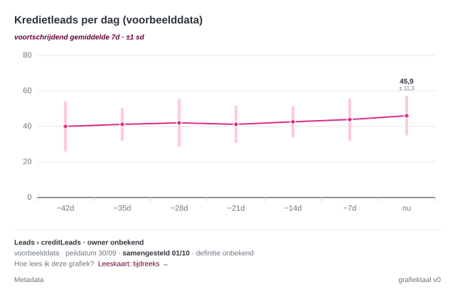
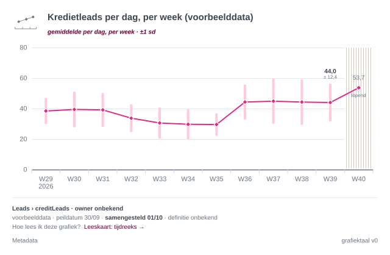
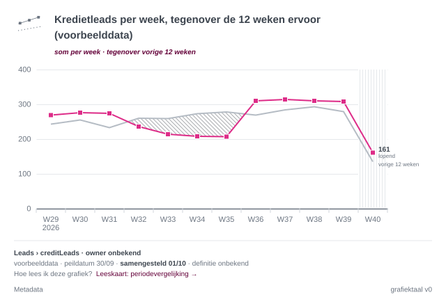

# immoscoop-ptditt-semgraph

Semantic chart service: renders charts by meaning (e.g. `movingWindowAverage`), not form, following the Immoscoop
chart language. The rules live in the service: the caller sends raw values, and the service computes, validates
and draws, with title, reading cue and footer.

- Analysis (functional and technical): [ptditt - Tooling - Grafiekserver](https://immoscoop.atlassian.net/wiki/spaces/DATA/pages/1352106324)
- Chart language, the source of the visual rules: [Figma, file grafiektaal](https://www.figma.com/design/X9FMecd5iH6jIced8nZQf6)
- Requirements: collected on [Confluence](https://immoscoop.atlassian.net/wiki/spaces/DATA/pages/1359872021); once
  implemented, [docs/requirements](docs/requirements/README.md) in this repository is their source of truth. How we
  handle requirements, also conflicting ones, is in [CLAUDE.md](CLAUDE.md).

## Philosophy

- **Ask by meaning, not by form.** You ask for what you want to show (a moving window average), never for "a line
  chart". The semgraph knows which calculation, axis, spread and rules belong to it.
- **The rules live in the service.** The caller sends raw values; the service computes, validates and draws.
  Everything smart happens in our code; Vega-Lite only draws what it gets.
- **Absence is never polished away.** Missing data is drawn as missing, never as zero, and unknown context is
  printed as unknown.
- **Bad practice is supported, but never silently.** What would mislead is refused. What only informs the reader
  less well is drawn, under a red block that tells the reader how to read it with care (REQ-032, REQ-038,
  REQ-040). It speaks to the reader, never about whoever made the chart: reading your own chart stays
  comfortable, delivering it does not (REQ-041).
- **Compare with what is not on the screen.** What is on the screen, the reader compares by eye. A comparison
  therefore always brings in the period just before the screen, as long as what the screen shows, and never a
  period that is already visible (REQ-037).

## Status: v0

Five semgraphs on a time axis of daily data, end to end as SVG over REST, in English and Dutch (nl-BE), packaged
as one Docker image:

| Semgraph | Per slot | Drawn as |
| --- | --- | --- |
| `movingWindowAverage` | per window of days (blocks that do not overlap), the mean of its days | line of diamonds over thin bars, ±1 sd |
| `movingWindowMedian` | per window of days (blocks that do not overlap), the median of its days | line of dots in wide bars, P25–P75 |
| `calendarAverage` | per ISO week, month, quarter or year, the mean of its days | line of diamonds over thin bars, ±1 sd |
| `calendarMedian` | per ISO week, month, quarter or year, the median of its days | line of dots in wide bars, P25–P75 |
| `periodComparison` | per window or calendar period: the total, mean or median, against the period just before the screen | a line in the focus colour against a grey line, a shortfall hatched |

MCP, PNG, the interactive HTML page, the widget, the choice aid (`/choose`) and the other semgraphs come later, on
the same core.





## Run it

Requires Node 24 (`.nvmrc`; Node ≥ 22.18 also works). Node runs the TypeScript sources directly, so there is no
build step.

```sh
npm ci
npm start                 # http://localhost:8080
npm test                  # unit, API, conformance and golden SVG tests
npm run typecheck
npm run render:examples   # every example to out/*.svg, to compare with Figma
```

With Docker:

```sh
docker build -t semgraph .
docker run --rm -p 8080:8080 semgraph
```

Then open <http://localhost:8080/semgraphs/movingWindowAverage/examples/basic> in a browser, or:

```sh
curl -X POST http://localhost:8080/render \
  -H 'content-type: application/json' \
  --data @semgraphs/movingWindowAverage/examples/basic.json > basic.svg
```

The container is stateless, needs no secrets and listens on `PORT` (default 8080). It has no login of its own:
that comes from the platform it is deployed on (still to be agreed), so do not expose it publicly.
`LOG_LEVEL` sets the log level (default `info`).

## API

| Call | Does |
| --- | --- |
| `GET /healthz` | `{status, version, languageVersion, tokensVersion}` |
| `GET /semgraphs` | available semgraphs (title, the question they answer) and the planned ones; `?locale=` |
| `GET /semgraphs/{id}` | metadata, JSON Schema, links to Figma and learning material, examples |
| `POST /validate` | checks a request without drawing; always 200 with `{outcome, issues}` |
| `POST /render` | draws the chart: 200 SVG, 422 refusal, 400 invalid request |
| `GET /semgraphs/{id}/examples/{name}` | renders one of the example requests, for a demo in the browser |

Every request ends in one of four outcomes:

| Outcome | `/render` | Meaning |
| --- | --- | --- |
| `ok` | 200 SVG | The chart follows the chart language and carries the version label. |
| `deviation` | 200 SVG | Tolerated deviation: drawn under a red block between the title and the chart, without the version label and without a footer note (REQ-042). The codes are in the `Semgraph-Deviations` header. |
| `refused` | 422 JSON | The chart would mislead, so it is not drawn. |
| `invalid` | 400 JSON | The request itself is not valid. |

Issues always have the same shape, in the language of `locale`:

```json
{
  "level": "refusal",
  "code": "uniqueAggregationRequired",
  "field": "/uniqueAggregation",
  "message": "For unique counts you have to choose: uniques counted per day, or uniques over the whole period. Those are two different metrics.",
  "alternative": "Add uniqueAggregation daily when the values are daily uniques. …",
  "learnMore": "https://immoscoop.atlassian.net/wiki/spaces/DATA/pages/1354629146"
}
```

SVG responses also carry `Semgraph-Language-Version` and `Semgraph-Tokens-Version`, `nosniff` and a strict
Content-Security-Policy.

## The contract

All four share one contract, composed by their classes and written to `semgraphs/<id>/schema.json`
(`npm run schemas`; a test fails when a file is out of date). The request from the analysis, plus `measureType`
(required until Domain Hub or the dbt YAML supplies it):

```json
{
  "semgraph": "movingWindowAverage",
  "metric": "creditLeads",
  "measureType": "additive",
  "window": 7,
  "spread": "stddev",
  "horizon": 7,
  "format": "svg",
  "locale": "nl-BE",
  "data": [
    { "day": "2026-09-01", "value": 42 },
    { "day": "2026-09-02", "value": 38 }
  ]
}
```

| Field | Moving window | Calendar |
| --- | --- | --- |
| `window` | days per window: 1 (the daily values) or a multiple of 7; 2–364 otherwise a tolerated deviation | – |
| `unit` | – | `week` (ISO, Monday–Sunday), `month`, `quarter`, `year` |
| `horizon` | windows on the axis, 2–730 | periods on the axis, 2–120 |
| `spread` | average: `stddev` or `none`; median: `iqr` or `none` | same |
| `values` | `off`, `last` (default), `lastAndPrevious`, `all` | same, default `lastAndPrevious` |

`periodComparison` takes `statistic` (`sum`, `mean` or `median`) and either `window` or `unit`, with a `horizon`
of 2–120 windows or periods; `spread` is `stddev` or `none` for a mean, `iqr` or `none` for a median and `none`
for a sum. The data covers the screen and the period just before it. It has no `values`: it labels the ends of
its two lines.

Shared and optional: `title`; `uniqueAggregation` (`daily` or `overPeriod`, required for unique counts);
`valueAxis` (`zero`, the default, or `zoom`); `context` for the footer (`domain`, `dataset`, `owner`,
`reliability`, `definitionUrl`); `meta`, the metadata of the chart (REQ-010: `question`, `askedBy`, `builtBy`,
`references` as `{label, url}`, `query`, `compiledOn`); `locale`; `format` (`svg`). `data` holds at most 4000 days. Unknown fields are
rejected, so a typo never silently becomes a default and no extra columns (such as personal data) get in. See for
example [`semgraphs/calendarMedian/schema.json`](semgraphs/calendarMedian/schema.json).

**Zero is not missing.** `0` is a measured zero; `null` or an absent day means "no data", drawn as missing and
never as zero. A `GROUP BY day` in BigQuery returns no row for a day without events, so complete the days first,
and only use 0 where nothing happening really means zero:

```sql
WITH days AS (
  SELECT day
  FROM UNNEST(GENERATE_DATE_ARRAY(
    DATE_SUB(CURRENT_DATE('Europe/Brussels'), INTERVAL 40 DAY),
    DATE_SUB(CURRENT_DATE('Europe/Brussels'), INTERVAL 1 DAY))) AS day
)
SELECT FORMAT_DATE('%F', day) AS day, COALESCE(counts.value, 0) AS value
FROM days
LEFT JOIN (
  SELECT DATE(created_at, 'Europe/Brussels') AS day, COUNT(*) AS value
  FROM `project.dataset.table`
  GROUP BY day
) AS counts USING (day)
ORDER BY day
```

What the service does:

1. "Today" is the last day in the data, but never the running day in Brussels, which is not complete yet. The last
   window of a moving window reads "now" ("nu") when it ends yesterday, and its date otherwise (REQ-030).
2. Slots: every point is a block of time (REQ-029). A moving window has one block per window, blocks that do not
   overlap, the last one ending on the last complete day: 7 windows of 7 days run from −42d to "nu". A window of
   one day shows the daily values, without spread (REQ-031). A calendar chart has one block per period, ending
   with the period of the last complete day. While that period is not over, it is **running**: its value covers
   the days so far, its point is hollow, and "current" ("lopend") stands under it (on hover: "running: 3 of 7
   days").
3. Statistics, the same for both families: the mean with the sample standard deviation (n − 1, as `STDDEV` in
   BigQuery), or the median with P25–P75 (linear interpolation, as `PERCENTILE_CONT`). Tests compare with
   BigQuery's output, also per ISO week. A block with a missing day has no point: one missing day removes its
   window or its period, never more.
4. Rules: refusal for a measure type the metadata does not allow, unique counts without `uniqueAggregation`,
   uniques over the period, fewer than `minimumPoints` values in the days the chart uses, or no complete slot at
   all; for a comparison also a total of unique counts, or no complete period before the screen. Tolerated
   deviation for a window that is not 1 or a multiple of 7, or a mean or median without its spread. Every
   tolerated deviation is drawn under a red block with white text between the title and the chart, with a
   message to the reader: "Lees deze grafiek met voorzichtigheid: …" (REQ-032, REQ-038, REQ-040, REQ-041).
5. Drawing: always a line through the points, broken where data is missing and never bridged (REQ-001); the
   centre as a diamond for a mean (REQ-006) and a dot for a median (REQ-008), filled when final and hollow while
   running; a thin bar for ±1 sd or a wide rounded bar for P25–P75, in the light tint of the focus colour, which
   is used for spread only (REQ-009); never a bar for a value on the time axis (REQ-002); missing stretches as
   an outlined area labelled "no data"; both axes labelled; a darker, thicker baseline. The time axis as in
   Figma: ticks on the boundaries between blocks, labels in the middle of a block, the year on a second line on
   the first label and at a year change, which gets a longer, darker tick.
   Values (REQ-033), centred above the point with the spread as a detail: `last` for a moving window, and
   `lastAndPrevious` for a calendar chart (the last final value in bold, a running one next to it in grey);
   `off`; or `all`, only while every point has 40 pixels, otherwise the default with a message. The value axis
   grows until every label fits.
6. Value axis: from zero by default. With `"valueAxis": "zoom"` it starts at a round value just below the data,
   which the chart language allows for positions such as averages and medians; the baseline then starts with a
   short zigzag and the first axis value is bold. When the round start is zero anyway, it stays at zero.
7. The footer, as the building blocks Origin, Status and Learn link in Figma: domain › dataset · owner (semibold);
   reliability · as of 30/09 · **compiled 01/10** · definition →; "How do I read this chart? Reading card: time
   series →". Missing context is printed as unknown: absence is never polished away. The compiled day is always
   there, bold (REQ-011): `meta.compiledOn`, or the day the chart is drawn, in Brussels.
   Below it, at the bottom left, the metadata as short text labels, one topic each: Question (with who asked),
   References, Query and Metadata (who built it, the compiled day, the semgraph and the version of the service)
   (REQ-012, REQ-018). A label only appears when it has content, so Metadata is always there (REQ-020). On hover
   the label grows into a panel over the whole chart; the panel is part of the label's element, so the pointer
   never leaves it, and closing waits about 350 ms (REQ-014). The text is selectable, a long query is cut where
   the panel ends, and there are no copy buttons. CSS only, no script (REQ-016, `src/core/render/meta.ts`, class
   `MetaLayer`): shown as an image, the panels stay hidden and the date stays visible. The version label
   ("grafiektaal v0") sits at the right of that row, only when the chart conforms.
8. Hover, without script (`src/core/render/hover.ts`, class `HoverLayer`): every slot has a column over the full
   height, also a slot without data. On hover or focus it shows grey dotted guides (vertical through the slot,
   horizontal from the y axis to the centre and both spread edges, the lower edge never below zero), a ring in the
   focus colour around the point, and a box centred on the slot, above the spread or below it when there is no
   room, always inside the plot:
   `23 sep (−7d)` (bold), `gemiddelde 7d: 43,7`, `±1 sd: 12,2`, `venster 17–23 sep`; for a slot without data
   `16 sep (−14d)`, `geen data: 15 sep ontbreekt`.
   - Positions come from Vega's own scales (`view.scale('x')`, `view.scale('y')` after `toSVG`); a test checks
     that every ring lies on Vega's point within 0.01 px.
   - The device rules of REQ-015, every column with `tabindex="0"`: the mouse only hovers and a click holds
     nothing open (`:hover` and `:focus-visible`); on a device without hover a tap opens and a tap elsewhere
     closes (`:focus` under `@media (hover:none)`); Tab opens, the next Tab closes. The metadata labels follow
     the same rules. `aria-label` holds the lines.
   - The detail is hidden with the attribute `visibility="hidden"` and made visible by CSS, so a renderer without
     CSS (such as a future PNG export) shows nothing instead of everything.
   - No ids (several charts can share one page), every class starts with `semgraph-hover` (CSS in an inline SVG
     applies to the whole page), and `pointer-events="none"` on guides and box, so the next column takes over.
   - It works when the SVG is opened directly or inlined, not inside ``, Slack or e-mail. On the interactive
     page this will be Vega-Lite's own way (a tooltip encoding and a pointerover param with a rule); this CSS layer
     is then the static fallback.
9. Many values (REQ-022): while each slot has room for its bar plus some air (8 pixels for a mean, 13 for a
   median's wide bar), every point is drawn with its bar. Beyond that the bars would overlap, so the spread
   becomes a band along the line, in the same colours (the learning material: spread "as a band around a line or
   as a line around a point"), and only the last point, a lone point between two gaps and a running period keep
   their marker, so the shape of the statistic stays visible. Lines and bands never bridge a gap; a lone point
   and a running period keep their own bar. A moving window keeps at most eight labels, every 1, 2, 4, 13, 26 or
   52 windows (daily values per week); a calendar chart labels every period that fits ("W40", "sep", "K3",
   "2026"). Narrow blocks get their ticks under the labels. See `examples/long-horizon.json` (78 weeks).
10. Comparison (`periodComparison`): the current period in the focus colour against the period just before the
    screen, as long as what the screen shows, as a grey line on the same axis (REQ-003, REQ-037). Both show the
    same value: the total per period (a square, REQ-007), the mean or the median (REQ-035). Only the focus series
    has a light band (REQ-005), every point of it has its marker while there is room, and only a shortfall
    against the comparison is hatched, cut at the crossings; a gain gets no fill (REQ-004). The hatching is an
    SVG pattern whose id is unique per chart (REQ-036). The last value and the name of the comparison ("vorige
    12 weken", "vorig jaar") stand at the ends of the lines. A running period is compared with as many days of
    the earlier period. On hover each block also shows the block it is compared with.

## How it is built

The charts are classes, so nothing is written twice:

```text
TimeAxisChart (src/charts/time-axis-chart.ts)    contract, reference day, strict slots, rules, value axis, hover lines
├── MovingWindowChart                             blocks of a rolling window that do not overlap, relative axis
│   ├── MovingWindowAverage   ── uses Average
│   ├── MovingWindowMedian    ── uses Median
│   └── RollingComparison     ── with a comparison; uses Sum, Average or Median
└── CalendarChart                                 slots per ISO week, month, quarter or year, running period
    ├── CalendarAverage       ── uses Average
    ├── CalendarMedian        ── uses Median
    └── CalendarComparison    ── with a comparison; uses Sum, Average or Median

PeriodComparison (semgraphs/periodComparison)     one semgraph: the request picks the family and the statistic

Statistic (src/charts/statistics.ts)              centre, spread, bar width, shape, labels
├── Average                                       mean, ±1 sd (n − 1), thin bar, diamond (REQ-006)
├── Median                                        median, P25–P75, wide bar, dot (REQ-008)
└── Sum                                           total per period, no spread, square (REQ-007)
```

The shape of a point per kind of number (square for an amount, diamond for a mean, dot for a median) is defined
once, in `src/charts/signatures.ts`. The time axis (`src/charts/time-axis.ts`) and the value labels
(`src/charts/value-labels.ts`) are drawn by helpers that every family shares, and so is the comparison
(`src/charts/comparison.ts`): any time-axis chart compares with the period before the screen once it sets
`compares`.

The statistic is its own hierarchy, used by both families: with single inheritance alone, the mean and median code
would have to be written once per family. A family decides which days a slot summarizes and how slots are
labelled; the statistic decides centre and spread; the base class does the rest, including the Vega-Lite spec.
A new semgraph on a time axis is a class of a few lines, plus its `metadata.yml` and texts.

```text
vocabulary/attributes.yml              closed vocabulary of the 9 attributes
semgraphs/catalog.yml                  all semgraphs of the catalogue: available or planned
semgraphs/<id>/                        index.ts (the class), metadata.yml, schema.json (generated), examples
src/charts/                            the chart classes, statistics, signatures, calendar periods and scales
docs/requirements/                     the implemented requirements (REQ-xxx), the source of truth once implemented
test/requirements.test.ts              one test per requirement, run on every example of every semgraph
locales/en.yml, nl-BE.yml              every text; other locales fall back to English
tokens/ptditt-grafiektaal-tokens.json  style values, read from the Figma variables and text styles
src/core/pipeline.ts                   schema -> input checks -> compute -> rules -> draw -> template
src/core/render/                       Vega-Lite to SVG (headless, no external loading), HoverLayer, the template
src/core/conformance.ts                the conformance checks, run by the tests and at start-up
src/app.ts, src/routes/                the REST layer (Fastify); an MCP layer will call the same pipeline
```

Everything smart happens in our code; Vega-Lite only draws what it gets. The axis ticks and labels, which value is
labelled, and how the spread is drawn are computed before Vega-Lite sees anything.

The conformance checks from the analysis run in CI and at start-up; the service does not start when they fail:
attributes and values only from the vocabulary, every applicable attribute filled (`any` explicitly), every pair of
semgraphs disjoint in at least one attribute, valid `askWhen`, and an English base text for every key. Check 3 is
stricter than "differs": `[additive, unique]` and `[unique]` differ, but both fit a unique count, and then the
choice aid cannot end at exactly one semgraph. Two attributes were added so the new semgraphs stay
distinguishable: `periodType` (rolling or calendar, asked when the time axis is calendar) and `centralTendency`
(mean or median). A test runs checks 1–4 on the first fill of the analysis, with these attributes and the new
semgraphs: fifteen in all.

## Provisional choices, to confirm

Only the cover page of the Figma file was readable when v0 was built. These choices still need checking against
the pages Anatomy and Line charts, and with the team:

1. Missing points as an outlined area labelled "no data" (the cover says "an outlined area is missing data").
2. A strict window (an incomplete window has no point), rather than a hollow dot for an incomplete window.
3. `minimumPoints` counts the values in the horizon × window days the chart uses (so daily values need a horizon
   of at least 28 days); n − 1; a value axis from zero; no rule of its own for the horizon.
4. Conformance check 3 sharpened to "disjoint".
5. The place of the version label ("chart language v0"): at the right of the row of metadata labels. Figma has
   no building block for it yet.
6. The token values Figma does not hold yet: the width of the spread bars and of the outline of missing data.
7. The switch from bars to a band, and the look of the hover (guides, ring, box).
8. The two new attributes `periodType` and `centralTendency`, and their values for the semgraphs of the analysis
   (`any` where they do not matter); see `test/fixtures/analysis-attributes.yml`.
9. Calendar periods are strict too: a week, month, quarter or year with a missing day has no point. A running
   period is hollow and covers the days so far; ISO weeks run from Monday to Sunday.
10. The zoomed axis (zigzag and bold first value), and `uniqueAggregation` values `daily` and `overPeriod`.
11. For `periodComparison`: one semgraph with `statistic` and either `window` or `unit`; the hatch (dark diagonal
    lines on white, after the Figma example); a running period compared with as many days of the earlier period.

## Notes for consumers

- An SVG embedded with `` cannot follow its links and does not use the fonts of the page. Inline the SVG, or
  open it directly, to keep the links in the footer working.
- Fonts are referenced by name (Poppins, Nunito, with fallbacks); the final typography is still open.
